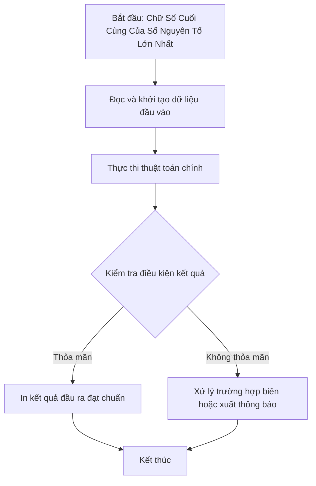

# Chữ Số Cuối Cùng Của Số Nguyên Tố Lớn Nhất

## 1. Thông tin tệp mã nguồn
- [`Chu_snt_cuoi_cung_max.c++`](./Chu_snt_cuoi_cung_max.c++)
- **Thư mục chuyên đề**: `DSA/01_Toan_Hoc_va_Ly_Thuyet_So/Chu_snt_cuoi_cung_max/`
- **Ngôn ngữ**: C/C++ (Chuẩn C++11 trở lên)

## 2. Mục tiêu & Tóm tắt bài toán
Tìm số nguyên tố có chữ số hàng đơn vị lớn hơn hoặc bằng các chữ số còn lại.

---

## 3. Ý tưởng & Phương pháp giải thuật
### Phương án tiếp cận:
Kiểm tra SNT kết hợp duyệt tách chữ số.

### Các bước thực hiện chi tiết:
1. Khởi tạo dữ liệu và đọc đầu vào theo định dạng bài toán.
2. Thực hiện thuật toán cốt lõi: Kiểm tra SNT kết hợp duyệt tách chữ số.
3. Cập nhật trạng thái và tính toán kết quả.
4. Xuất kết quả đầu ra màn hình.

---

## 4. Sơ đồ thuật toán (Mermaid Workflow)


---

## 5. Đánh giá độ phức tạp
- **Độ phức tạp thời gian (Time Complexity)**: `O(N sqrt(M))`
- **Độ phức tạp không gian (Space Complexity)**: `O(1)`

---

## 6. Input / Output mẫu & Giải thích

### Input mẫu:
```text
50
```

### Output mẫu:
```text
2 3 5 7 11 13 17 19 23 29 37 47 
12
```

### Giải thích:
Ví dụ 37 là SNT và chữ số cuối 7 >= 3.

## 7. Hướng dẫn biên dịch & chạy thử
```bash
# Di chuyển vào thư mục bài toán
cd "DSA/01_Toan_Hoc_va_Ly_Thuyet_So/Chu_snt_cuoi_cung_max"

# Biên dịch chương trình C++
g++ -std=c++11 -O2 "Chu_snt_cuoi_cung_max.c++" -o "Chu_snt_cuoi_cung_max"

# Chạy chương trình
./"Chu_snt_cuoi_cung_max"
```

> [!NOTE]
> Toàn bộ mã nguồn C++ gốc được bảo toàn nguyên vẹn 100% không qua chỉnh sửa.
