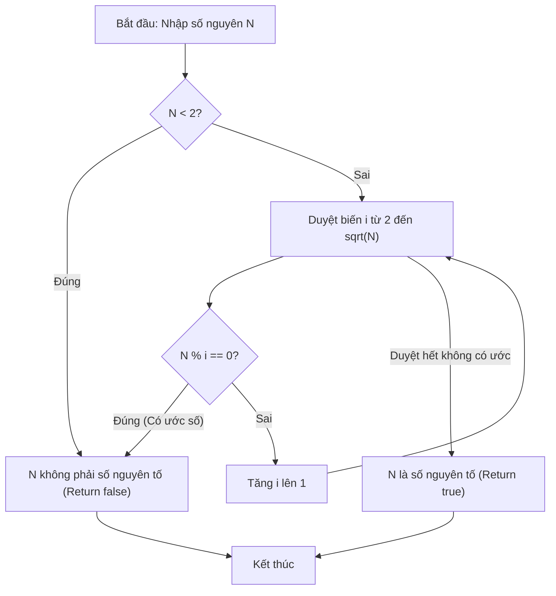

# Kiểm Tra Số Nguyên Tố Trong Đoạn

## 1. Thông tin tệp mã nguồn
- [`Prime_2.cpp`](./Prime_2.cpp)
- **Thư mục chuyên đề**: `DSA/01_Toan_Hoc_va_Ly_Thuyet_So/Prime_2/`
- **Ngôn ngữ**: C/C++ (Chuẩn C++11 trở lên)

## 2. Mục tiêu & Tóm tắt bài toán
Liệt kê và đếm các số nguyên tố trong đoạn [L, R].

---

## 3. Ý tưởng & Phương pháp giải thuật
### Phương án tiếp cận:
Kiểm tra ước từ 2 đến sqrt(N).

### Các bước thực hiện chi tiết:
1. Khởi tạo dữ liệu và đọc đầu vào theo định dạng bài toán.
2. Thực hiện thuật toán cốt lõi: Kiểm tra ước từ 2 đến sqrt(N).
3. Cập nhật trạng thái và tính toán kết quả.
4. Xuất kết quả đầu ra màn hình.

---

## 4. Sơ đồ thuật toán (Mermaid Workflow)


---

## 5. Đánh giá độ phức tạp
- **Độ phức tạp thời gian (Time Complexity)**: `O((R-L+1) sqrt(R))`
- **Độ phức tạp không gian (Space Complexity)**: `O(1)`

---

## 6. Input / Output mẫu & Giải thích

### Input mẫu:
```text
10 20
```

### Output mẫu:
```text
23 29 31 37 41 43 47 53 59 61 67 71 73 79 83 89 97 101 103 107 109 113 127 131 137 139 149 151 157 163 167 173 179 181 191 193 197 199 211 223 227 229 233 239 241 251 257 263 269 271 277 281 283 293 307 311 313 317 331 337 347 349 353 359 367 373 379 383 389 397 401 409 419 421 431 433 439 443 449 457 461 463 467 479 487 491 499 503 509 521 523 541 547 557 563 569 571 577 587 593 599 601 607 613 617 619 631 641 643 647 653 659 661 673 677 683 691 701 709 719 727 733 739 743 751 757 761 769 773 787 797 809 811 821 823 827 829 839 853 857 859 863 877 881 883 887 907 911 919 929 937 941 947 953 967 971 977 983 991 997 1000 1002 1006 1007 1025 1027 1028 1033 1034 1035 1036 1067 1068 1073 1075 1076 1080 1081 1082 1087 1090 1092 1095 1098 1100 1105 1106 1113 1116 1121 1122 1123 1124 1138 1139 1140 1145 1147 1148 1153 1155 1156 1162 1164 1168 1177 1178 1179 1180 1186 1187 1188 1242 1243 1244 1251 1252 1259 1260 1265 1267 1268 1273 1275 1276 1281 1283 1284 1291 1292 1308 1324 1506 1507 1508 1513 1514 1523 1524 1529 1531 1532 1538 1539 1540 1544 1546 2561 2563 2564 2571 2572 2587 2588 2604 2609 2610 2619 2627 2628 2636 2666 2668 2672 2683 2684 2696 2699 2700 2704 2707 2708 2715 2716 2720 2723 2724 2728 2729 2731 2732 2737 2739 2740 2745 2747 2748 2752 2753 2755 2756 2760 2761 2763 2764 2768 2769 2771 2772 2777 2779 2780 2787 2788 2795 2796 2803 2804 2811 2812 2816 2819 2820 2827 2828 2835 2836 2840 2843 2844 2848 2849 2851 2852 2857 2859 2860 2867 2868 2872 2875 2876 2883 2884 2888 2891 2892 2896 2899 2900 2904 2905 2907 2908 2913 2915 2916 2921 2923 2924 2928 2929 2931 2932 2937 2939 2940 2944 2945 2947 2948 2952 2953 2955 2956 2960 2963 2964 2968 2971 2972 2979 2980 2984 2987 2988 2992 2995 2996 3000 3003 3004 3011 3012 3016 3019 3020 3024 3027 3028 3035 3036 3040 3041 3043 3044 3048 3049 3051 3052 3059 3060 3067 3068 3075 3076 3080 3083 3084 3088 3089 3091 3092 3097 3099 3100 3104 3105 3107 3108 3113 3115 3116 3121 3123 3124 3129 3131 3132 3137 3139 3140 3145 3147 3148 3152 3153 3155 3156 3161 3163 3164 3168 3171 3172 3176 3179 3180 3184 3187 3188 3195 3196 3200 3203 3204 3209 3211 3212 3216 3219 3220 3227 3228 3241 3243 3244 3251 3252 3259 3260 3264 3267 3268 3275 3276 3280 3283 3284 3288 3289 3291 3292 3297 3299 3300 3304 3305 3307 3308 3313 3315 3316 3320 3321 3323 3324 3328 3329 3331 3332 3336 3337 3339 3340 3352 3354 3355 3356 3358 3361 3362 3364 3367 3368 3370 3372 3374 3377 3379 3380 3382 3383 3385 3386 3387 3388 3389 3390 3392 3394 3395 3398 3399 3401 3402 3406 3407 3412 3414 3416 3418 3420 3421 3423 3425 3426 3427 3428 3432 3434 3436 3438 3441 3443 3444 3446 3447 3449 3450 3451 3452 3453 3454 3456 3458 3459 3462 3463 3465 3466 3470 3471 3476 3478 3480 3482 3484 3485 3487 3489 3490 3491 3492 3495 3496 3497 3498 3499 3502 3503 3504 3506 3507 3508 3510 3515 3518 3519 3520 3521 3522 3523 3524 3525 3527 3528 3529 3530 3531 3533 3534 3535 3538 3541 3542 3544 3545 3546 3547 3548 3549 3550 3552 3553 3554 3557 3560 3563 3564 3565 3566 3567 3569 3570 3571 3572 3573 3575 3576 3577 3580 3581 3583 3584 3585 3586 3588 3589 3590 3593 3594 3596 3598 3600 3601 3602 3604 3605 3607 3610 3611 3612 3613 3615 3616 3617 3618 3619 3621 3622 3623 3626 3627 3629 3632 3633 3635 3637 3639 3640 3641 3643 3644 3645 3648 3649 3651 3653 3655 3656 3657 3659 3660 3662 3665 3666 3667 3668 3670 3671 3672 3673 3674 3676 3677 3678 3681 3682 3684 3687 3688 3690 3692 3694 3695 3696 3698 3699 3700 3703 3704 3706 3708 3710 3711 3712 3714 3715 3717 3720 3721 3722 3723 3725 3726 3727 3728 3729 3731 3732 3733 3736 3737 3739 3742 3743 3745 3747 3749 3750 3751 3753 3754 3755 3758 3759 3761 3763 3765 3766 3767 3769 3770 3772 3775 3776 3777 3778 3780 3781 3782 3783 3784 3786 3787 3788 3791 3792 3794 3797 3798 3800 3802 3804 3805 3806 3808 3809 3810 3813 3814 3816 3818 3820 3821 3822 3824 3825 3827 3830 3831 3832 3833 3835 3836 3837 3838 3839 3841 3842 3843 3846 3847 3849 3852 3853 3855 3857 3859 3860 3861 3863 3864 3865 3868 3869 3871 3873 3875 3876 3877 3879 3880 3882 3885 3886 3887 3888 3890 3891 3892 3893 3894 3896 3897 3898 3901 3902 3904 3907 3908 3910 3912 3914 3915 3916 3918 3919 3920 3923 3924 3926 3928 3930 3931 3932 3934 3935 3937 3940 3941 3942 3943 3945 3946 3947 3948 3949 3951 3952 3953 3956 3957 3959 3962 3963 3965 3967 3969 3970 3971 3973 3974 3975 3978 3979 3981 3983 3985 3986 3987 3989 3990 3992 3995 3996 3997 3998 4000 4001 4002 4003 4004 4006 4007 4008 4011 4012 4014 4017 4018 4020 4022 4024 4025 4026 4028 4029 4030 4033 4034 4036 4038 4040 4041 4042 4044 4045 4047 4050 4051 4052 4053 4055 4056 4057 4058 4059 4061 4062 4063 4066 4067 4069 4071 4073 4074 4076 4077 4079 4082 4083 4084 4085 4087 4088 4089 4090 4091 4093 4094 4095 4098 4099 4102 4103 4104 4106 4108 4111 4112 4113 4114 4116 4117 4118 4119 4120 4122 4123 4124 4127 4128 4130 4133 4134 4136 4138 4140 4141 4142 4144 4145 4146 4149 4150 4152 4154 4156 4157 4158 4160 4161 4163 4166 4167 4170 4172 4173 4174 4177 4178 4179 4180 4183 4185 4188 4189 4191 4194 4195 4196 4197 4199 4200 4201 4202 4203 4205 4206 4207 4210 4211 4213 4216 4217 4219 4221 4223 4224 4225 4228 4229 4231 4233 4235 4236 4238 4241 4242 4243 4244 4246 4247 4248 4249 4250 4252 4253 4254 4257 4258 4260 4263 4264 4266 4268 4270 4271 4272 4275 4276 4278 4280 4282 4283 4285 4288 4289 4290 4291 4293 4294 4295 4296 4297 4299 4300 4301 4304 4305 4307 4310 4311 4313 4315 4317 4318 4319 4322 4323 4325 4327 4329 4330 4332 4335 4336 4337 4338 4340 4341 4342 4343 4344 4346 4347 4348 4351 4352 4354 4357 4358 4360 4362 4364 4365 4366 4369 4370 4372 4374 4376 4377 4379 4382 4383 4384 4385 4387 4388 4389 4390 4391 4393 4394 4395 4398 4399 4401 4404 4405 4407 4409 4411 4412 4413 4416 4417 4419 4421 4423 4424 4426 4429 4430 4431 4432 4434 4435 4436 4437 4438 4440 4441 4442 4445 4446 4448 4451 4452 4454 4456 4458 4459 4460 4463 4464 4466 4468 4470 4471 4473 4476 4477 4478 4479 4481 4482 4483 4484 4485 4487 4488 4489 4492 4493 4495 4498 4499 4501 4503 4505 4506 4507 4510 4511 4513 4515 4517 4518 4520 4523 4524 4525 4526 4528 4529 4530 4531 4532 4534 4535 4536 4539 4540 4542 4545 4546 4548 4550 4552 4553 4554 4557 4558 4560 4562 4564 4565 4567 4570 4571 4572 4573 4575 4576 4577 4578 4579 4581 4582 4583 4586 4587 4591 4592 4594 4596 4597 4598 4600 4601 4603 4605 4606 4611 4612 4615 4617 4620 4621 4624 4626 4627 4628 4631 4632 4633 4635 4638 4639 4642 4644 4645 4646 4649 4650 4651 4652 4654 4657 4658 4659 4660 4662 4663 4664 4665 4666 4668 4669 4670 4673 4674 4676 4679 4681 4682 4683 4687 4688 4689 4691 4692 4695 4696 4699 4702 4703 4704 4706 4707 4708 4709 4710 4712 4713 4715 4717 4719 4721 4723 4724 4725 4726 4727 4728 4731 4734 4735 4737 4739 4741 4742 4744 4746 4748 4750 4751 4752 4753 4754 4755 4756 4760 4761 4762 4763 4765 4766 4767 4768 4769 4771 4772 4773 4776 4777 4779 4782 4784 4785 4786 4790 4791 4792 4794 4795 4798 4799 4802 4805 4806 4807 4809 4810 4811 4812 4813 4815 4816 4818 4820 4822 4824 4826 4827 4828 4829 4830 4831 4834 4837 4838 4840 4842 4844 4845 4847 4849 4850 4851 4853 4855 4857 4859 4861 4862 4863 4864 4866 4867 4868 4869 4870 4872 4873 4874 4877 4878 4881 4882 4883 4885 4887 4890 4891 4892 4894 4896 4897 4898 4900 4902 4905 4906 4907 4908 4910 4911 4912 4913 4915 4918 4920 4921 4922 4923 4926 4927 4928 4930 4932 4935 4936 4937 4939 4941 4944 4946 4949 4950 4951 4953 4954 4956 4959 4960 4962 4965 4967 4969 4971 4973 4974 4975 4976 4978 4982 4984 4985 4986 4987 4989 4991 4993 4995 4998 5001 5002 5003 5005 5008 5009 5010 5012 5013 5014 5016 5017 5019 5022 5024 5025 5026 5028 5030 5031 5032 5034 5036 5039 5041 5043 5045 5047 5048 5049 5050 5052 5056 5058 5059 5060 5061 5063 5065 5067 5069 5072 5075 5076 5077 5079 5082 5083 5084 5086 5087 5088 5090 5091 5093 5096 5098 5099 5100 5102 5104 5107 5109 5111 5113 5115 5116 5117 5118 5120 5124 5126 5127 5128 5129 5131 5133 5135 5137 5140 5143 5144 5145 5147 5150 5151 5152 5154 5155 5156 5158 5159 5161 5164 5166 5167 5168 5170 5171 5175 5176 5179 5182 5184 5186 5189 5191 5194 5196 5197 5198 5202 5203 5204 5205 5207 5209 5212 5213 5217 5218 5219 5221 5222 5224 5225 5227 5228 5229 5231 5234 5235 5236 5237 5240 5243 5244 5245 5248 5251 5252 5254 5257 5258 5260 5261 5262 5264 5266 5267 5268 5270 5271 5273 5275 5276 5278 5281 5285 5288 5291 5293 5295 5296 5298 5300 5301 5302 5303 5305 5306 5307 5308 5309 5311 5312 5313 5316 5317 5319 5322 5324 5325 5326 5330 5331 5332 5334 5335 5338 5339 5342 5345 5346 5347 5349 5350 5351 5352 5353 5355 5356 5358 5360 5362 5364 5366 5367 5368 5369 5370 5371 5374 5377 5378 5380 5382 5384 5385 5387 5389 5391 5393 5394 5395 5396 5397 5398 5399 5403 5404 5405 5406 5408 5409 5410 5411 5412 5414 5415 5416 5419 5420 5422 5425 5427 5428 5429 5433 5434 5435 5437 5438 5441 5442 5445 5448 5449 5450 5452 5453 5454 5455 5456 5458 5459 5461 5463 5465 5467 5469 5470 5471 5472 5473 5474 5477 5480 5481 5483 5485 5487 5488 5490 5492 5493 5494 5496 5498 5500 5502 5504 5505 5506 5507 5509 5510 5511 5512 5513 5515 5516 5517 5520 5521 5523 5526 5527 5529 5531 5533 5534 5535 5537 5538 5539 5542 5543 5545 5547 5549 5550 5551 5553 5554 5556 5559 5560 5561 5562 5564 5565 5566 5567 5568 5570 5571 5572 5575 5576 5578 5580 5582 5583 5585 5586 5588 5591 5592 5593 5594 5596 5597 5598 5599 5600 5602 5603 5604 5607 5608 5611 5612 5613 5615 5617 5620 5621 5624 5626 5627 5628 5631 5632 5633 5634 5637 5639 5642 5643 5645 5648 5649 5650 5651 5653 5654 5655 5656 5657 5659 5660 5661 5664 5665 5667 5670 5671 5673 5675 5677 5678 5679 5682 5683 5685 5687 5689 5690 5692 5695 5696 5699 5700 5701 5703 5704 5705 5708 5709 5710 5712 5715 5716 5719 5720 5721 5723 5724 5725 5728 5729 5730 5731 5732 5735 5737 5740 5741 5742 5743 5745 5746 5747 5748 5749 5751 5752 5753 5756 5757 5761 5762 5764 5766 5767 5768 5770 5771 5773 5775 5776 5781 5782 5785 5787 5790 5791 5794 5796 5797 5798 5801 5802 5803 5805 5808 5809 5812 5814 5815 5816 5819 5820 5821 5822 5824 5827 5828 5829 5830 5832 5833 5834 5835 5836 5838 5839 5840 5843 5844 5845 5849 5850 5852 5853 5855 5856 5857 5858 5861 5863 5864 5866 5867 5869 5870 5872 5874 5875 5877 5879 5882 5883 5884 5885 5887 5888 5889 5890 5891 5893 5894 5895 5898 5899 5900 5904 5905 5907 5908 5910 5911 5914 5917 5919 5920 5922 5923 5925 5927 5928 5929 5930 5932 5933 5934 5935 5936 5938 5939 5940 5943 5944 5945 5949 5950 5952 5953 5955 5956 5957 5958 5959 5961 5963 5966 5967 5968 5969 5971 5972 5973 5974 5975 5977 5978 5979 5982 5983 5985 5988 5990 5991 5992 5996 5997 5999 6000 6002 6003 6006 6009 6011 6012 6014 6015 6017 6019 6020 6021 6022 6024 6025 6026 6027 6028 6030 6031 6032 6035 6036 6037 6041 6042 6044 6045 6047 6048 6049 6050 6053 6055 6056 6058 6059 6061 6062 6064 6066 6067 6069 6071 6074 6075 6076 6077 6079 6080 6081 6082 6083 6085 6086 6087 6090 6091 6092 6096 6097 6099 6100 6102 6103 6106 6109 6111 6112 6114 6115 6117 6119 6120 6121 6122 6124 6125 6126 6127 6128 6130 6131 6132 6135 6136 6137 6141 6142 6144 6145 6147 6148 6149 6150 6151 6153 6155 6158 6159 6160 6162 6164 6165 6166 6168 6169 6171 6173 6174 6176 6179 6182 6183 6184 6185 6187 6188 6189 6190 6191 6193 6194 6195 6198 6199 6201 6204 6206 6207 6208 6212 6213 6215 6216 6218 6219 6222 6225 6227 6228 6230 6231 6233 6235 6237 6240 6241 6243 6245 6247 6250 6251 6253 6254 6255 6258 6259 6260 6261 6262 6263 6264 6267 6269 6271 6272 6274 6276 6277 6278 6279 6281 6285 6288 6289 6291 6295 6297 6299 6303 6305 6307 6308 6310 6312 6314 6317 6320 6322 6323 6325 6327 6329 6332 6334 6335 6337 6338 6340 6341 6342 6343 6344 6345 6347 6349 6350 6353 6354 6356 6357 6361 6362 6367 6369 6371 6373 6374 6375 6377 6378 6379 6380 6382 6383 6384 6387 6391 6392 6395 6396 6397 6398 6405 6406 6407 6408 6411 6412 6413 6414 6416 6417 6418 6419 6422 6423 6424 6427 6431 6432 6434 6437 6439 6440 6442 6443 6444 6445 6447 6448 6449 6451 6452 6453 6458 6459 6460 6462 6464 6465 6466 6468 6469 6470 6471 6473 6475 6478 6479 6481 6482 6484 6486 6487 6490 6492 6502 6507 6508 6511 6513 6514 6515 6516 6517 6519 6520 6521 6522 6523 6525 6526 6527 6530 6531 6533 6534 6535 6536 6537 6540 6541 6542 6544 6546 6547 6548 6549 6550 6552 6556 6558 6559 6560 6561 6562 6564 6565 6566 6567 6568 6570 6571 6572 6575 6576 6578 6579 6580 6581 6582 6585 6586 6587 6589 6591 6592 6593 6594 6595 6597 6601 6602 6604 6606 6607 6608 6609 6610 6611 6612 6613 6615 6616 6617 6618 6619 6621 6622 6623 6626 6627 6628 6632 6633 6635 6636 6638 6641 6642 6643 6646 6647 6648 6651 6653 6655 6656 6657 6660 6662 6663 6664 6667 6668 6671 6672 6673 6676 6677 6678 6679 6680 6683 6685 6686 6687 6690 6692 6693 6694 6697 6698 6699 6700 6701 6704 6708 6709 6710 6713 6714 6715 6717 6719 6720 6721 6723 6725 6726 6727 6728 6731 6733 6734 6735 6738 6739 6743 6746 6747 6748 6751 6753 6754 6755 6758 6759 6760 6761 6763 6765 6766 6768 6770 6771 6772 6774 6775 6777 6779 6781 6782 6784 6786 6787 6790 6792 6793 6794 6797 6798 6799 6800 6802 6804 6805 6807 6809 6810 6811 6813 6814 6816 6818 6820 6821 6823 6825 6826 6827 6829 6831 6832 6833 6835 6836 6838 6840 6841 6843 6845 6846 6847 6849 6850 6852 6854 6856 6857 6859 6861 6862 6863 6865 6866 6868 6870 6871 6873 6875 6876 6877 6879 6880 6882 6884 6886 6887 6889 6891 6892 6893 6895 6896 6898 6900 6901 6903 6905 6906 6908 6909 6911 6913 6915 6916 6918 6920 6923 6925 6928 6929 6930 6933 6935 6936 6937 6940 6941 6942 6943 6945 6947 6948 6949 6952 6954 6955 6958 6960 6961 6962 6965 6966 6967 6968 6970 6972 6973 6974 6977 6981 6983 6984 6986 6987 6988 6989 6990 6992 6995 6997 6998 7000 7002 7003 7005 7007 7009 7012 7013 7015 7016 7017 7019 7021 7022 7023 7025 7026 7027 7029 7031 7033 7037 7038 7039 7040 7043 7046 7047 7049 7050 7051 7053 7055 7056 7057 7059 7062 7065 7066 7067 7068 7070 7071 7072 7073 7074 7076 7077 7078 7081 7082 7084 7085 7086 7087 7088 7091 7092 7093 7095 7097 7098 7100 7102 7103 7104 7105 7110 7111 7112 7116 7117 7119 7120 7122 7124 7125 7126 7127 7128 7129 7131 7135 7136 7137 7142 7146 7147 7148 7151 7156 7157 7159 7161 7162 7163 7164 7165 7167 7168 7169 7170 7171 7173 7174 7175 7178 7179 7183 7187 7188 7189 7191 7194 7195 7196 7197 7198 7199 7203 7204 7206 7208 7209 7210 7211 7212 7214 7215 7216 7217 7218 7220 7221 7222 7225 7226 7230 7231 7233 7235 7236 7237 7239 7240 7242 7244 7245 7250 7251 7254 7256 7261 7262 7263 7265 7266 7267 7268 7269 7270 7272 7273 7274 7275 7276 7278 7279 7280 7283 7284 7288 7289 7291 7293 7294 7295 7297 7298 7300 7302 7303 7308 7309 7312 7313 7315 7317 7319 7320 7322 7324 7326 7327 7330 7331 7332 7334 7335 7336 7337 7340 7341 7342 7344 7345 7346 7349 7350 7351 7353 7355 7356 7357 7360 7362 7363 7364 7367 7368 7369 7371 7372 7373 7374 7377 7378 7379 7381 7382 7383 7386 7387 7388 7390 7392 7393 7394 7397 7399 7400 7401 7402 7403 7404 7406 7407 7408 7409 7410 7411 7414 7415 7417 7418 7421 7422 7424 7427 7429 7430 7432 7433 7434 7435 7438 7439 7440 7442 7443 7444 7447 7448 7449 7451 7453 7455 7458 7461 7462 7463 7466 7467 7469 7470 7472 7473 7474 7477 7478 7479 7481 7482 7483 7486 7487 7489 7490 7493 7494 7495 7500 7501 7503 7504 7507 7508 7511 7513 7515 7516 7517 7520 7521 7522 7524 7525 7526 7529 7530 7532 7533 7536 7537 7539 7541 7542 7545 7546 7549 7551 7552 7553 7555 7556 7559 7560 7563 7564 7567 7568 7569 7571 7573 7574 7576 7579 7580 7581 7582 7586 7588 7589 7592 7593 7595 7596 7597 7599 7600 7601 7603 7606 7608 7609 7612 7613 7615 7616 7617 7619 7621 7622 7623 7625 7626 7628 7629 7630 7635 7637 7638 7639 7641 7642 7643 7645 7648 7651 7652 7654 7657 7659 7660 7663 7664 7665 7666 7668 7671 7672 7674 7676 7678 7680 7682 7683 7684 7686 7688 7689 7690 7694 7695 7696 7697 7698 7700 7704 7705 7706 7707 7708 7709 7710 7711 7716 7719 7720 7721 7722 7724 7725 7727 7728 7729 7730 7732 7733 7734 7735 7736 7737 7741 7742 7743 7745 7746 7748 7749 7751 7752 7753 7754 7757 7759 7761 7762 7764 7765 7767 7769 7772 7773 7774 7777 7780 7781 7783 7784 7785 7786 7788 7789 7790 7791 7792 7795 7796 7799 7801 7802 7803 7805 7806 7807 7808 7810 7812 7813 7815 7816 7817 7818 7820 7821 7822 7824 7828 7829 7830 7832 7833 7834 7835 7837 7838 7839 7840 7842 7843 7844 7845 7847 7849 7850 7851 7852 7856 7857 7858 7860 7861 7863 7864 7866 7867 7868 7869 7872 7874 7876 7877 7879 7880 7882 7884 7887 7888 7889 7892 7895 7896 7899 7900 7901 7902 7903 7905 7906 7907 7908 7909 7911 7914 7917 7923 7924 7925 7927 7929 7932 7933 7934 7937 7940 7941 7942 7943 7944 7945 7946 7947 7948 7949 7951 7954 7957 7963 7964 7965 7967 7970 7971 7972 7974 7975 7976 7977 7979 7980 7981 7982 7984 7985 7986 7987 7
```

### Giải thích:
Các SNT trong đoạn [10, 20].

## 7. Hướng dẫn biên dịch & chạy thử
```bash
# Di chuyển vào thư mục bài toán
cd "DSA/01_Toan_Hoc_va_Ly_Thuyet_So/Prime_2"

# Biên dịch chương trình C++
g++ -std=c++11 -O2 "Prime_2.cpp" -o "Prime_2"

# Chạy chương trình
./"Prime_2"
```

> [!NOTE]
> Toàn bộ mã nguồn C++ gốc được bảo toàn nguyên vẹn 100% không qua chỉnh sửa.
