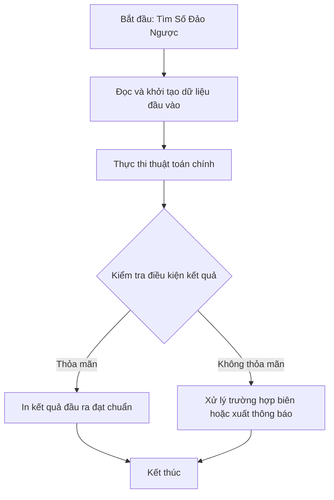

# Tìm Số Đảo Ngược

## 1. Thông tin tệp mã nguồn
- [`So_dao_nguoc.cpp`](./So_dao_nguoc.cpp)
- **Thư mục chuyên đề**: `DSA/01_Toan_Hoc_va_Ly_Thuyet_So/So_dao_nguoc/`
- **Ngôn ngữ**: C/C++ (Chuẩn C++11 trở lên)

## 2. Mục tiêu & Tóm tắt bài toán
Tạo số mới bằng cách đảo ngược các chữ số của số nguyên N.

---

## 3. Ý tưởng & Phương pháp giải thuật
### Phương án tiếp cận:
Lấy từng chữ số n % 10 nhân dồn vào rev.

### Các bước thực hiện chi tiết:
1. Khởi tạo dữ liệu và đọc đầu vào theo định dạng bài toán.
2. Thực hiện thuật toán cốt lõi: Lấy từng chữ số n % 10 nhân dồn vào rev.
3. Cập nhật trạng thái và tính toán kết quả.
4. Xuất kết quả đầu ra màn hình.

---

## 4. Sơ đồ thuật toán (Mermaid Workflow)


---

## 5. Đánh giá độ phức tạp
- **Độ phức tạp thời gian (Time Complexity)**: `O(log10 N)`
- **Độ phức tạp không gian (Space Complexity)**: `O(1)`

---

## 6. Input / Output mẫu & Giải thích

### Input mẫu:
```text
1234
```

### Output mẫu:
```text
4321
```

### Giải thích:
1234 đảo ngược thành 4321.

---

## 7. Hướng dẫn biên dịch & chạy thử
```bash
# Di chuyển vào thư mục bài toán
cd "DSA/01_Toan_Hoc_va_Ly_Thuyet_So/So_dao_nguoc"

# Biên dịch chương trình C++
g++ -std=c++11 -O2 "So_dao_nguoc.cpp" -o "So_dao_nguoc"

# Chạy chương trình
./"So_dao_nguoc"
```

> [!NOTE]
> Toàn bộ mã nguồn C++ gốc được bảo toàn nguyên vẹn 100% không qua chỉnh sửa.
