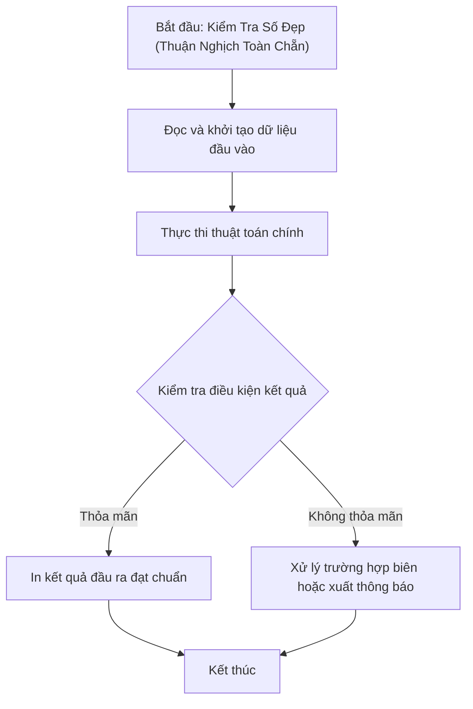

# Kiểm Tra Số Đẹp (Thuận Nghịch Toàn Chẵn)

## 1. Thông tin tệp mã nguồn
- [`so_dep.cpp`](./so_dep.cpp)
- **Thư mục chuyên đề**: `DSA/01_Toan_Hoc_va_Ly_Thuyet_So/so_dep/`
- **Ngôn ngữ**: C/C++ (Chuẩn C++11 trở lên)

## 2. Mục tiêu & Tóm tắt bài toán
Số thuận nghịch và toàn chữ số chẵn.

---

## 3. Ý tưởng & Phương pháp giải thuật
### Phương án tiếp cận:
Kiểm tra đảo ngược và kiểm tra từng chữ số chẵn.

### Các bước thực hiện chi tiết:
1. Khởi tạo dữ liệu và đọc đầu vào theo định dạng bài toán.
2. Thực hiện thuật toán cốt lõi: Kiểm tra đảo ngược và kiểm tra từng chữ số chẵn.
3. Cập nhật trạng thái và tính toán kết quả.
4. Xuất kết quả đầu ra màn hình.

---

## 4. Sơ đồ thuật toán (Mermaid Workflow)


---

## 5. Đánh giá độ phức tạp
- **Độ phức tạp thời gian (Time Complexity)**: `O(log10 N)`
- **Độ phức tạp không gian (Space Complexity)**: `O(1)`

---

## 6. Input / Output mẫu & Giải thích

### Input mẫu:
```text
2442
```

### Output mẫu:
```text
NO
NO
NO
NO
NO
NO
NO
NO
NO
NO
NO
NO
NO
NO
NO
NO
NO
NO
NO
NO
NO
NO
NO
NO
NO
NO
NO
NO
NO
NO
NO
NO
NO
NO
NO
NO
NO
NO
NO
NO
NO
NO
NO
NO
NO
NO
NO
NO
NO
NO
NO
NO
NO
NO
NO
NO
NO
NO
NO
NO
NO
NO
NO
NO
NO
NO
NO
NO
NO
NO
NO
NO
NO
NO
NO
NO
NO
NO
NO
NO
NO
NO
NO
NO
NO
NO
NO
NO
NO
NO
NO
NO
NO
NO
NO
NO
NO
NO
NO
NO
NO
NO
NO
NO
NO
NO
NO
NO
NO
NO
NO
NO
NO
NO
NO
NO
NO
NO
NO
NO
NO
NO
NO
NO
NO
NO
NO
NO
NO
NO
NO
NO
NO
NO
NO
NO
NO
NO
NO
NO
NO
NO
NO
NO
NO
NO
NO
NO
NO
NO
NO
NO
NO
NO
NO
NO
NO
NO
NO
NO
NO
NO
NO
NO
NO
NO
NO
NO
NO
NO
NO
NO
NO
NO
NO
NO
NO
NO
NO
NO
NO
NO
NO
NO
NO
NO
NO
NO
NO
NO
NO
NO
NO
NO
NO
NO
NO
NO
NO
NO
NO
NO
NO
NO
NO
NO
NO
NO
NO
NO
NO
NO
NO
NO
NO
NO
NO
NO
NO
NO
NO
NO
NO
NO
NO
NO
NO
NO
NO
NO
NO
NO
NO
NO
NO
NO
NO
NO
NO
NO
NO
NO
NO
NO
NO
NO
NO
NO
NO
NO
NO
NO
NO
NO
NO
NO
NO
NO
NO
NO
NO
NO
NO
NO
NO
NO
NO
NO
NO
NO
NO
NO
NO
NO
NO
NO
NO
NO
NO
NO
NO
NO
NO
NO
NO
NO
NO
NO
NO
NO
NO
NO
NO
NO
NO
NO
NO
NO
NO
NO
NO
NO
NO
NO
NO
NO
NO
NO
NO
NO
NO
NO
NO
NO
NO
NO
NO
NO
NO
NO
NO
NO
NO
NO
NO
NO
NO
NO
NO
NO
NO
NO
NO
NO
NO
NO
NO
NO
NO
NO
NO
NO
NO
NO
NO
NO
NO
NO
NO
NO
NO
NO
NO
NO
NO
NO
NO
NO
NO
NO
NO
NO
NO
NO
NO
NO
NO
NO
NO
NO
NO
NO
NO
NO
NO
NO
NO
NO
NO
NO
NO
NO
NO
NO
NO
NO
NO
NO
NO
NO
NO
NO
NO
NO
NO
NO
NO
NO
NO
NO
NO
NO
NO
NO
NO
NO
NO
NO
NO
NO
NO
NO
NO
NO
NO
NO
NO
NO
NO
NO
NO
NO
NO
NO
NO
NO
NO
NO
NO
NO
NO
NO
NO
NO
NO
NO
NO
NO
NO
NO
NO
NO
NO
NO
NO
NO
NO
NO
NO
NO
NO
NO
NO
NO
NO
NO
NO
NO
NO
NO
NO
NO
NO
NO
NO
NO
NO
NO
NO
NO
NO
NO
NO
NO
NO
NO
NO
NO
NO
NO
NO
NO
NO
NO
NO
NO
NO
NO
NO
NO
NO
NO
NO
NO
NO
NO
NO
NO
NO
NO
NO
NO
NO
NO
NO
NO
NO
NO
NO
NO
NO
NO
NO
NO
NO
NO
NO
NO
NO
NO
NO
NO
NO
NO
NO
NO
NO
NO
NO
NO
NO
NO
NO
NO
NO
NO
NO
NO
NO
NO
NO
NO
NO
NO
NO
NO
NO
NO
NO
NO
NO
NO
NO
NO
NO
NO
NO
NO
NO
NO
NO
NO
NO
NO
NO
NO
NO
NO
NO
NO
NO
NO
NO
NO
NO
NO
NO
NO
NO
NO
NO
NO
NO
NO
NO
NO
NO
NO
NO
NO
NO
NO
NO
NO
NO
NO
NO
NO
NO
NO
NO
NO
NO
NO
NO
NO
NO
NO
NO
NO
NO
NO
NO
NO
NO
NO
NO
NO
NO
NO
NO
NO
NO
NO
NO
NO
NO
NO
NO
NO
NO
NO
NO
NO
NO
NO
NO
NO
NO
NO
NO
NO
NO
NO
NO
NO
NO
NO
NO
NO
NO
NO
NO
NO
NO
NO
NO
NO
NO
NO
NO
NO
NO
NO
NO
NO
NO
NO
NO
NO
NO
NO
NO
NO
NO
NO
NO
NO
NO
NO
NO
NO
NO
NO
NO
NO
NO
NO
NO
NO
NO
NO
NO
NO
NO
NO
NO
NO
NO
NO
NO
NO
NO
NO
NO
NO
NO
NO
NO
NO
NO
NO
NO
NO
NO
NO
NO
NO
NO
NO
NO
NO
NO
NO
NO
NO
NO
NO
NO
NO
NO
NO
NO
NO
NO
NO
NO
NO
NO
NO
NO
NO
NO
NO
NO
NO
NO
NO
NO
NO
NO
NO
NO
NO
NO
NO
NO
NO
NO
NO
NO
NO
NO
NO
NO
NO
NO
NO
NO
NO
NO
NO
NO
NO
NO
NO
NO
NO
NO
NO
NO
NO
NO
NO
NO
NO
NO
NO
NO
NO
NO
NO
NO
NO
NO
NO
NO
NO
NO
NO
NO
NO
NO
NO
NO
NO
NO
NO
NO
NO
NO
NO
NO
NO
NO
NO
NO
NO
NO
NO
NO
NO
NO
NO
NO
NO
NO
NO
NO
NO
NO
NO
NO
NO
NO
NO
NO
NO
NO
NO
NO
NO
NO
NO
NO
NO
NO
NO
NO
NO
NO
NO
NO
NO
NO
NO
NO
NO
NO
NO
NO
NO
NO
NO
NO
NO
NO
NO
NO
NO
NO
NO
NO
NO
NO
NO
NO
NO
NO
NO
NO
NO
NO
NO
NO
NO
NO
NO
NO
NO
NO
NO
NO
NO
NO
NO
NO
NO
NO
NO
NO
NO
NO
NO
NO
NO
NO
NO
NO
NO
NO
NO
NO
NO
NO
NO
NO
NO
NO
NO
NO
NO
NO
NO
NO
NO
NO
NO
NO
NO
NO
NO
NO
NO
NO
NO
NO
NO
NO
NO
NO
NO
NO
NO
NO
NO
NO
NO
NO
NO
NO
NO
NO
NO
NO
NO
NO
NO
NO
NO
NO
NO
NO
NO
NO
NO
NO
NO
NO
NO
NO
NO
NO
NO
NO
NO
NO
NO
NO
NO
NO
NO
NO
NO
NO
NO
NO
NO
NO
NO
NO
NO
NO
NO
NO
NO
NO
NO
NO
NO
NO
NO
NO
NO
NO
NO
NO
NO
NO
NO
NO
NO
NO
NO
NO
NO
NO
NO
NO
NO
NO
NO
NO
NO
NO
NO
NO
NO
NO
NO
NO
NO
NO
NO
NO
NO
NO
NO
NO
NO
NO
NO
NO
NO
NO
NO
NO
NO
NO
NO
NO
NO
NO
NO
NO
NO
NO
NO
NO
NO
NO
NO
NO
NO
NO
NO
NO
NO
NO
NO
NO
NO
NO
NO
NO
NO
NO
NO
NO
NO
NO
NO
NO
NO
NO
NO
NO
NO
NO
NO
NO
NO
NO
NO
NO
NO
NO
NO
NO
NO
NO
NO
NO
NO
NO
NO
NO
NO
NO
NO
NO
NO
NO
NO
NO
NO
NO
NO
NO
NO
NO
NO
NO
NO
NO
NO
NO
NO
NO
NO
NO
NO
NO
NO
NO
NO
NO
NO
NO
NO
NO
NO
NO
NO
NO
NO
NO
NO
NO
NO
NO
NO
NO
NO
NO
NO
NO
NO
NO
NO
NO
NO
NO
NO
NO
NO
NO
NO
NO
NO
NO
NO
NO
NO
NO
NO
NO
NO
NO
NO
NO
NO
NO
NO
NO
NO
NO
NO
NO
NO
NO
NO
NO
NO
NO
NO
NO
NO
NO
NO
NO
NO
NO
NO
NO
NO
NO
NO
NO
NO
NO
NO
NO
NO
NO
NO
NO
NO
NO
NO
NO
NO
NO
NO
NO
NO
NO
NO
NO
NO
NO
NO
NO
NO
NO
NO
NO
NO
NO
NO
NO
NO
NO
NO
NO
NO
NO
NO
NO
NO
NO
NO
NO
NO
NO
NO
NO
NO
NO
NO
NO
NO
NO
NO
NO
NO
NO
NO
NO
NO
NO
NO
NO
NO
NO
NO
NO
NO
NO
NO
NO
NO
NO
NO
NO
NO
NO
NO
NO
NO
NO
NO
NO
NO
NO
NO
NO
NO
NO
NO
NO
NO
NO
NO
NO
NO
NO
NO
NO
NO
NO
NO
NO
NO
NO
NO
NO
NO
NO
NO
NO
NO
NO
NO
NO
NO
NO
NO
NO
NO
NO
NO
NO
NO
NO
NO
NO
NO
NO
NO
NO
NO
NO
NO
NO
NO
NO
NO
NO
NO
NO
NO
NO
NO
NO
NO
NO
NO
NO
NO
NO
NO
NO
NO
NO
NO
NO
NO
NO
NO
NO
NO
NO
NO
NO
NO
NO
NO
NO
NO
NO
NO
NO
NO
NO
NO
NO
NO
NO
NO
NO
NO
NO
NO
NO
NO
NO
NO
NO
NO
NO
NO
NO
NO
NO
NO
NO
NO
NO
NO
NO
NO
NO
NO
NO
NO
NO
NO
NO
NO
NO
NO
NO
NO
NO
NO
NO
NO
NO
NO
NO
NO
NO
NO
NO
NO
NO
NO
NO
NO
NO
NO
NO
NO
NO
NO
NO
NO
NO
NO
NO
NO
NO
NO
NO
NO
NO
NO
NO
NO
NO
NO
NO
NO
NO
NO
NO
NO
NO
NO
NO
NO
NO
NO
NO
NO
NO
NO
NO
NO
NO
NO
NO
NO
NO
NO
NO
NO
NO
NO
NO
NO
NO
NO
NO
NO
NO
NO
NO
NO
NO
NO
NO
NO
NO
NO
NO
NO
NO
NO
NO
NO
NO
NO
NO
NO
NO
NO
NO
NO
NO
NO
NO
NO
NO
NO
NO
NO
NO
NO
NO
NO
NO
NO
NO
NO
NO
NO
NO
NO
NO
NO
NO
NO
NO
NO
NO
NO
NO
NO
NO
NO
NO
NO
NO
NO
NO
NO
NO
NO
NO
NO
NO
NO
NO
NO
NO
NO
NO
NO
NO
NO
NO
NO
NO
NO
NO
NO
NO
NO
NO
NO
NO
NO
NO
NO
NO
NO
NO
NO
NO
NO
NO
NO
NO
NO
NO
NO
NO
NO
NO
NO
NO
NO
NO
NO
NO
NO
NO
NO
NO
NO
NO
NO
NO
NO
NO
NO
NO
NO
NO
NO
NO
NO
NO
NO
NO
NO
NO
NO
NO
NO
NO
NO
NO
NO
NO
NO
NO
NO
NO
NO
NO
NO
NO
NO
NO
NO
NO
NO
NO
NO
NO
NO
NO
NO
NO
NO
NO
NO
NO
NO
NO
NO
NO
NO
NO
NO
NO
NO
NO
NO
NO
NO
NO
NO
NO
NO
NO
NO
NO
NO
NO
NO
NO
NO
NO
NO
NO
NO
NO
NO
NO
NO
NO
NO
NO
NO
NO
NO
NO
NO
NO
NO
NO
NO
NO
NO
NO
NO
NO
NO
NO
NO
NO
NO
NO
NO
NO
NO
NO
NO
NO
NO
NO
NO
NO
NO
NO
NO
NO
NO
NO
NO
NO
NO
NO
NO
NO
NO
NO
NO
NO
NO
NO
NO
NO
NO
NO
NO
NO
NO
NO
NO
NO
NO
NO
NO
NO
NO
NO
NO
NO
NO
NO
NO
NO
NO
NO
NO
NO
NO
NO
NO
NO
NO
NO
NO
NO
NO
NO
NO
NO
NO
NO
NO
NO
NO
NO
NO
NO
NO
NO
NO
NO
NO
NO
NO
NO
NO
NO
NO
NO
NO
NO
NO
NO
NO
NO
NO
NO
NO
NO
NO
NO
NO
NO
NO
NO
NO
NO
NO
NO
NO
NO
NO
NO
NO
NO
NO
NO
NO
NO
NO
NO
NO
NO
NO
NO
NO
NO
NO
NO
NO
NO
NO
NO
NO
NO
NO
NO
NO
NO
NO
NO
NO
NO
NO
NO
NO
NO
NO
NO
NO
NO
NO
NO
NO
NO
NO
NO
NO
NO
NO
NO
NO
NO
NO
NO
NO
NO
NO
NO
NO
NO
NO
NO
NO
NO
NO
NO
NO
NO
NO
NO
NO
NO
NO
NO
NO
NO
NO
NO
NO
NO
NO
NO
NO
NO
NO
NO
NO
NO
NO
NO
NO
NO
NO
NO
NO
NO
NO
NO
NO
NO
NO
NO
NO
NO
NO
NO
NO
NO
NO
NO
NO
NO
NO
NO
NO
NO
NO
NO
NO
NO
NO
NO
NO
NO
NO
NO
NO
NO
NO
NO
NO
NO
NO
NO
NO
NO
NO
NO
NO
NO
NO
NO
NO
NO
NO
NO
NO
NO
NO
NO
NO
NO
NO
NO
NO
NO
NO
NO
NO
NO
NO
NO
NO
NO
NO
NO
NO
NO
NO
NO
NO
NO
NO
NO
NO
NO
NO
NO
NO
NO
NO
NO
NO
NO
NO
NO
NO
NO
NO
NO
NO
NO
NO
NO
NO
NO
NO
NO
NO
NO
NO
NO
NO
NO
NO
NO
NO
NO
NO
NO
NO
NO
NO
NO
NO
NO
NO
NO
NO
NO
NO
NO
NO
NO
NO
NO
NO
NO
NO
NO
NO
NO
NO
NO
NO
NO
NO
NO
NO
NO
NO
NO
NO
NO
NO
NO
NO
NO
NO
NO
NO
NO
NO
NO
NO
NO
NO
NO
NO
NO
NO
NO
NO
NO
NO
NO
NO
NO
NO
NO
NO
NO
NO
NO
NO
NO
NO
NO
NO
NO
NO
NO
NO
NO
NO
NO
NO
NO
NO
NO
NO
NO
NO
NO
NO
NO
NO
NO
NO
NO
NO
NO
NO
NO
NO
NO
NO
NO
NO
NO
NO
NO
NO
NO
NO
NO
NO
NO
NO
NO
NO
NO
NO
NO
NO
NO
NO
NO
NO
NO
NO
NO
NO
NO
NO
NO
NO
NO
NO
NO
NO
NO
NO
NO
NO
NO
NO
NO
NO
NO
NO
NO
NO
NO
NO
NO
NO
NO
NO
NO
NO
NO
NO
NO
NO
NO
NO
NO
NO
NO
NO
NO
NO
NO
NO
NO
NO
NO
NO
NO
NO
NO
NO
NO
NO
NO
NO
NO
NO
NO
NO
NO
NO
NO
NO
NO
NO
NO
NO
NO
NO
NO
NO
NO
NO
NO
NO
NO
NO
NO
NO
NO
NO
NO
NO
NO
NO
NO
NO
NO
NO
NO
NO
NO
NO
NO
NO
NO
NO
NO
NO
NO
NO
NO
NO
NO
NO
NO
NO
NO
NO
NO
NO
NO
NO
NO
NO
NO
NO
NO
NO
NO
NO
NO
NO
NO
NO
NO
NO
NO
NO
NO
NO
NO
NO
NO
NO
NO
NO
NO
NO
NO
NO
NO
NO
NO
NO
NO
NO
NO
NO
NO
NO
NO
NO
NO
NO
NO
NO
NO
NO
NO
NO
NO
NO
NO
NO
NO
NO
NO
NO
NO
NO
NO
NO
NO
NO
NO
NO
NO
NO
NO
NO
NO
NO
NO
NO
NO
NO
NO
NO
NO
NO
NO
NO
NO
NO
NO
NO
NO
NO
NO
NO
NO
NO
NO
NO
NO
NO
NO
NO
NO
NO
NO
NO
NO
NO
NO
NO
NO
NO
NO
NO
NO
NO
NO
NO
NO
NO
NO
NO
NO
NO
NO
NO
NO
NO
NO
NO
NO
NO
NO
NO
NO
NO
NO
NO
NO
NO
NO
NO
NO
NO
NO
NO
NO
NO
NO
NO
NO
NO
NO
NO
NO
NO
NO
NO
NO
NO
NO
NO
NO
NO
NO
NO
NO
NO
NO
NO
NO
NO
NO
NO
NO
NO
NO
NO
```

### Giải thích:
2442 đối xứng và toàn chữ số chẵn.

## 7. Hướng dẫn biên dịch & chạy thử
```bash
# Di chuyển vào thư mục bài toán
cd "DSA/01_Toan_Hoc_va_Ly_Thuyet_So/so_dep"

# Biên dịch chương trình C++
g++ -std=c++11 -O2 "so_dep.cpp" -o "so_dep"

# Chạy chương trình
./"so_dep"
```

> [!NOTE]
> Toàn bộ mã nguồn C++ gốc được bảo toàn nguyên vẹn 100% không qua chỉnh sửa.
