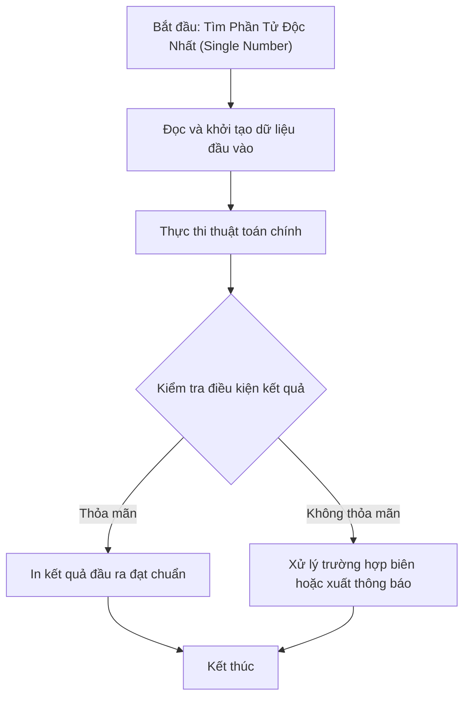

# Tìm Phần Tử Độc Nhất (Single Number)

## 1. Thông tin tệp mã nguồn
- [`So_don.cpp`](./So_don.cpp)
- **Thư mục chuyên đề**: `DSA/01_Toan_Hoc_va_Ly_Thuyet_So/So_don/`
- **Ngôn ngữ**: C/C++ (Chuẩn C++11 trở lên)

## 2. Mục tiêu & Tóm tắt bài toán
Tìm số duy nhất xuất hiện 1 lần trong khi các số khác xuất hiện 2 lần.

---

## 3. Ý tưởng & Phương pháp giải thuật
### Phương án tiếp cận:
Phép toán XOR bitwise triệt tiêu các cặp trùng.

### Các bước thực hiện chi tiết:
1. Khởi tạo dữ liệu và đọc đầu vào theo định dạng bài toán.
2. Thực hiện thuật toán cốt lõi: Phép toán XOR bitwise triệt tiêu các cặp trùng.
3. Cập nhật trạng thái và tính toán kết quả.
4. Xuất kết quả đầu ra màn hình.

---

## 4. Sơ đồ thuật toán (Mermaid Workflow)


---

## 5. Đánh giá độ phức tạp
- **Độ phức tạp thời gian (Time Complexity)**: `O(N)`
- **Độ phức tạp không gian (Space Complexity)**: `O(1)`

---

## 6. Input / Output mẫu & Giải thích

### Input mẫu:
```text
5
4 1 2 1 2
```

### Output mẫu:
```text
4
```

### Giải thích:
4 là số duy nhất xuất hiện 1 lần.

---

## 7. Hướng dẫn biên dịch & chạy thử
```bash
# Di chuyển vào thư mục bài toán
cd "DSA/01_Toan_Hoc_va_Ly_Thuyet_So/So_don"

# Biên dịch chương trình C++
g++ -std=c++11 -O2 "So_don.cpp" -o "So_don"

# Chạy chương trình
./"So_don"
```

> [!NOTE]
> Toàn bộ mã nguồn C++ gốc được bảo toàn nguyên vẹn 100% không qua chỉnh sửa.
