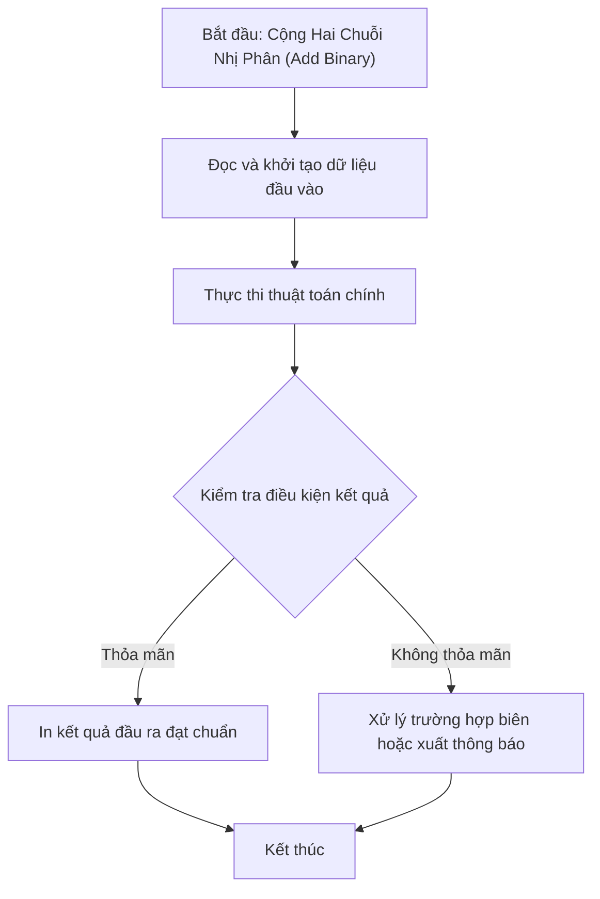

# Cộng Hai Chuỗi Nhị Phân (Add Binary)

## 1. Thông tin tệp mã nguồn
- [`Them_nhi_phan.cpp`](./Them_nhi_phan.cpp)
- **Thư mục chuyên đề**: `DSA/01_Toan_Hoc_va_Ly_Thuyet_So/Them_nhi_phan/`
- **Ngôn ngữ**: C/C++ (Chuẩn C++11 trở lên)

## 2. Mục tiêu & Tóm tắt bài toán
Tính tổng của hai số nhị phân dưới dạng chuỗi.

---

## 3. Ý tưởng & Phương pháp giải thuật
### Phương án tiếp cận:
Mô phỏng phép cộng cơ số 2 từ phải sang trái có nhớ.

### Các bước thực hiện chi tiết:
1. Khởi tạo dữ liệu và đọc đầu vào theo định dạng bài toán.
2. Thực hiện thuật toán cốt lõi: Mô phỏng phép cộng cơ số 2 từ phải sang trái có nhớ.
3. Cập nhật trạng thái và tính toán kết quả.
4. Xuất kết quả đầu ra màn hình.

---

## 4. Sơ đồ thuật toán (Mermaid Workflow)


---

## 5. Đánh giá độ phức tạp
- **Độ phức tạp thời gian (Time Complexity)**: `O(max(L1, L2))`
- **Độ phức tạp không gian (Space Complexity)**: `O(max(L1, L2))`

---

## 6. Input / Output mẫu & Giải thích

### Input mẫu:
```text
1010
1011
10101
```

### Output mẫu:
```text
0 1 0 1
```

### Giải thích:
10 + 11 = 21 (10101).

## 7. Hướng dẫn biên dịch & chạy thử
```bash
# Di chuyển vào thư mục bài toán
cd "DSA/01_Toan_Hoc_va_Ly_Thuyet_So/Them_nhi_phan"

# Biên dịch chương trình C++
g++ -std=c++11 -O2 "Them_nhi_phan.cpp" -o "Them_nhi_phan"

# Chạy chương trình
./"Them_nhi_phan"
```

> [!NOTE]
> Toàn bộ mã nguồn C++ gốc được bảo toàn nguyên vẹn 100% không qua chỉnh sửa.
