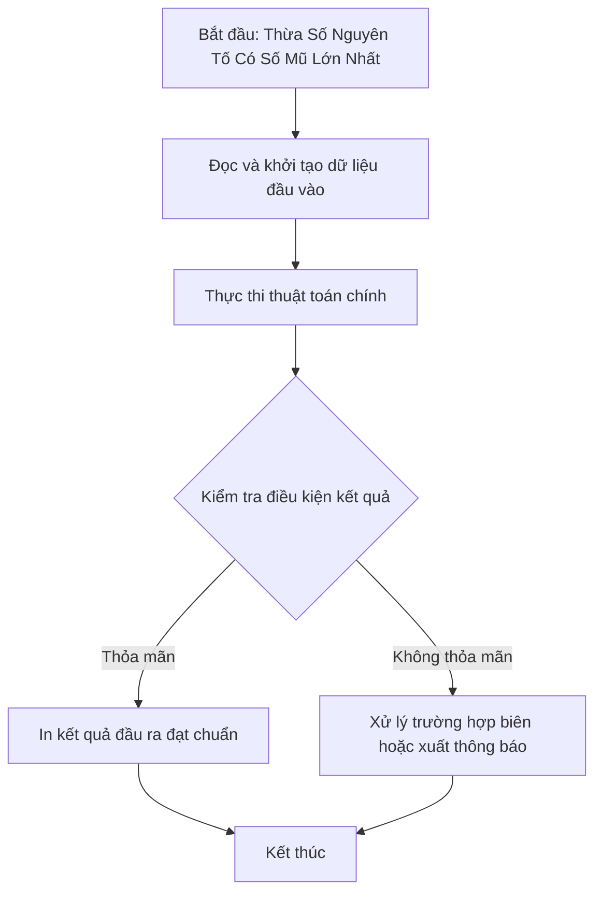

# Thừa Số Nguyên Tố Có Số Mũ Lớn Nhất

## 1. Thông tin tệp mã nguồn
- [`Thua_snt_so_mu_max.cpp`](./Thua_snt_so_mu_max.cpp)
- **Thư mục chuyên đề**: `DSA/01_Toan_Hoc_va_Ly_Thuyet_So/Thua_snt_so_mu_max/`
- **Ngôn ngữ**: C/C++ (Chuẩn C++11 trở lên)

## 2. Mục tiêu & Tóm tắt bài toán
Tìm thừa số nguyên tố xuất hiện với số mũ cao nhất.

---

## 3. Ý tưởng & Phương pháp giải thuật
### Phương án tiếp cận:
Phân tích N thành tích thừa số nguyên tố, cập nhật max mũ.

### Các bước thực hiện chi tiết:
1. Khởi tạo dữ liệu và đọc đầu vào theo định dạng bài toán.
2. Thực hiện thuật toán cốt lõi: Phân tích N thành tích thừa số nguyên tố, cập nhật max mũ.
3. Cập nhật trạng thái và tính toán kết quả.
4. Xuất kết quả đầu ra màn hình.

---

## 4. Sơ đồ thuật toán (Mermaid Workflow)


---

## 5. Đánh giá độ phức tạp
- **Độ phức tạp thời gian (Time Complexity)**: `O(sqrt(N))`
- **Độ phức tạp không gian (Space Complexity)**: `O(1)`

---

## 6. Input / Output mẫu & Giải thích

### Input mẫu:
```text
72
```

### Output mẫu:
```text
1:1 2:3 3:2 
2^3
```

### Giải thích:
72 = 2^3 * 3^2, số 2 có mũ 3 lớn nhất.

## 7. Hướng dẫn biên dịch & chạy thử
```bash
# Di chuyển vào thư mục bài toán
cd "DSA/01_Toan_Hoc_va_Ly_Thuyet_So/Thua_snt_so_mu_max"

# Biên dịch chương trình C++
g++ -std=c++11 -O2 "Thua_snt_so_mu_max.cpp" -o "Thua_snt_so_mu_max"

# Chạy chương trình
./"Thua_snt_so_mu_max"
```

> [!NOTE]
> Toàn bộ mã nguồn C++ gốc được bảo toàn nguyên vẹn 100% không qua chỉnh sửa.
