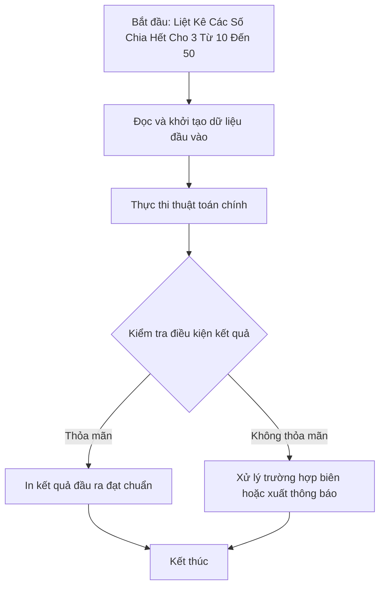

# Liệt Kê Các Số Chia Hết Cho 3 Từ 10 Đến 50

## 1. Thông tin tệp mã nguồn
- [`cac so chia het cho 3 tu 10-50.cpp`](./cac so chia het cho 3 tu 10-50.cpp)
- **Thư mục chuyên đề**: `DSA/01_Toan_Hoc_va_Ly_Thuyet_So/cac so chia het cho 3 tu 10-50/`
- **Ngôn ngữ**: C/C++ (Chuẩn C++11 trở lên)

## 2. Mục tiêu & Tóm tắt bài toán
In ra dãy số chia hết cho 3 trong đoạn [10, 50].

---

## 3. Ý tưởng & Phương pháp giải thuật
### Phương án tiếp cận:
Vòng lặp với bước nhảy 3 từ 12 đến 48.

### Các bước thực hiện chi tiết:
1. Khởi tạo dữ liệu và đọc đầu vào theo định dạng bài toán.
2. Thực hiện thuật toán cốt lõi: Vòng lặp với bước nhảy 3 từ 12 đến 48.
3. Cập nhật trạng thái và tính toán kết quả.
4. Xuất kết quả đầu ra màn hình.

---

## 4. Sơ đồ thuật toán (Mermaid Workflow)


---

## 5. Đánh giá độ phức tạp
- **Độ phức tạp thời gian (Time Complexity)**: `O(1)`
- **Độ phức tạp không gian (Space Complexity)**: `O(1)`

---

## 6. Input / Output mẫu & Giải thích

### Input mẫu:
```text
Không yêu cầu tham số đầu vào (dữ liệu được khởi tạo trực tiếp trong mã nguồn)
```

### Output mẫu:
```text
Nhung so chia het cho 3 tu 10-50 la:12 15 18 21 24 27 30 33 36 39 42 45 48
```

### Giải thích:
Chương trình thực thi và xuất kết quả trực tiếp từ dữ liệu mẫu trong mã nguồn.

## 7. Hướng dẫn biên dịch & chạy thử
```bash
# Di chuyển vào thư mục bài toán
cd "DSA/01_Toan_Hoc_va_Ly_Thuyet_So/cac so chia het cho 3 tu 10-50"

# Biên dịch chương trình C++
g++ -std=c++11 -O2 "cac so chia het cho 3 tu 10-50.cpp" -o "cac so chia het cho 3 tu 10-50"

# Chạy chương trình
./"cac so chia het cho 3 tu 10-50"
```

> [!NOTE]
> Toàn bộ mã nguồn C++ gốc được bảo toàn nguyên vẹn 100% không qua chỉnh sửa.
