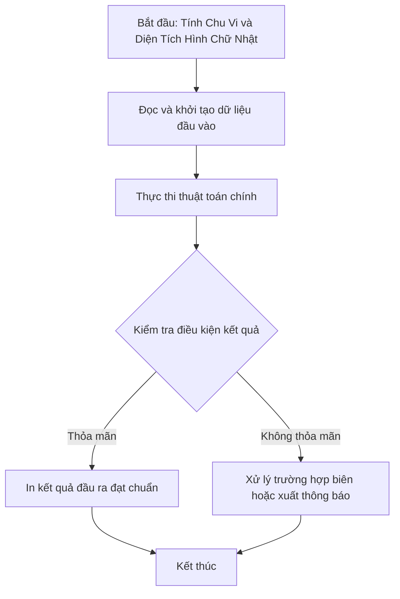

# Tính Chu Vi và Diện Tích Hình Chữ Nhật

## 1. Thông tin tệp mã nguồn
- [`cv and dt hinh chu nhat.cpp`](./cv and dt hinh chu nhat.cpp)
- **Thư mục chuyên đề**: `DSA/01_Toan_Hoc_va_Ly_Thuyet_So/cv and dt hinh chu nhat/`
- **Ngôn ngữ**: C/C++ (Chuẩn C++11 trở lên)

## 2. Mục tiêu & Tóm tắt bài toán
Tính chu vi và diện tích HCN từ chiều dài và chiều rộng.

---

## 3. Ý tưởng & Phương pháp giải thuật
### Phương án tiếp cận:
Áp dụng công thức hình học cơ bản.

### Các bước thực hiện chi tiết:
1. Khởi tạo dữ liệu và đọc đầu vào theo định dạng bài toán.
2. Thực hiện thuật toán cốt lõi: Áp dụng công thức hình học cơ bản.
3. Cập nhật trạng thái và tính toán kết quả.
4. Xuất kết quả đầu ra màn hình.

---

## 4. Sơ đồ thuật toán (Mermaid Workflow)


---

## 5. Đánh giá độ phức tạp
- **Độ phức tạp thời gian (Time Complexity)**: `O(1)`
- **Độ phức tạp không gian (Space Complexity)**: `O(1)`

---

## 6. Input / Output mẫu & Giải thích

### Input mẫu:
```text
4 5
```

### Output mẫu:
```text
Moi ban nhap chieu dai:Moi ban nhap chieu rong:chu vi hinh chu nhat la:18
dien tich hinh chu nhat la:20
```

### Giải thích:
2*(4+5) = 18, 4*5 = 20.

## 7. Hướng dẫn biên dịch & chạy thử
```bash
# Di chuyển vào thư mục bài toán
cd "DSA/01_Toan_Hoc_va_Ly_Thuyet_So/cv and dt hinh chu nhat"

# Biên dịch chương trình C++
g++ -std=c++11 -O2 "cv and dt hinh chu nhat.cpp" -o "cv and dt hinh chu nhat"

# Chạy chương trình
./"cv and dt hinh chu nhat"
```

> [!NOTE]
> Toàn bộ mã nguồn C++ gốc được bảo toàn nguyên vẹn 100% không qua chỉnh sửa.
