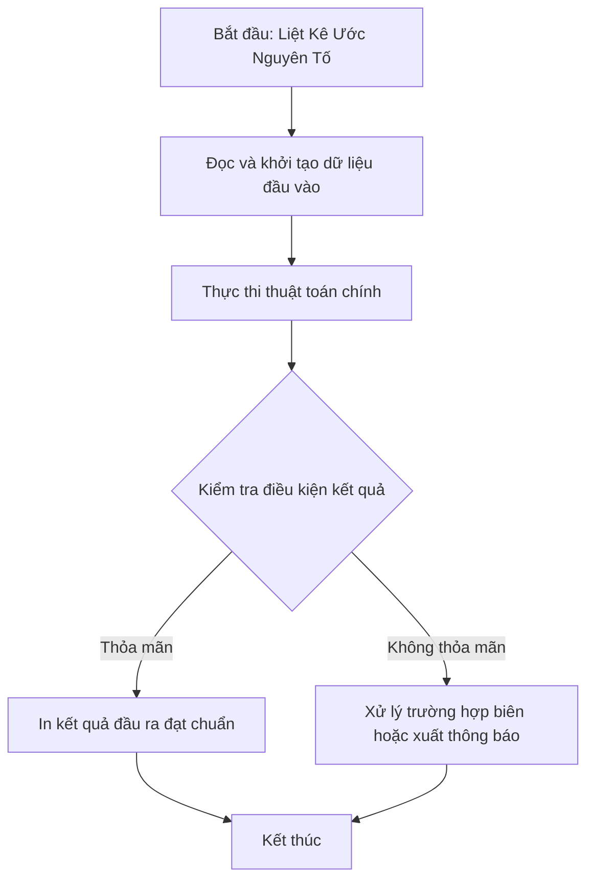

# Liệt Kê Ước Nguyên Tố

## 1. Thông tin tệp mã nguồn
- [`phantichuocngto.cpp`](./phantichuocngto.cpp)
- **Thư mục chuyên đề**: `DSA/01_Toan_Hoc_va_Ly_Thuyet_So/phantichuocngto/`
- **Ngôn ngữ**: C/C++ (Chuẩn C++11 trở lên)

## 2. Mục tiêu & Tóm tắt bài toán
In các ước nguyên tố phân biệt của số N.

---

## 3. Ý tưởng & Phương pháp giải thuật
### Phương án tiếp cận:
Duyệt tìm ước và chia hết cho ước nguyên tố.

### Các bước thực hiện chi tiết:
1. Khởi tạo dữ liệu và đọc đầu vào theo định dạng bài toán.
2. Thực hiện thuật toán cốt lõi: Duyệt tìm ước và chia hết cho ước nguyên tố.
3. Cập nhật trạng thái và tính toán kết quả.
4. Xuất kết quả đầu ra màn hình.

---

## 4. Sơ đồ thuật toán (Mermaid Workflow)


---

## 5. Đánh giá độ phức tạp
- **Độ phức tạp thời gian (Time Complexity)**: `O(sqrt(N))`
- **Độ phức tạp không gian (Space Complexity)**: `O(1)`

---

## 6. Input / Output mẫu & Giải thích

### Input mẫu:
```text
28
```

### Output mẫu:
```text
Nhap vao gia tri duong n:CAC UOC KHONG NGUYEN TO:

CAC UOC NGUYEN TO:
2 3 4 5 7 9 11 13 17 19 23 25
```

### Giải thích:
Ước nguyên tố của 28 là 2 và 7.

## 7. Hướng dẫn biên dịch & chạy thử
```bash
# Di chuyển vào thư mục bài toán
cd "DSA/01_Toan_Hoc_va_Ly_Thuyet_So/phantichuocngto"

# Biên dịch chương trình C++
g++ -std=c++11 -O2 "phantichuocngto.cpp" -o "phantichuocngto"

# Chạy chương trình
./"phantichuocngto"
```

> [!NOTE]
> Toàn bộ mã nguồn C++ gốc được bảo toàn nguyên vẹn 100% không qua chỉnh sửa.
