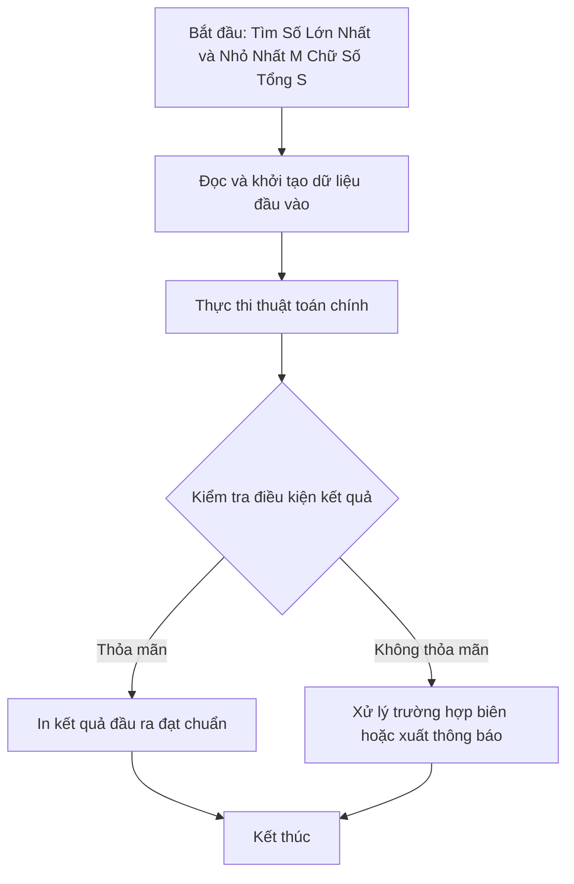

# Tìm Số Lớn Nhất và Nhỏ Nhất M Chữ Số Tổng S

## 1. Thông tin tệp mã nguồn
- [`timso_lonnhat_nhonhat_co_m_phtu_tongbang_s.cpp`](./timso_lonnhat_nhonhat_co_m_phtu_tongbang_s.cpp)
- **Thư mục chuyên đề**: `DSA/01_Toan_Hoc_va_Ly_Thuyet_So/timso_lonnhat_nhonhat_co_m_phtu_tongbang_s/`
- **Ngôn ngữ**: C/C++ (Chuẩn C++11 trở lên)

## 2. Mục tiêu & Tóm tắt bài toán
Xây dựng số nhỏ nhất và số lớn nhất có M chữ số và tổng các chữ số bằng S.

---

## 3. Ý tưởng & Phương pháp giải thuật
### Phương án tiếp cận:
Thuật toán tham lam (Greedy) điền chữ số 9 vào đầu (max) hoặc cuối (min).

### Các bước thực hiện chi tiết:
1. Khởi tạo dữ liệu và đọc đầu vào theo định dạng bài toán.
2. Thực hiện thuật toán cốt lõi: Thuật toán tham lam (Greedy) điền chữ số 9 vào đầu (max) hoặc cuối (min).
3. Cập nhật trạng thái và tính toán kết quả.
4. Xuất kết quả đầu ra màn hình.

---

## 4. Sơ đồ thuật toán (Mermaid Workflow)


---

## 5. Đánh giá độ phức tạp
- **Độ phức tạp thời gian (Time Complexity)**: `O(M)`
- **Độ phức tạp không gian (Space Complexity)**: `O(M)`

---

## 6. Input / Output mẫu & Giải thích

### Input mẫu:
```text
2 9
```

### Output mẫu:
```text
18 90
```

### Giải thích:
Số nhỏ nhất có 2 chữ số tổng bằng 9 là 18; số lớn nhất là 90.

## 7. Hướng dẫn biên dịch & chạy thử
```bash
# Di chuyển vào thư mục bài toán
cd "DSA/01_Toan_Hoc_va_Ly_Thuyet_So/timso_lonnhat_nhonhat_co_m_phtu_tongbang_s"

# Biên dịch chương trình C++
g++ -std=c++11 -O2 "timso_lonnhat_nhonhat_co_m_phtu_tongbang_s.cpp" -o "timso_lonnhat_nhonhat_co_m_phtu_tongbang_s"

# Chạy chương trình
./"timso_lonnhat_nhonhat_co_m_phtu_tongbang_s"
```

> [!NOTE]
> Toàn bộ mã nguồn C++ gốc được bảo toàn nguyên vẹn 100% không qua chỉnh sửa.
