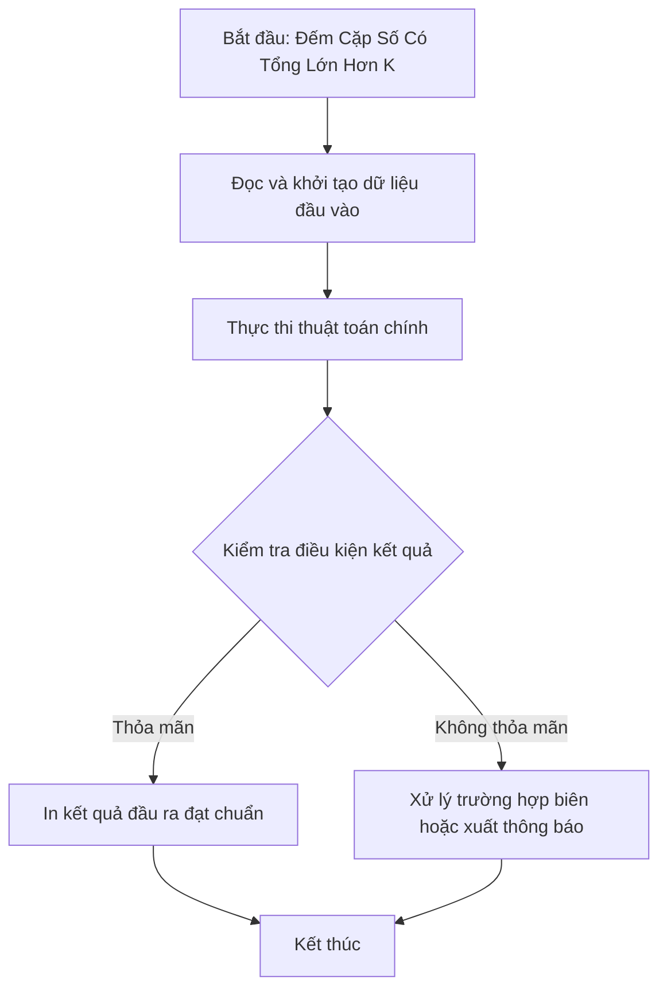

# Đếm Cặp Số Có Tổng Lớn Hơn K

## 1. Thông tin tệp mã nguồn
- [`Cap_so_co_tong_lon_hon_k.cpp`](./Cap_so_co_tong_lon_hon_k.cpp)
- **Thư mục chuyên đề**: `DSA/02_Mang_va_Mang_Cong_Don/Cap_so_co_tong_lon_hon_k/`
- **Ngôn ngữ**: C/C++ (Chuẩn C++11 trở lên)

## 2. Mục tiêu & Tóm tắt bài toán
Đếm số cặp (i, j) với i < j sao cho a[i] + a[j] > K.

---

## 3. Ý tưởng & Phương pháp giải thuật
### Phương án tiếp cận:
Sắp xếp mảng kết hợp 2 con trỏ / upper_bound.

### Các bước thực hiện chi tiết:
1. Khởi tạo dữ liệu và đọc đầu vào theo định dạng bài toán.
2. Thực hiện thuật toán cốt lõi: Sắp xếp mảng kết hợp 2 con trỏ / upper_bound.
3. Cập nhật trạng thái và tính toán kết quả.
4. Xuất kết quả đầu ra màn hình.

---

## 4. Sơ đồ thuật toán (Mermaid Workflow)


---

## 5. Đánh giá độ phức tạp
- **Độ phức tạp thời gian (Time Complexity)**: `O(N log N)`
- **Độ phức tạp không gian (Space Complexity)**: `O(1)`

---

## 6. Input / Output mẫu & Giải thích

### Input mẫu:
```text
7 8
2 3 4 4 5 5 6
```

### Output mẫu:
```text
3 6;4 5;4 5;4 6;4 5;4 5;4 6;5 5;5 6;5 6;
10
```

### Giải thích:
Các cặp có tổng > 5.

## 7. Hướng dẫn biên dịch & chạy thử
```bash
# Di chuyển vào thư mục bài toán
cd "DSA/02_Mang_va_Mang_Cong_Don/Cap_so_co_tong_lon_hon_k"

# Biên dịch chương trình C++
g++ -std=c++11 -O2 "Cap_so_co_tong_lon_hon_k.cpp" -o "Cap_so_co_tong_lon_hon_k"

# Chạy chương trình
./"Cap_so_co_tong_lon_hon_k"
```

> [!NOTE]
> Toàn bộ mã nguồn C++ gốc được bảo toàn nguyên vẹn 100% không qua chỉnh sửa.
