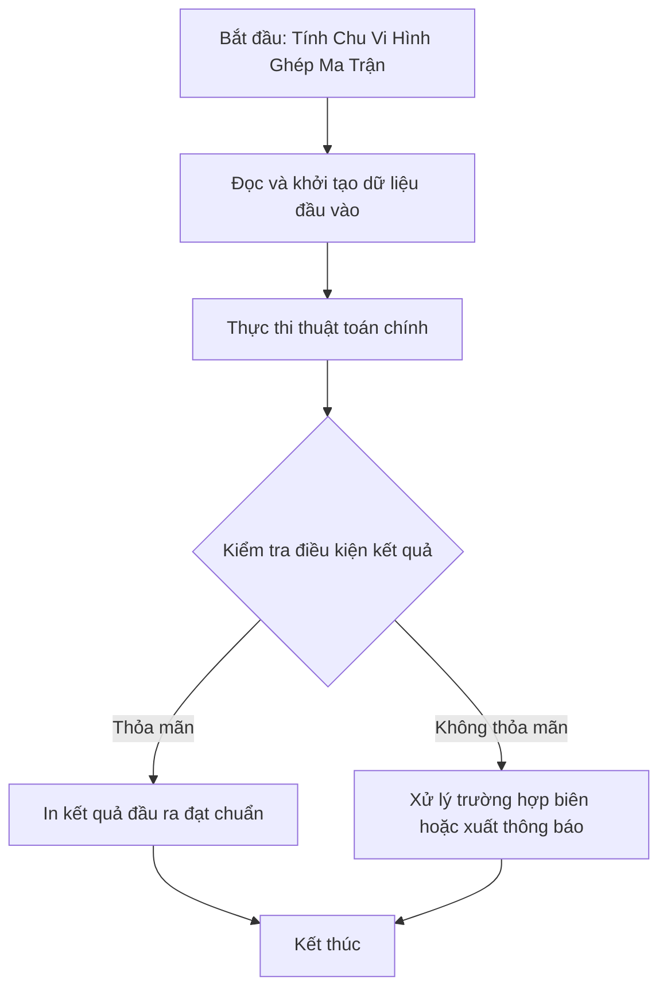

# Tính Chu Vi Hình Ghép Ma Trận

## 1. Thông tin tệp mã nguồn
- [`Chu_vi.cpp`](./Chu_vi.cpp)
- **Thư mục chuyên đề**: `DSA/02_Mang_va_Mang_Cong_Don/Chu_vi/`
- **Ngôn ngữ**: C/C++ (Chuẩn C++11 trở lên)

## 2. Mục tiêu & Tóm tắt bài toán
Tính chu vi hình tạo bởi các ô số 1 trên lưới vuông.

---

## 3. Ý tưởng & Phương pháp giải thuật
### Phương án tiếp cận:
Đếm các cạnh tiếp xúc với ô số 0 hoặc biên.

### Các bước thực hiện chi tiết:
1. Khởi tạo dữ liệu và đọc đầu vào theo định dạng bài toán.
2. Thực hiện thuật toán cốt lõi: Đếm các cạnh tiếp xúc với ô số 0 hoặc biên.
3. Cập nhật trạng thái và tính toán kết quả.
4. Xuất kết quả đầu ra màn hình.

---

## 4. Sơ đồ thuật toán (Mermaid Workflow)


---

## 5. Đánh giá độ phức tạp
- **Độ phức tạp thời gian (Time Complexity)**: `O(N*M)`
- **Độ phức tạp không gian (Space Complexity)**: `O(1)`

---

## 6. Input / Output mẫu & Giải thích

### Input mẫu:
```text
5 8
1 1 0 0 0 1 0 0
0 0 0 1 1 0 1 1
1 0 1 1 0 1 0 1
0 0 1 1 0 1 1 0
0 1 1 1 0 0 1 0
```

### Output mẫu:
```text
6 4 16 8 4 10
```

### Giải thích:
Chu vi hình dấu cộng.

## 7. Hướng dẫn biên dịch & chạy thử
```bash
# Di chuyển vào thư mục bài toán
cd "DSA/02_Mang_va_Mang_Cong_Don/Chu_vi"

# Biên dịch chương trình C++
g++ -std=c++11 -O2 "Chu_vi.cpp" -o "Chu_vi"

# Chạy chương trình
./"Chu_vi"
```

> [!NOTE]
> Toàn bộ mã nguồn C++ gốc được bảo toàn nguyên vẹn 100% không qua chỉnh sửa.
