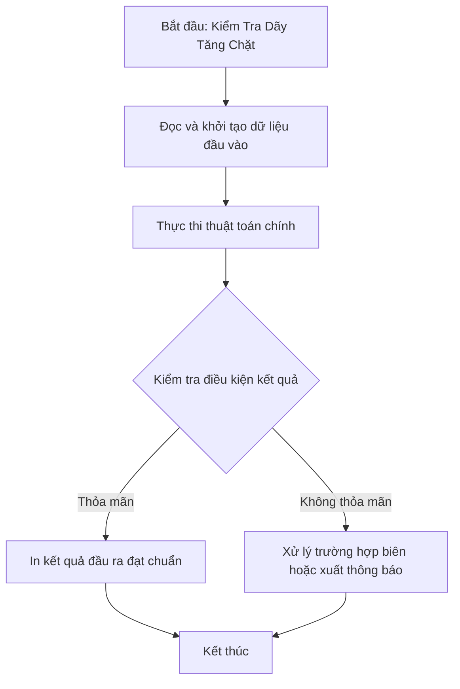

# Kiểm Tra Dãy Tăng Chặt

## 1. Thông tin tệp mã nguồn
- [`Day_tang_chat.cpp`](./Day_tang_chat.cpp)
- **Thư mục chuyên đề**: `DSA/02_Mang_va_Mang_Cong_Don/Day_tang_chat/`
- **Ngôn ngữ**: C/C++ (Chuẩn C++11 trở lên)

## 2. Mục tiêu & Tóm tắt bài toán
Kiểm tra dãy số có strictly increasing (a[i] < a[i+1]) hay không.

---

## 3. Ý tưởng & Phương pháp giải thuật
### Phương án tiếp cận:
Duyệt tuần tự kiểm tra điều kiện.

### Các bước thực hiện chi tiết:
1. Khởi tạo dữ liệu và đọc đầu vào theo định dạng bài toán.
2. Thực hiện thuật toán cốt lõi: Duyệt tuần tự kiểm tra điều kiện.
3. Cập nhật trạng thái và tính toán kết quả.
4. Xuất kết quả đầu ra màn hình.

---

## 4. Sơ đồ thuật toán (Mermaid Workflow)


---

## 5. Đánh giá độ phức tạp
- **Độ phức tạp thời gian (Time Complexity)**: `O(N)`
- **Độ phức tạp không gian (Space Complexity)**: `O(1)`

---

## 6. Input / Output mẫu & Giải thích

### Input mẫu:
```text
4
1 2 3 5
```

### Output mẫu:
```text
2 3 5 256 
0
```

### Giải thích:
Dãy tăng chặt.

## 7. Hướng dẫn biên dịch & chạy thử
```bash
# Di chuyển vào thư mục bài toán
cd "DSA/02_Mang_va_Mang_Cong_Don/Day_tang_chat"

# Biên dịch chương trình C++
g++ -std=c++11 -O2 "Day_tang_chat.cpp" -o "Day_tang_chat"

# Chạy chương trình
./"Day_tang_chat"
```

> [!NOTE]
> Toàn bộ mã nguồn C++ gốc được bảo toàn nguyên vẹn 100% không qua chỉnh sửa.
