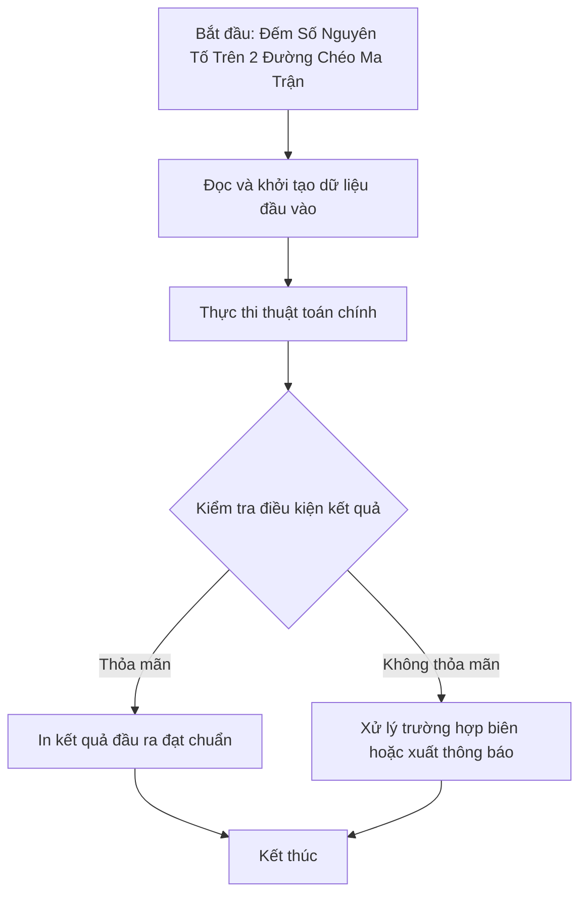

# Đếm Số Nguyên Tố Trên 2 Đường Chéo Ma Trận

## 1. Thông tin tệp mã nguồn
- [`Dem_snt_tren_duong_cheo.cpp`](./Dem_snt_tren_duong_cheo.cpp)
- **Thư mục chuyên đề**: `DSA/02_Mang_va_Mang_Cong_Don/Dem_snt_tren_duong_cheo/`
- **Ngôn ngữ**: C/C++ (Chuẩn C++11 trở lên)

## 2. Mục tiêu & Tóm tắt bài toán
Đếm số lượng SNT trên đường chéo chính và đường chéo phụ của ma trận vuông.

---

## 3. Ý tưởng & Phương pháp giải thuật
### Phương án tiếp cận:
Hàm kiểm tra SNT và duyệt chỉ số i == j và i + j == n - 1.

### Các bước thực hiện chi tiết:
1. Khởi tạo dữ liệu và đọc đầu vào theo định dạng bài toán.
2. Thực hiện thuật toán cốt lõi: Hàm kiểm tra SNT và duyệt chỉ số i == j và i + j == n - 1.
3. Cập nhật trạng thái và tính toán kết quả.
4. Xuất kết quả đầu ra màn hình.

---

## 4. Sơ đồ thuật toán (Mermaid Workflow)


---

## 5. Đánh giá độ phức tạp
- **Độ phức tạp thời gian (Time Complexity)**: `O(N sqrt(M))`
- **Độ phức tạp không gian (Space Complexity)**: `O(1)`

---

## 6. Input / Output mẫu & Giải thích

### Input mẫu:
```text
3
2 4 3
5 7 1
11 6 13
```

### Output mẫu:
```text
5
```

### Giải thích:
Các SNT trên đường chéo: 2, 3, 7, 11, 13.

---

## 7. Hướng dẫn biên dịch & chạy thử
```bash
# Di chuyển vào thư mục bài toán
cd "DSA/02_Mang_va_Mang_Cong_Don/Dem_snt_tren_duong_cheo"

# Biên dịch chương trình C++
g++ -std=c++11 -O2 "Dem_snt_tren_duong_cheo.cpp" -o "Dem_snt_tren_duong_cheo"

# Chạy chương trình
./"Dem_snt_tren_duong_cheo"
```

> [!NOTE]
> Toàn bộ mã nguồn C++ gốc được bảo toàn nguyên vẹn 100% không qua chỉnh sửa.
