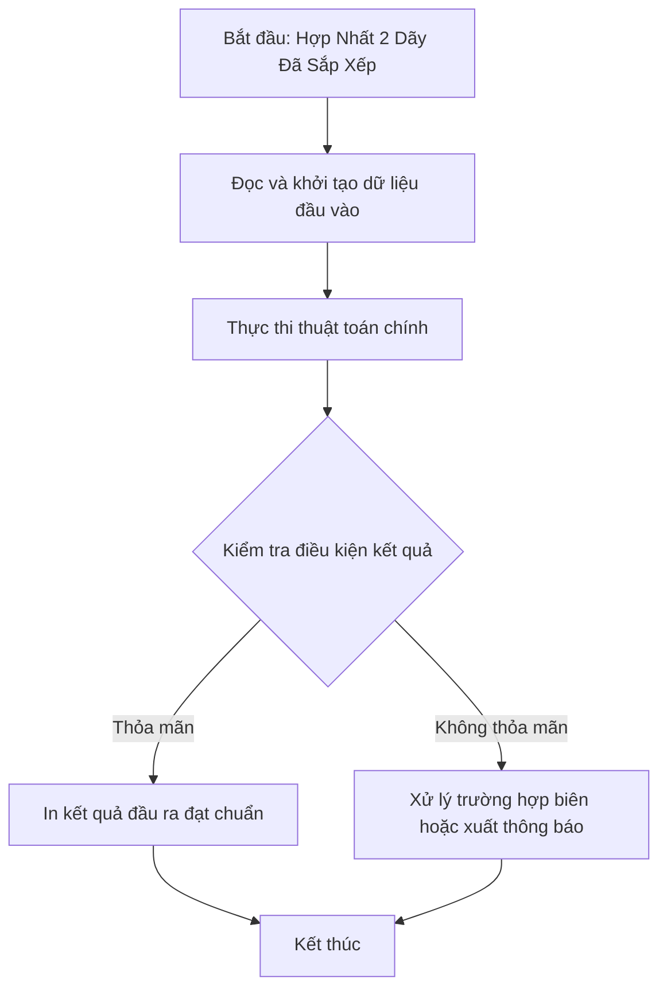

# Hợp Nhất 2 Dãy Đã Sắp Xếp

## 1. Thông tin tệp mã nguồn
- [`Hop_nhat_2_ds_da_ss.cpp`](./Hop_nhat_2_ds_da_ss.cpp)
- **Thư mục chuyên đề**: `DSA/02_Mang_va_Mang_Cong_Don/Hop_nhat_2_ds_da_ss/`
- **Ngôn ngữ**: C/C++ (Chuẩn C++11 trở lên)

## 2. Mục tiêu & Tóm tắt bài toán
Gộp 2 mảng đã sắp xếp thành 1 mảng tăng dần duy nhất.

---

## 3. Ý tưởng & Phương pháp giải thuật
### Phương án tiếp cận:
Kỹ thuật 2 con trỏ của Merge Sort.

### Các bước thực hiện chi tiết:
1. Khởi tạo dữ liệu và đọc đầu vào theo định dạng bài toán.
2. Thực hiện thuật toán cốt lõi: Kỹ thuật 2 con trỏ của Merge Sort.
3. Cập nhật trạng thái và tính toán kết quả.
4. Xuất kết quả đầu ra màn hình.

---

## 4. Sơ đồ thuật toán (Mermaid Workflow)


---

## 5. Đánh giá độ phức tạp
- **Độ phức tạp thời gian (Time Complexity)**: `O(N + M)`
- **Độ phức tạp không gian (Space Complexity)**: `O(N + M)`

---

## 6. Input / Output mẫu & Giải thích

### Input mẫu:
```text
3 3
1 3 5
2 4 6
```

### Output mẫu:
```text
1 2 3 4 5 6
```

### Giải thích:
Mảng sau khi hợp nhất.

---

## 7. Hướng dẫn biên dịch & chạy thử
```bash
# Di chuyển vào thư mục bài toán
cd "DSA/02_Mang_va_Mang_Cong_Don/Hop_nhat_2_ds_da_ss"

# Biên dịch chương trình C++
g++ -std=c++11 -O2 "Hop_nhat_2_ds_da_ss.cpp" -o "Hop_nhat_2_ds_da_ss"

# Chạy chương trình
./"Hop_nhat_2_ds_da_ss"
```

> [!NOTE]
> Toàn bộ mã nguồn C++ gốc được bảo toàn nguyên vẹn 100% không qua chỉnh sửa.
