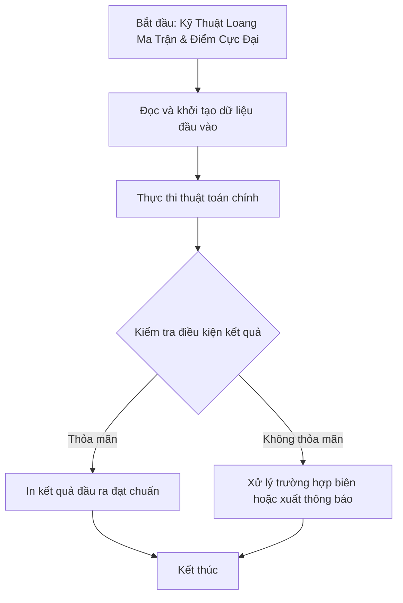

# Kỹ Thuật Loang Ma Trận & Điểm Cực Đại

## 1. Thông tin tệp mã nguồn
- [`Ky_Thuat_Loang_tren_mang_2-chieu.cpp`](./Ky_Thuat_Loang_tren_mang_2-chieu.cpp)
- **Thư mục chuyên đề**: `DSA/02_Mang_va_Mang_Cong_Don/Ky_Thuat_Loang_tren_mang_2-chieu/`
- **Ngôn ngữ**: C/C++ (Chuẩn C++11 trở lên)

## 2. Mục tiêu & Tóm tắt bài toán
Đếm số điểm cực đại trên ma trận số nguyên 2D.

---

## 3. Ý tưởng & Phương pháp giải thuật
### Phương án tiếp cận:
Duyệt 8 hướng kiểm tra tính cực đại.

### Các bước thực hiện chi tiết:
1. Khởi tạo dữ liệu và đọc đầu vào theo định dạng bài toán.
2. Thực hiện thuật toán cốt lõi: Duyệt 8 hướng kiểm tra tính cực đại.
3. Cập nhật trạng thái và tính toán kết quả.
4. Xuất kết quả đầu ra màn hình.

---

## 4. Sơ đồ thuật toán (Mermaid Workflow)


---

## 5. Đánh giá độ phức tạp
- **Độ phức tạp thời gian (Time Complexity)**: `O(N*M)`
- **Độ phức tạp không gian (Space Complexity)**: `O(N*M)`

---

## 6. Input / Output mẫu & Giải thích

### Input mẫu:
```text
dem so diem cuc dai cua mang 2 chieu
diem cuc dai la diem lon nhat so voi cac so dung canh no
```

### Output mẫu:
```text
Nhap chi so hang,cot:So luong cuc dai:0
```

### Giải thích:
Điểm trung tâm có giá trị 5 là cực đại.

## 7. Hướng dẫn biên dịch & chạy thử
```bash
# Di chuyển vào thư mục bài toán
cd "DSA/02_Mang_va_Mang_Cong_Don/Ky_Thuat_Loang_tren_mang_2-chieu"

# Biên dịch chương trình C++
g++ -std=c++11 -O2 "Ky_Thuat_Loang_tren_mang_2-chieu.cpp" -o "Ky_Thuat_Loang_tren_mang_2-chieu"

# Chạy chương trình
./"Ky_Thuat_Loang_tren_mang_2-chieu"
```

> [!NOTE]
> Toàn bộ mã nguồn C++ gốc được bảo toàn nguyên vẹn 100% không qua chỉnh sửa.
