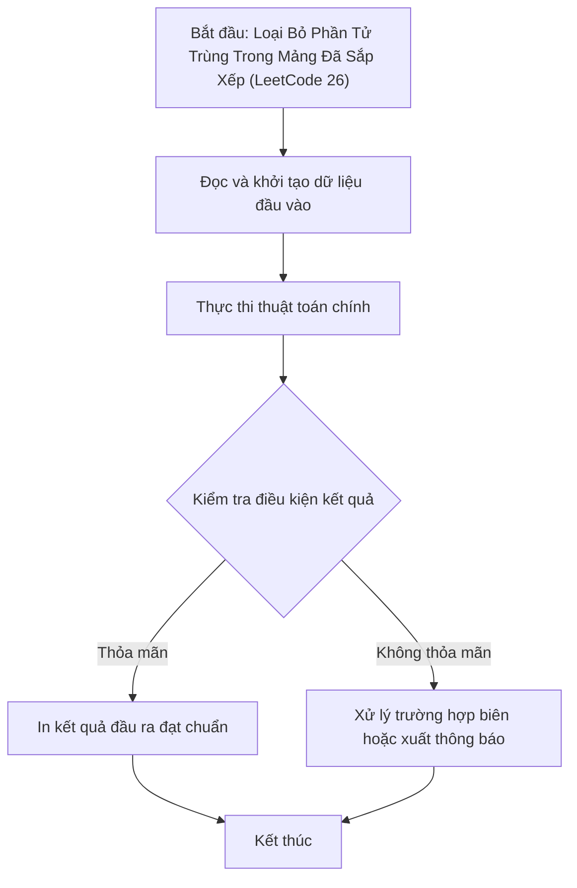

# Loại Bỏ Phần Tử Trùng Trong Mảng Đã Sắp Xếp (LeetCode 26)

## 1. Thông tin tệp mã nguồn
- [`Loai_bo_ban_sao_trong_mang_ss.cpp`](./Loai_bo_ban_sao_trong_mang_ss.cpp)
- **Thư mục chuyên đề**: `DSA/02_Mang_va_Mang_Cong_Don/Loai_bo_ban_sao_trong_mang_ss/`
- **Ngôn ngữ**: C/C++ (Chuẩn C++11 trở lên)

## 2. Mục tiêu & Tóm tắt bài toán
Xóa các phần tử trùng lặp tại chỗ trên mảng tăng dần.

---

## 3. Ý tưởng & Phương pháp giải thuật
### Phương án tiếp cận:
Hai con trỏ ghi đè các phần tử phân biệt lên đầu mảng.

### Các bước thực hiện chi tiết:
1. Khởi tạo dữ liệu và đọc đầu vào theo định dạng bài toán.
2. Thực hiện thuật toán cốt lõi: Hai con trỏ ghi đè các phần tử phân biệt lên đầu mảng.
3. Cập nhật trạng thái và tính toán kết quả.
4. Xuất kết quả đầu ra màn hình.

---

## 4. Sơ đồ thuật toán (Mermaid Workflow)


---

## 5. Đánh giá độ phức tạp
- **Độ phức tạp thời gian (Time Complexity)**: `O(N)`
- **Độ phức tạp không gian (Space Complexity)**: `O(1)`

---

## 6. Input / Output mẫu & Giải thích

### Input mẫu:
```text
5
1 1 2 2 3
```

### Output mẫu:
```text
Do dai:3
1,2,3,_,_,
```

### Giải thích:
Còn lại 3 phần tử phân biệt.

## 7. Hướng dẫn biên dịch & chạy thử
```bash
# Di chuyển vào thư mục bài toán
cd "DSA/02_Mang_va_Mang_Cong_Don/Loai_bo_ban_sao_trong_mang_ss"

# Biên dịch chương trình C++
g++ -std=c++11 -O2 "Loai_bo_ban_sao_trong_mang_ss.cpp" -o "Loai_bo_ban_sao_trong_mang_ss"

# Chạy chương trình
./"Loai_bo_ban_sao_trong_mang_ss"
```

> [!NOTE]
> Toàn bộ mã nguồn C++ gốc được bảo toàn nguyên vẹn 100% không qua chỉnh sửa.
