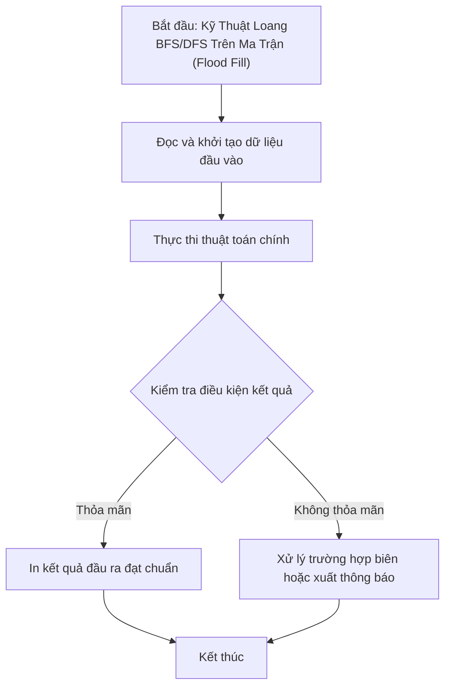

# Kỹ Thuật Loang BFS/DFS Trên Ma Trận (Flood Fill)

## 1. Thông tin tệp mã nguồn
- [`Loang_mang_2_chieu.c++`](./Loang_mang_2_chieu.c++)
- **Thư mục chuyên đề**: `DSA/02_Mang_va_Mang_Cong_Don/Loang_mang_2_chieu/`
- **Ngôn ngữ**: C/C++ (Chuẩn C++11 trở lên)

## 2. Mục tiêu & Tóm tắt bài toán
Đếm các miền liên thông các ô cùng giá trị trên ma trận.

---

## 3. Ý tưởng & Phương pháp giải thuật
### Phương án tiếp cận:
BFS hoặc DFS loang các ô kề cạnh cùng giá trị.

### Các bước thực hiện chi tiết:
1. Khởi tạo dữ liệu và đọc đầu vào theo định dạng bài toán.
2. Thực hiện thuật toán cốt lõi: BFS hoặc DFS loang các ô kề cạnh cùng giá trị.
3. Cập nhật trạng thái và tính toán kết quả.
4. Xuất kết quả đầu ra màn hình.

---

## 4. Sơ đồ thuật toán (Mermaid Workflow)


---

## 5. Đánh giá độ phức tạp
- **Độ phức tạp thời gian (Time Complexity)**: `O(N*M)`
- **Độ phức tạp không gian (Space Complexity)**: `O(N*M)`

---

## 6. Input / Output mẫu & Giải thích

### Input mẫu:
```text
3 3
1 1 2
1 2 2
3 3 3
```

### Output mẫu:
```text
3
```

### Giải thích:
Có 3 miền liên thông.

---

## 7. Hướng dẫn biên dịch & chạy thử
```bash
# Di chuyển vào thư mục bài toán
cd "DSA/02_Mang_va_Mang_Cong_Don/Loang_mang_2_chieu"

# Biên dịch chương trình C++
g++ -std=c++11 -O2 "Loang_mang_2_chieu.c++" -o "Loang_mang_2_chieu"

# Chạy chương trình
./"Loang_mang_2_chieu"
```

> [!NOTE]
> Toàn bộ mã nguồn C++ gốc được bảo toàn nguyên vẹn 100% không qua chỉnh sửa.
