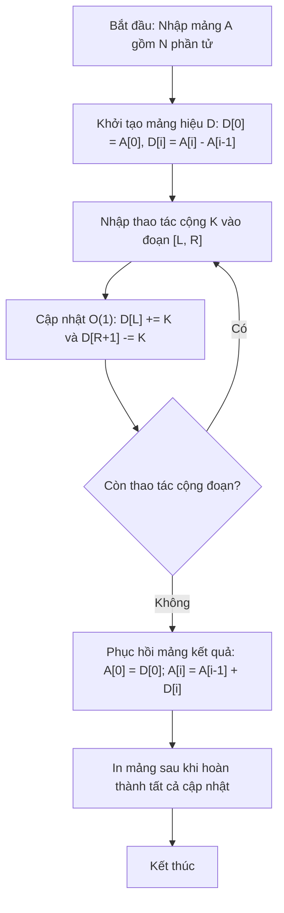

# Mảng Hiệu (Difference Array)

## 1. Thông tin tệp mã nguồn
- [`Mang_hieu.cpp`](./Mang_hieu.cpp)
- **Thư mục chuyên đề**: `DSA/02_Mang_va_Mang_Cong_Don/Mang_hieu/`
- **Ngôn ngữ**: C/C++ (Chuẩn C++11 trở lên)

## 2. Mục tiêu & Tóm tắt bài toán
Cập nhật tăng đoạn [L, R] thêm K đơn vị với O(1).

---

## 3. Ý tưởng & Phương pháp giải thuật
### Phương án tiếp cận:
Mảng hiệu D[L] += K, D[R+1] -= K, phục hồi bằng prefix sum.

### Các bước thực hiện chi tiết:
1. Khởi tạo dữ liệu và đọc đầu vào theo định dạng bài toán.
2. Thực hiện thuật toán cốt lõi: Mảng hiệu D[L] += K, D[R+1] -= K, phục hồi bằng prefix sum.
3. Cập nhật trạng thái và tính toán kết quả.
4. Xuất kết quả đầu ra màn hình.

---

## 4. Sơ đồ thuật toán (Mermaid Workflow)


---

## 5. Đánh giá độ phức tạp
- **Độ phức tạp thời gian (Time Complexity)**: `O(1) mỗi truy vấn`
- **Độ phức tạp không gian (Space Complexity)**: `O(N)`

---

## 6. Input / Output mẫu & Giải thích

### Input mẫu:
```text
5 1
1 2 3 4 5
1 3 2
```

### Output mẫu:
```text
Nhap so ptu:Nhap chi so l,r,k:Mang sau khi bien doi:
5 4 5 1 3
```

### Giải thích:
Tăng đoạn 1 đến 3 thêm 2 đơn vị.

## 7. Hướng dẫn biên dịch & chạy thử
```bash
# Di chuyển vào thư mục bài toán
cd "DSA/02_Mang_va_Mang_Cong_Don/Mang_hieu"

# Biên dịch chương trình C++
g++ -std=c++11 -O2 "Mang_hieu.cpp" -o "Mang_hieu"

# Chạy chương trình
./"Mang_hieu"
```

> [!NOTE]
> Toàn bộ mã nguồn C++ gốc được bảo toàn nguyên vẹn 100% không qua chỉnh sửa.
