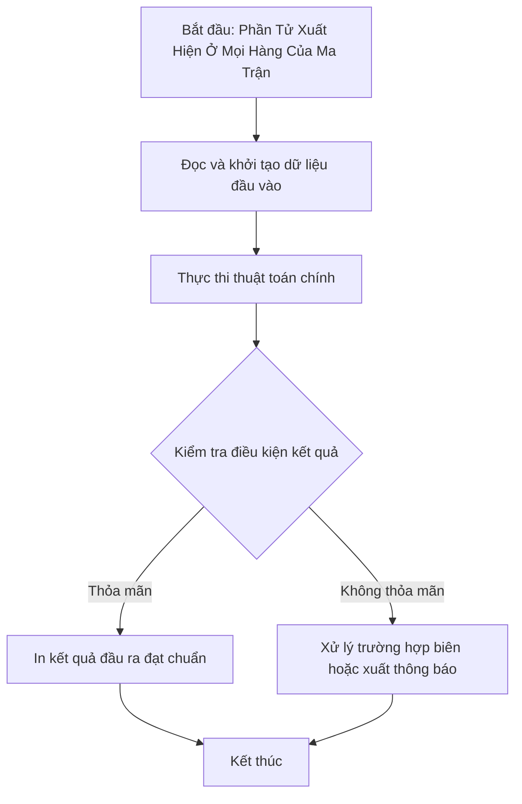

# Phần Tử Xuất Hiện Ở Mọi Hàng Của Ma Trận

## 1. Thông tin tệp mã nguồn
- [`Phan_tu_xuat_hien_o_moi_hang.cpp`](./Phan_tu_xuat_hien_o_moi_hang.cpp)
- **Thư mục chuyên đề**: `DSA/02_Mang_va_Mang_Cong_Don/Phan_tu_xuat_hien_o_moi_hang/`
- **Ngôn ngữ**: C/C++ (Chuẩn C++11 trở lên)

## 2. Mục tiêu & Tóm tắt bài toán
Tìm các số nguyên có mặt trong tất cả N hàng của ma trận.

---

## 3. Ý tưởng & Phương pháp giải thuật
### Phương án tiếp cận:
Sử dụng map / set đếm số hàng chứa mỗi phần tử.

### Các bước thực hiện chi tiết:
1. Khởi tạo dữ liệu và đọc đầu vào theo định dạng bài toán.
2. Thực hiện thuật toán cốt lõi: Sử dụng map / set đếm số hàng chứa mỗi phần tử.
3. Cập nhật trạng thái và tính toán kết quả.
4. Xuất kết quả đầu ra màn hình.

---

## 4. Sơ đồ thuật toán (Mermaid Workflow)


---

## 5. Đánh giá độ phức tạp
- **Độ phức tạp thời gian (Time Complexity)**: `O(N * M log M)`
- **Độ phức tạp không gian (Space Complexity)**: `O(M)`

---

## 6. Input / Output mẫu & Giải thích

### Input mẫu:
```text
4
1 2 2 3
2 1 2 4
1 4 5 2
2 2 3 1
```

### Output mẫu:
```text
1 2
```

### Giải thích:
2 và 3 xuất hiện ở cả 3 hàng.

## 7. Hướng dẫn biên dịch & chạy thử
```bash
# Di chuyển vào thư mục bài toán
cd "DSA/02_Mang_va_Mang_Cong_Don/Phan_tu_xuat_hien_o_moi_hang"

# Biên dịch chương trình C++
g++ -std=c++11 -O2 "Phan_tu_xuat_hien_o_moi_hang.cpp" -o "Phan_tu_xuat_hien_o_moi_hang"

# Chạy chương trình
./"Phan_tu_xuat_hien_o_moi_hang"
```

> [!NOTE]
> Toàn bộ mã nguồn C++ gốc được bảo toàn nguyên vẹn 100% không qua chỉnh sửa.
