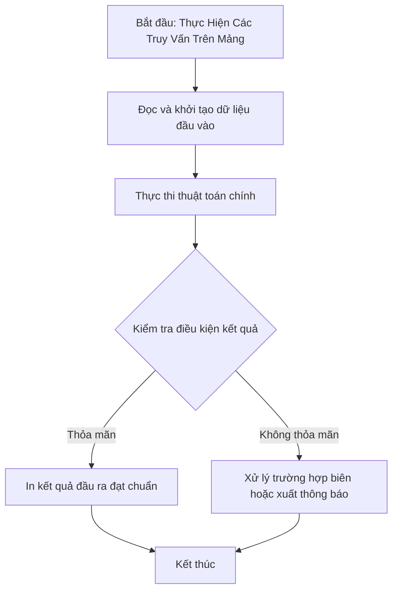

# Thực Hiện Các Truy Vấn Trên Mảng

## 1. Thông tin tệp mã nguồn
- [`Truy_van_tren_mang.c++`](./Truy_van_tren_mang.c++)
- **Thư mục chuyên đề**: `DSA/02_Mang_va_Mang_Cong_Don/Truy_van_tren_mang/`
- **Ngôn ngữ**: C/C++ (Chuẩn C++11 trở lên)

## 2. Mục tiêu & Tóm tắt bài toán
Xử lý các thao tác thêm, xóa, tìm kiếm giá trị X trên mảng.

---

## 3. Ý tưởng & Phương pháp giải thuật
### Phương án tiếp cận:
Sử dụng cấu trúc std::multiset hoặc hash map.

### Các bước thực hiện chi tiết:
1. Khởi tạo dữ liệu và đọc đầu vào theo định dạng bài toán.
2. Thực hiện thuật toán cốt lõi: Sử dụng cấu trúc std::multiset hoặc hash map.
3. Cập nhật trạng thái và tính toán kết quả.
4. Xuất kết quả đầu ra màn hình.

---

## 4. Sơ đồ thuật toán (Mermaid Workflow)


---

## 5. Đánh giá độ phức tạp
- **Độ phức tạp thời gian (Time Complexity)**: `O(Q log N)`
- **Độ phức tạp không gian (Space Complexity)**: `O(N)`

---

## 6. Input / Output mẫu & Giải thích

### Input mẫu:
```text
4
1 5
1 3
2 5
3 3
```

### Output mẫu:
```text
YES
```

### Giải thích:
Truy vấn trên mảng.

---

## 7. Hướng dẫn biên dịch & chạy thử
```bash
# Di chuyển vào thư mục bài toán
cd "DSA/02_Mang_va_Mang_Cong_Don/Truy_van_tren_mang"

# Biên dịch chương trình C++
g++ -std=c++11 -O2 "Truy_van_tren_mang.c++" -o "Truy_van_tren_mang"

# Chạy chương trình
./"Truy_van_tren_mang"
```

> [!NOTE]
> Toàn bộ mã nguồn C++ gốc được bảo toàn nguyên vẹn 100% không qua chỉnh sửa.
