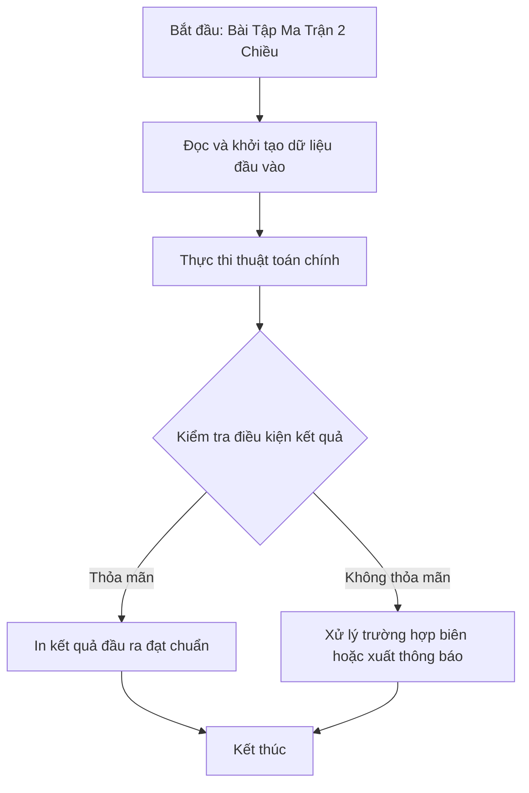

# Bài Tập Ma Trận 2 Chiều

## 1. Thông tin tệp mã nguồn
- [`bt mang 2 chieu.cpp`](./bt mang 2 chieu.cpp)
- **Thư mục chuyên đề**: `DSA/02_Mang_va_Mang_Cong_Don/bt mang 2 chieu/`
- **Ngôn ngữ**: C/C++ (Chuẩn C++11 trở lên)

## 2. Mục tiêu & Tóm tắt bài toán
Các thao tác cơ bản trên ma trận 2 chiều.

---

## 3. Ý tưởng & Phương pháp giải thuật
### Phương án tiếp cận:
Vòng lặp lồng nhau duyệt hàng và cột.

### Các bước thực hiện chi tiết:
1. Khởi tạo dữ liệu và đọc đầu vào theo định dạng bài toán.
2. Thực hiện thuật toán cốt lõi: Vòng lặp lồng nhau duyệt hàng và cột.
3. Cập nhật trạng thái và tính toán kết quả.
4. Xuất kết quả đầu ra màn hình.

---

## 4. Sơ đồ thuật toán (Mermaid Workflow)


---

## 5. Đánh giá độ phức tạp
- **Độ phức tạp thời gian (Time Complexity)**: `O(N*M)`
- **Độ phức tạp không gian (Space Complexity)**: `O(1)`

---

## 6. Input / Output mẫu & Giải thích

### Input mẫu:
```text
2 2
1 2
3 4
```

### Output mẫu:
```text
nhap so cot:nhap so hang:mang[0][0]=mang[0][1]=
mang[1][0]=mang[1][1]=
1	2	
3	4	

gia tri lon nhap la:4
nhap so can kiem tra:khong ton tai -117001384 trong mang
```

### Giải thích:
Duyệt ma trận 2 chiều.

## 7. Hướng dẫn biên dịch & chạy thử
```bash
# Di chuyển vào thư mục bài toán
cd "DSA/02_Mang_va_Mang_Cong_Don/bt mang 2 chieu"

# Biên dịch chương trình C++
g++ -std=c++11 -O2 "bt mang 2 chieu.cpp" -o "bt mang 2 chieu"

# Chạy chương trình
./"bt mang 2 chieu"
```

> [!NOTE]
> Toàn bộ mã nguồn C++ gốc được bảo toàn nguyên vẹn 100% không qua chỉnh sửa.
