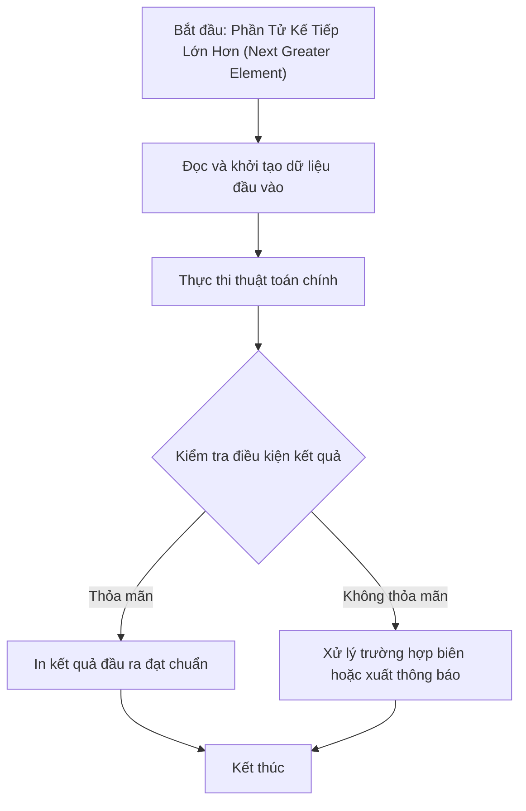

# Phần Tử Kế Tiếp Lớn Hơn (Next Greater Element)

## 1. Thông tin tệp mã nguồn
- [`insosaulonhon.cpp`](./insosaulonhon.cpp)
- **Thư mục chuyên đề**: `DSA/02_Mang_va_Mang_Cong_Don/insosaulonhon/`
- **Ngôn ngữ**: C/C++ (Chuẩn C++11 trở lên)

## 2. Mục tiêu & Tóm tắt bài toán
Tìm phần tử đầu tiên bên phải lớn hơn phần tử hiện tại.

---

## 3. Ý tưởng & Phương pháp giải thuật
### Phương án tiếp cận:
Ngăn xếp đơn điệu (Monotonic Stack) duyệt ngược.

### Các bước thực hiện chi tiết:
1. Khởi tạo dữ liệu và đọc đầu vào theo định dạng bài toán.
2. Thực hiện thuật toán cốt lõi: Ngăn xếp đơn điệu (Monotonic Stack) duyệt ngược.
3. Cập nhật trạng thái và tính toán kết quả.
4. Xuất kết quả đầu ra màn hình.

---

## 4. Sơ đồ thuật toán (Mermaid Workflow)


---

## 5. Đánh giá độ phức tạp
- **Độ phức tạp thời gian (Time Complexity)**: `O(N)`
- **Độ phức tạp không gian (Space Complexity)**: `O(N)`

---

## 6. Input / Output mẫu & Giải thích

### Input mẫu:
```text
Dữ liệu mảng khởi tạo trong mã nguồn:
a[7] = {3, 4, 2, 5, 1, 6, 2}
```

### Output mẫu:
```text
4 5 6
```

### Giải thích:
Tìm các phần tử đứng sau lớn hơn trong mảng bằng Ngăn xếp (Stack).

## 7. Hướng dẫn biên dịch & chạy thử
```bash
# Di chuyển vào thư mục bài toán
cd "DSA/02_Mang_va_Mang_Cong_Don/insosaulonhon"

# Biên dịch chương trình C++
g++ -std=c++11 -O2 "insosaulonhon.cpp" -o "insosaulonhon"

# Chạy chương trình
./"insosaulonhon"
```

> [!NOTE]
> Toàn bộ mã nguồn C++ gốc được bảo toàn nguyên vẹn 100% không qua chỉnh sửa.
