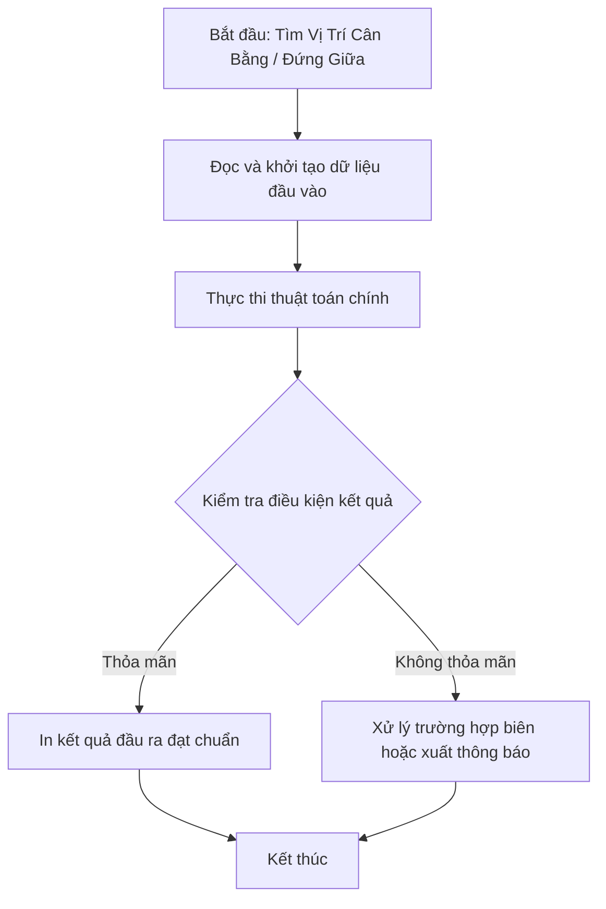

# Tìm Vị Trí Cân Bằng / Đứng Giữa

## 1. Thông tin tệp mã nguồn
- [`vitridunggiua.cpp`](./vitridunggiua.cpp)
- **Thư mục chuyên đề**: `DSA/02_Mang_va_Mang_Cong_Don/vitridunggiua/`
- **Ngôn ngữ**: C/C++ (Chuẩn C++11 trở lên)

## 2. Mục tiêu & Tóm tắt bài toán
Tìm chỉ số sao cho tổng các phần tử bên trái bằng bên phải.

---

## 3. Ý tưởng & Phương pháp giải thuật
### Phương án tiếp cận:
Tính tổng mảng và duyệt so sánh tổng tiền tố.

### Các bước thực hiện chi tiết:
1. Khởi tạo dữ liệu và đọc đầu vào theo định dạng bài toán.
2. Thực hiện thuật toán cốt lõi: Tính tổng mảng và duyệt so sánh tổng tiền tố.
3. Cập nhật trạng thái và tính toán kết quả.
4. Xuất kết quả đầu ra màn hình.

---

## 4. Sơ đồ thuật toán (Mermaid Workflow)


---

## 5. Đánh giá độ phức tạp
- **Độ phức tạp thời gian (Time Complexity)**: `O(N)`
- **Độ phức tạp không gian (Space Complexity)**: `O(1)`

---

## 6. Input / Output mẫu & Giải thích

### Input mẫu:
```text
5
1 3 5 2 2
```

### Output mẫu:
```text
Vi tri dung giua cua xau s:5
```

### Giải thích:
Vị trí 2 có tổng trái (1+3)=4, tổng phải (2+2)=4.

## 7. Hướng dẫn biên dịch & chạy thử
```bash
# Di chuyển vào thư mục bài toán
cd "DSA/02_Mang_va_Mang_Cong_Don/vitridunggiua"

# Biên dịch chương trình C++
g++ -std=c++11 -O2 "vitridunggiua.cpp" -o "vitridunggiua"

# Chạy chương trình
./"vitridunggiua"
```

> [!NOTE]
> Toàn bộ mã nguồn C++ gốc được bảo toàn nguyên vẹn 100% không qua chỉnh sửa.
