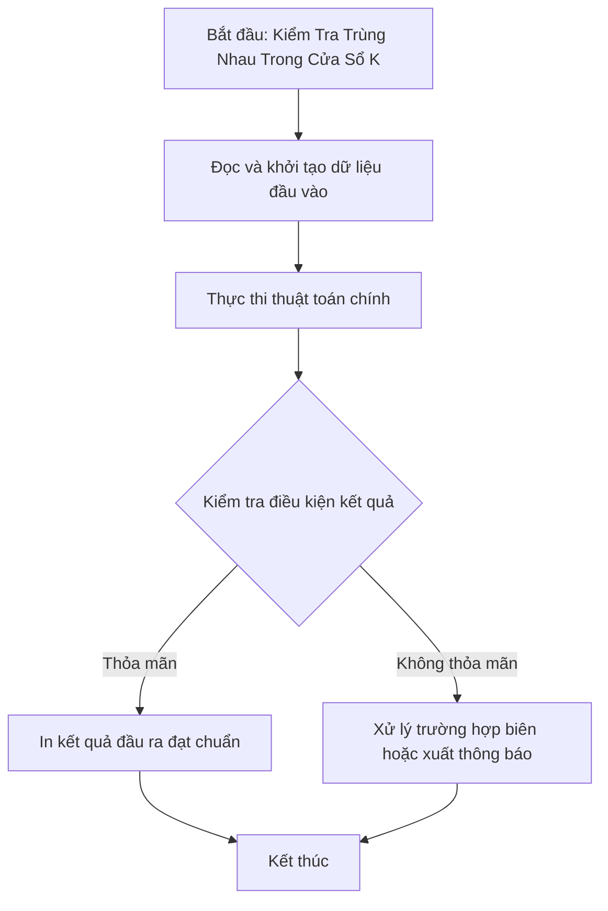

# Kiểm Tra Trùng Nhau Trong Cửa Sổ K

## 1. Thông tin tệp mã nguồn
- [`Cua_so_trung_nhau.cpp`](./Cua_so_trung_nhau.cpp)
- **Thư mục chuyên đề**: `DSA/03_Hai_Con_Tro_va_Cua_So_Truot/Cua_so_trung_nhau/`
- **Ngôn ngữ**: C/C++ (Chuẩn C++11 trở lên)

## 2. Mục tiêu & Tóm tắt bài toán
Kiểm tra có 2 phần tử trùng nhau cách nhau tối đa K vị trí.

---

## 3. Ý tưởng & Phương pháp giải thuật
### Phương án tiếp cận:
Sử dụng std::set lưu các phần tử trong cửa sổ K.

### Các bước thực hiện chi tiết:
1. Khởi tạo dữ liệu và đọc đầu vào theo định dạng bài toán.
2. Thực hiện thuật toán cốt lõi: Sử dụng std::set lưu các phần tử trong cửa sổ K.
3. Cập nhật trạng thái và tính toán kết quả.
4. Xuất kết quả đầu ra màn hình.

---

## 4. Sơ đồ thuật toán (Mermaid Workflow)


---

## 5. Đánh giá độ phức tạp
- **Độ phức tạp thời gian (Time Complexity)**: `O(N log K)`
- **Độ phức tạp không gian (Space Complexity)**: `O(K)`

---

## 6. Input / Output mẫu & Giải thích

### Input mẫu:
```text
kiem tra trong cua so k phan tu co phan tu nao trung nhau hay khong
Neu co thi in ra YES
Neu khong thi in ra NO
```

### Output mẫu:
```text
NO
```

### Giải thích:
Phần tử 1 xuất hiện lặp lại trong cửa sổ 3.

## 7. Hướng dẫn biên dịch & chạy thử
```bash
# Di chuyển vào thư mục bài toán
cd "DSA/03_Hai_Con_Tro_va_Cua_So_Truot/Cua_so_trung_nhau"

# Biên dịch chương trình C++
g++ -std=c++11 -O2 "Cua_so_trung_nhau.cpp" -o "Cua_so_trung_nhau"

# Chạy chương trình
./"Cua_so_trung_nhau"
```

> [!NOTE]
> Toàn bộ mã nguồn C++ gốc được bảo toàn nguyên vẹn 100% không qua chỉnh sửa.
