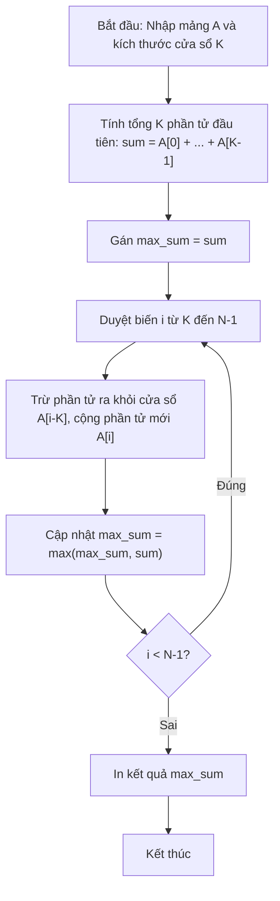

# Kỹ Thuật Cửa Sổ Trượt (Sliding Window)

## 1. Thông tin tệp mã nguồn
- [`Cua_so_truot.cpp`](./Cua_so_truot.cpp)
- **Thư mục chuyên đề**: `DSA/03_Hai_Con_Tro_va_Cua_So_Truot/Cua_so_truot/`
- **Ngôn ngữ**: C/C++ (Chuẩn C++11 trở lên)

## 2. Mục tiêu & Tóm tắt bài toán
Tìm dãy con liên tiếp độ dài K có tổng lớn nhất.

---

## 3. Ý tưởng & Phương pháp giải thuật
### Phương án tiếp cận:
Dịch cửa sổ K phần tử: trừ phần tử ra, cộng phần tử vào.

### Các bước thực hiện chi tiết:
1. Khởi tạo dữ liệu và đọc đầu vào theo định dạng bài toán.
2. Thực hiện thuật toán cốt lõi: Dịch cửa sổ K phần tử: trừ phần tử ra, cộng phần tử vào.
3. Cập nhật trạng thái và tính toán kết quả.
4. Xuất kết quả đầu ra màn hình.

---

## 4. Sơ đồ thuật toán (Mermaid Workflow)


---

## 5. Đánh giá độ phức tạp
- **Độ phức tạp thời gian (Time Complexity)**: `O(N)`
- **Độ phức tạp không gian (Space Complexity)**: `O(1)`

---

## 6. Input / Output mẫu & Giải thích

### Input mẫu:
```text
6 3
1 3 6 1 8 3
```

### Output mẫu:
```text
6
6 
1837438722
1 1837438720 1 
1837438722
1 1837438720 1 
1837438722
1 1837438720 1 
1837438722
1 1837438720 1 
1837438722
1 1837438720 1
```

### Giải thích:
Cửa sổ [6, 1, 8] có tổng 15 lớn nhất.

## 7. Hướng dẫn biên dịch & chạy thử
```bash
# Di chuyển vào thư mục bài toán
cd "DSA/03_Hai_Con_Tro_va_Cua_So_Truot/Cua_so_truot"

# Biên dịch chương trình C++
g++ -std=c++11 -O2 "Cua_so_truot.cpp" -o "Cua_so_truot"

# Chạy chương trình
./"Cua_so_truot"
```

> [!NOTE]
> Toàn bộ mã nguồn C++ gốc được bảo toàn nguyên vẹn 100% không qua chỉnh sửa.
