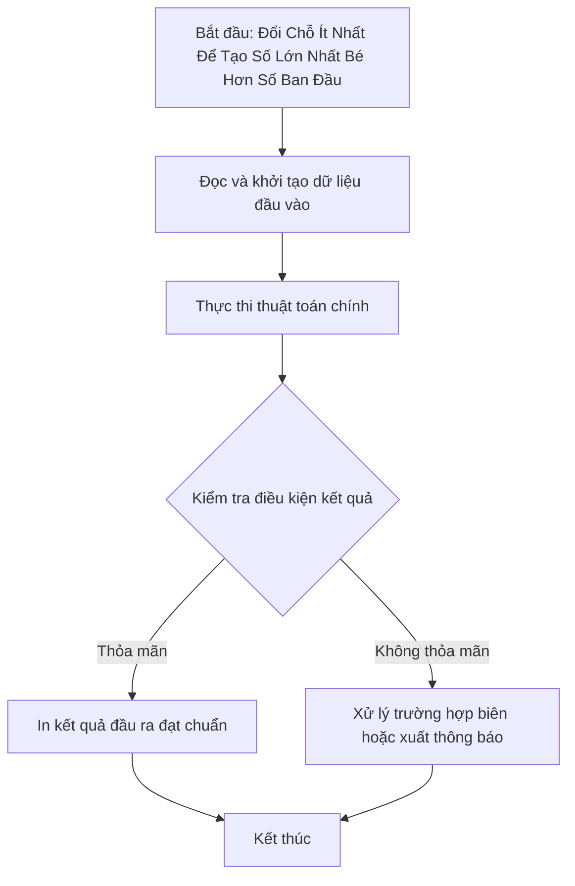

# Đổi Chỗ Ít Nhất Để Tạo Số Lớn Nhất Bé Hơn Số Ban Đầu

## 1. Thông tin tệp mã nguồn
- [`Doi_cho_it_nhat.cpp`](./Doi_cho_it_nhat.cpp)
- **Thư mục chuyên đề**: `DSA/03_Hai_Con_Tro_va_Cua_So_Truot/Doi_cho_it_nhat/`
- **Ngôn ngữ**: C/C++ (Chuẩn C++11 trở lên)

## 2. Mục tiêu & Tóm tắt bài toán
Đổi chỗ nhiều nhất 1 lần để số mới lớn nhất nhưng bé hơn số cũ.

---

## 3. Ý tưởng & Phương pháp giải thuật
### Phương án tiếp cận:
Tìm vị trí giảm dần đầu tiên từ phải sang và hoán vị chữ số tối ưu.

### Các bước thực hiện chi tiết:
1. Khởi tạo dữ liệu và đọc đầu vào theo định dạng bài toán.
2. Thực hiện thuật toán cốt lõi: Tìm vị trí giảm dần đầu tiên từ phải sang và hoán vị chữ số tối ưu.
3. Cập nhật trạng thái và tính toán kết quả.
4. Xuất kết quả đầu ra màn hình.

---

## 4. Sơ đồ thuật toán (Mermaid Workflow)


---

## 5. Đánh giá độ phức tạp
- **Độ phức tạp thời gian (Time Complexity)**: `O(L)`
- **Độ phức tạp không gian (Space Complexity)**: `O(1)`

---

## 6. Input / Output mẫu & Giải thích

### Input mẫu:
```text
1243
```

### Output mẫu:
```text
1234
```

### Giải thích:
Hoán vị 1 lần tạo số lớn nhất bé hơn ban đầu.

---

## 7. Hướng dẫn biên dịch & chạy thử
```bash
# Di chuyển vào thư mục bài toán
cd "DSA/03_Hai_Con_Tro_va_Cua_So_Truot/Doi_cho_it_nhat"

# Biên dịch chương trình C++
g++ -std=c++11 -O2 "Doi_cho_it_nhat.cpp" -o "Doi_cho_it_nhat"

# Chạy chương trình
./"Doi_cho_it_nhat"
```

> [!NOTE]
> Toàn bộ mã nguồn C++ gốc được bảo toàn nguyên vẹn 100% không qua chỉnh sửa.
