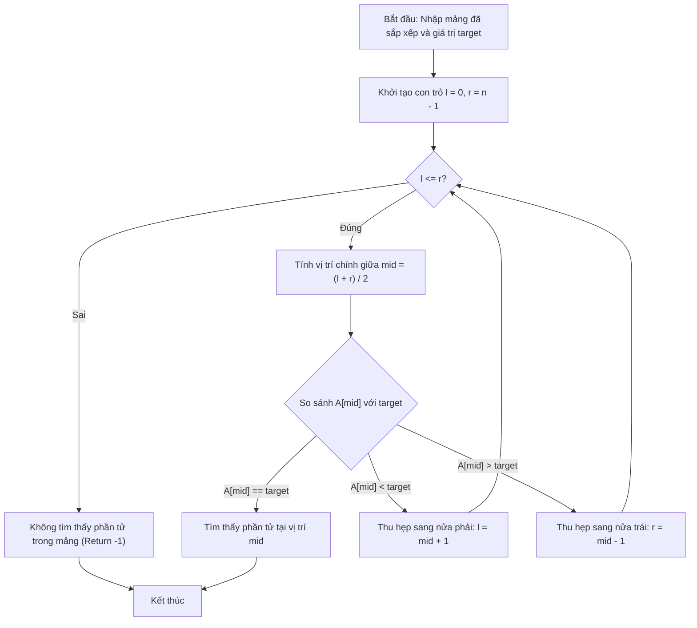

# Tìm Kiếm Nhị Phân (Binary Search)

## 1. Thông tin tệp mã nguồn
- [`Binary_search(tim kiem nhi phan).cpp`](./Binary_search(tim kiem nhi phan).cpp)
- **Thư mục chuyên đề**: `DSA/04_Sap_Xep_va_Tim_Kiem/Binary_search(tim kiem nhi phan)/`
- **Ngôn ngữ**: C/C++ (Chuẩn C++11 trở lên)

## 2. Mục tiêu & Tóm tắt bài toán
Tìm kiếm giá trị X trong mảng đã sắp xếp trong O(log N).

---

## 3. Ý tưởng & Phương pháp giải thuật
### Phương án tiếp cận:
Thu hẹp nửa khoảng tìm kiếm sau mỗi phép so sánh với trung điểm.

### Các bước thực hiện chi tiết:
1. Khởi tạo dữ liệu và đọc đầu vào theo định dạng bài toán.
2. Thực hiện thuật toán cốt lõi: Thu hẹp nửa khoảng tìm kiếm sau mỗi phép so sánh với trung điểm.
3. Cập nhật trạng thái và tính toán kết quả.
4. Xuất kết quả đầu ra màn hình.

---

## 4. Sơ đồ thuật toán (Mermaid Workflow)


---

## 5. Đánh giá độ phức tạp
- **Độ phức tạp thời gian (Time Complexity)**: `O(log N)`
- **Độ phức tạp không gian (Space Complexity)**: `O(1)`

---

## 6. Input / Output mẫu & Giải thích

### Input mẫu:
```text
5 7
1 3 5 7 9
```

### Output mẫu:
```text
Nhap so can tim kiem:
Phan tu 5 nam o a[5]
```

### Giải thích:
Tìm kiếm nhị phân.

## 7. Hướng dẫn biên dịch & chạy thử
```bash
# Di chuyển vào thư mục bài toán
cd "DSA/04_Sap_Xep_va_Tim_Kiem/Binary_search(tim kiem nhi phan)"

# Biên dịch chương trình C++
g++ -std=c++11 -O2 "Binary_search(tim kiem nhi phan).cpp" -o "Binary_search(tim kiem nhi phan)"

# Chạy chương trình
./"Binary_search(tim kiem nhi phan)"
```

> [!NOTE]
> Toàn bộ mã nguồn C++ gốc được bảo toàn nguyên vẹn 100% không qua chỉnh sửa.
