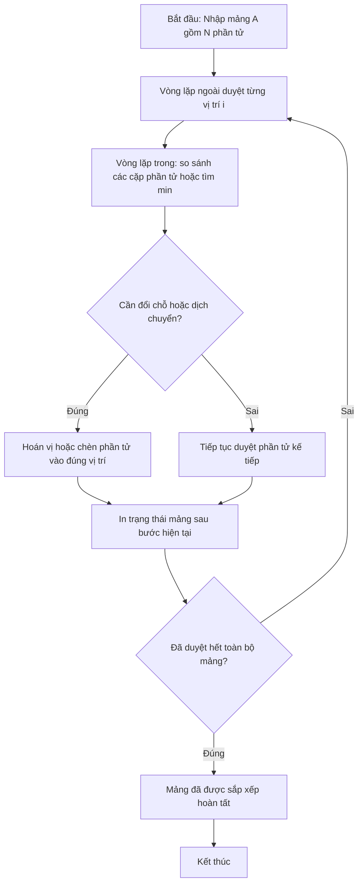

# In Các Bước Sắp Xếp Đổi Chỗ Trực Tiếp

## 1. Thông tin tệp mã nguồn
- [`Incacbucssdoichotructiep.cpp`](./Incacbucssdoichotructiep.cpp)
- **Thư mục chuyên đề**: `DSA/04_Sap_Xep_va_Tim_Kiem/Incacbucssdoichotructiep/`
- **Ngôn ngữ**: C/C++ (Chuẩn C++11 trở lên)

## 2. Mục tiêu & Tóm tắt bài toán
Mô phỏng sắp xếp đổi chỗ trực tiếp và in mảng sau mỗi bước.

---

## 3. Ý tưởng & Phương pháp giải thuật
### Phương án tiếp cận:
Hoán vị ngay khi a[j] < a[i].

### Các bước thực hiện chi tiết:
1. Khởi tạo dữ liệu và đọc đầu vào theo định dạng bài toán.
2. Thực hiện thuật toán cốt lõi: Hoán vị ngay khi a[j] < a[i].
3. Cập nhật trạng thái và tính toán kết quả.
4. Xuất kết quả đầu ra màn hình.

---

## 4. Sơ đồ thuật toán (Mermaid Workflow)


---

## 5. Đánh giá độ phức tạp
- **Độ phức tạp thời gian (Time Complexity)**: `O(N^2)`
- **Độ phức tạp không gian (Space Complexity)**: `O(1)`

---

## 6. Input / Output mẫu & Giải thích

### Input mẫu:
```text
4
5 7 3 2
```

### Output mẫu:
```text
Nhap so luong:Buoc 1:2 7 5 3 
Buoc 2:2 3 7 5 
Buoc 3:2 3 5 7
```

### Giải thích:
Mô phỏng đổi chỗ trực tiếp.

## 7. Hướng dẫn biên dịch & chạy thử
```bash
# Di chuyển vào thư mục bài toán
cd "DSA/04_Sap_Xep_va_Tim_Kiem/Incacbucssdoichotructiep"

# Biên dịch chương trình C++
g++ -std=c++11 -O2 "Incacbucssdoichotructiep.cpp" -o "Incacbucssdoichotructiep"

# Chạy chương trình
./"Incacbucssdoichotructiep"
```

> [!NOTE]
> Toàn bộ mã nguồn C++ gốc được bảo toàn nguyên vẹn 100% không qua chỉnh sửa.
