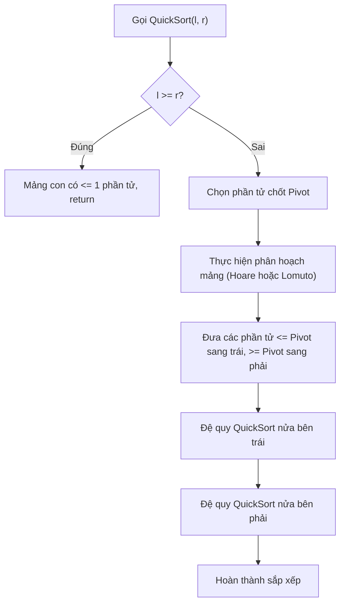

# Sắp Xếp Nhanh (Quick Sort)

## 1. Thông tin tệp mã nguồn
- [`Quicksort.cpp`](./Quicksort.cpp)
- **Thư mục chuyên đề**: `DSA/04_Sap_Xep_va_Tim_Kiem/Quicksort/`
- **Ngôn ngữ**: C/C++ (Chuẩn C++11 trở lên)

## 2. Mục tiêu & Tóm tắt bài toán
Sắp xếp mảng số nguyên ngẫu nhiên bằng thuật toán Quick Sort (phân hoạch Lomuto).

---

## 3. Ý tưởng & Phương pháp giải thuật
### Phương án tiếp cận:
Nhập số lượng phần tử N, chương trình tự động sinh mảng N số ngẫu nhiên bằng rand()%100 và thực hiện sắp xếp nhanh.

### Các bước thực hiện chi tiết:
1. Khởi tạo dữ liệu và đọc đầu vào theo định dạng bài toán.
2. Thực hiện thuật toán cốt lõi: Phân hoạch chia mảng theo phần tử chốt.
3. Cập nhật trạng thái và tính toán kết quả.
4. Xuất kết quả đầu ra màn hình.

---

## 4. Sơ đồ thuật toán (Mermaid Workflow)


---

## 5. Đánh giá độ phức tạp
- **Độ phức tạp thời gian (Time Complexity)**: `O(N log N)`
- **Độ phức tạp không gian (Space Complexity)**: `O(log N)`

---

## 6. Input / Output mẫu & Giải thích

### Input mẫu:
```text
5
```

### Output mẫu:
```text
7 30 49 58 73
```

### Giải thích:
Chương trình nhận vào số lượng phần tử n=5, tự sinh mảng 5 số ngẫu nhiên rồi áp dụng phân hoạch Lomuto để sắp xếp tăng dần.

## 7. Hướng dẫn biên dịch & chạy thử
```bash
# Di chuyển vào thư mục bài toán
cd "DSA/04_Sap_Xep_va_Tim_Kiem/Quicksort"

# Biên dịch chương trình C++
g++ -std=c++11 -O2 "Quicksort.cpp" -o "Quicksort"

# Chạy chương trình
./"Quicksort"
```

> [!NOTE]
> Toàn bộ mã nguồn C++ gốc được bảo toàn nguyên vẹn 100% không qua chỉnh sửa.
