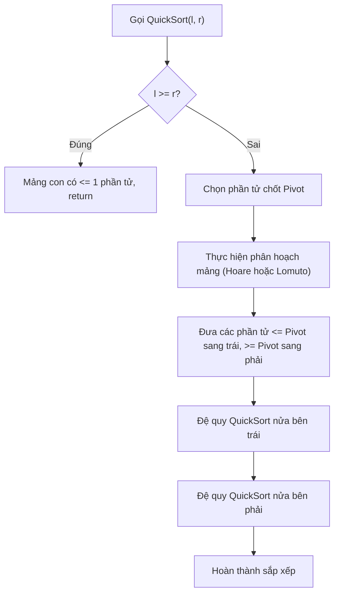

# Quick Sort Phân Hoạch Lomuto

## 1. Thông tin tệp mã nguồn
- [`Quicksort_Lomuto.cpp`](./Quicksort_Lomuto.cpp)
- **Thư mục chuyên đề**: `DSA/04_Sap_Xep_va_Tim_Kiem/Quicksort_Lomuto/`
- **Ngôn ngữ**: C/C++ (Chuẩn C++11 trở lên)

## 2. Mục tiêu & Tóm tắt bài toán
Sắp xếp mảng số nguyên ngẫu nhiên bằng Quick Sort với kỹ thuật phân hoạch Lomuto.

---

## 3. Ý tưởng & Phương pháp giải thuật
### Phương án tiếp cận:
Phân hoạch Lomuto chọn phần tử chốt (pivot) ở cuối mảng, chia mảng thành hai nửa và đệ quy sắp xếp.

### Các bước thực hiện chi tiết:
1. Khởi tạo dữ liệu và đọc đầu vào theo định dạng bài toán.
2. Thực hiện thuật toán cốt lõi: Con trỏ i theo dõi ranh giới phần tử nhỏ hơn pivot.
3. Cập nhật trạng thái và tính toán kết quả.
4. Xuất kết quả đầu ra màn hình.

---

## 4. Sơ đồ thuật toán (Mermaid Workflow)


---

## 5. Đánh giá độ phức tạp
- **Độ phức tạp thời gian (Time Complexity)**: `O(N log N)`
- **Độ phức tạp không gian (Space Complexity)**: `O(log N)`

---

## 6. Input / Output mẫu & Giải thích

### Input mẫu:
```text
5
```

### Output mẫu:
```text
7 30 49 58 73
```

### Giải thích:
Nhập n=5 phần tử ngẫu nhiên, kết quả sau khi phân hoạch Lomuto và đệ quy là dãy số tăng dần.

## 7. Hướng dẫn biên dịch & chạy thử
```bash
# Di chuyển vào thư mục bài toán
cd "DSA/04_Sap_Xep_va_Tim_Kiem/Quicksort_Lomuto"

# Biên dịch chương trình C++
g++ -std=c++11 -O2 "Quicksort_Lomuto.cpp" -o "Quicksort_Lomuto"

# Chạy chương trình
./"Quicksort_Lomuto"
```

> [!NOTE]
> Toàn bộ mã nguồn C++ gốc được bảo toàn nguyên vẹn 100% không qua chỉnh sửa.
