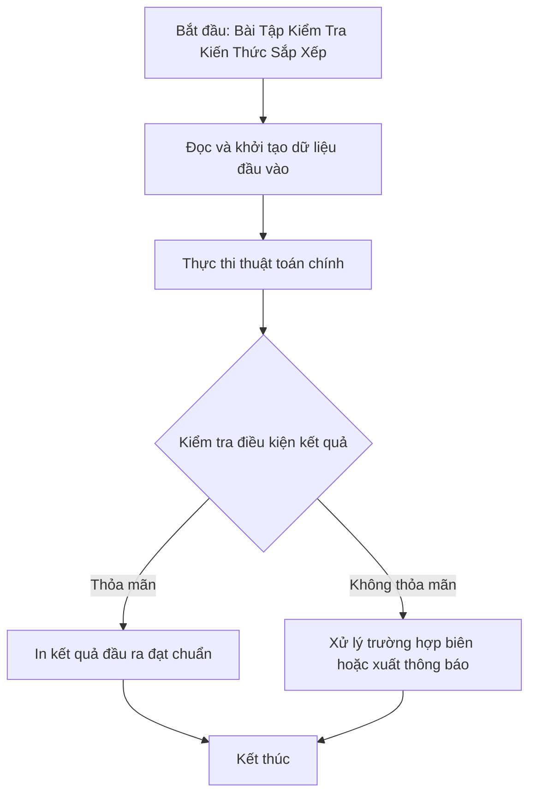

# Bài Tập Kiểm Tra Kiến Thức Sắp Xếp

## 1. Thông tin tệp mã nguồn
- [`Quiz.cpp`](./Quiz.cpp)
- **Thư mục chuyên đề**: `DSA/04_Sap_Xep_va_Tim_Kiem/Quiz/`
- **Ngôn ngữ**: C/C++ (Chuẩn C++11 trở lên)

## 2. Mục tiêu & Tóm tắt bài toán
Kiểm thử thao tác trên std::set: tìm kiếm, lùi iterator và xóa phần tử.

---

## 3. Ý tưởng & Phương pháp giải thuật
### Phương án tiếp cận:
Sử dụng std::set để lưu trữ các phần tử duy nhất theo thứ tự tăng dần, dùng iterator để xác định vị trí và xóa phần tử mong muốn.

### Các bước thực hiện chi tiết:
1. Khởi tạo dữ liệu và đọc đầu vào theo định dạng bài toán.
2. Thực hiện thuật toán cốt lõi: Kiểm thử so sánh mảng.
3. Cập nhật trạng thái và tính toán kết quả.
4. Xuất kết quả đầu ra màn hình.

---

## 4. Sơ đồ thuật toán (Mermaid Workflow)


---

## 5. Đánh giá độ phức tạp
- **Độ phức tạp thời gian (Time Complexity)**: `O(N log N)`
- **Độ phức tạp không gian (Space Complexity)**: `O(N)`

---

## 6. Input / Output mẫu & Giải thích

### Input mẫu:
```text
Dữ liệu khởi tạo trong mã nguồn:
a[7] = {5, 5, 1, 2, 3, 4, 1}
```

### Output mẫu:
```text
1 3 4 5
```

### Giải thích:
Mảng ban đầu {5, 5, 1, 2, 3, 4, 1} được nạp vào set thành tập hợp có thứ tự {1, 2, 3, 4, 5}. Tìm vị trí số 3 (se.find(3)), sau đó lùi iterator (--it) trỏ tới số 2 và gọi se.erase(it) để xóa số 2. Kết quả còn lại trong set là 1, 3, 4, 5.

## 7. Hướng dẫn biên dịch & chạy thử
```bash
# Di chuyển vào thư mục bài toán
cd "DSA/04_Sap_Xep_va_Tim_Kiem/Quiz"

# Biên dịch chương trình C++
g++ -std=c++11 -O2 "Quiz.cpp" -o "Quiz"

# Chạy chương trình
./"Quiz"
```

> [!NOTE]
> Toàn bộ mã nguồn C++ gốc được bảo toàn nguyên vẹn 100% không qua chỉnh sửa.
