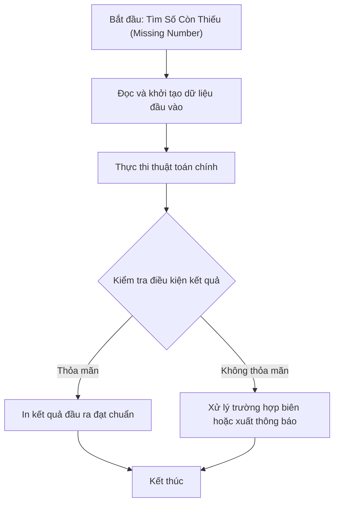

# Tìm Số Còn Thiếu (Missing Number)

## 1. Thông tin tệp mã nguồn
- [`Thieu_so.cpp`](./Thieu_so.cpp)
- **Thư mục chuyên đề**: `DSA/04_Sap_Xep_va_Tim_Kiem/Thieu_so/`
- **Ngôn ngữ**: C/C++ (Chuẩn C++11 trở lên)

## 2. Mục tiêu & Tóm tắt bài toán
Tìm số duy nhất bị thiếu trong dãy từ 0 đến N.

---

## 3. Ý tưởng & Phương pháp giải thuật
### Phương án tiếp cận:
Tổng Gauss n*(n+1)/2 trừ tổng thực tế của mảng.

### Các bước thực hiện chi tiết:
1. Khởi tạo dữ liệu và đọc đầu vào theo định dạng bài toán.
2. Thực hiện thuật toán cốt lõi: Tổng Gauss n*(n+1)/2 trừ tổng thực tế của mảng.
3. Cập nhật trạng thái và tính toán kết quả.
4. Xuất kết quả đầu ra màn hình.

---

## 4. Sơ đồ thuật toán (Mermaid Workflow)


---

## 5. Đánh giá độ phức tạp
- **Độ phức tạp thời gian (Time Complexity)**: `O(N)`
- **Độ phức tạp không gian (Space Complexity)**: `O(1)`

---

## 6. Input / Output mẫu & Giải thích

### Input mẫu:
```text
3
3 0 1
```

### Output mẫu:
```text
2
```

### Giải thích:
Số còn thiếu là 2.

---

## 7. Hướng dẫn biên dịch & chạy thử
```bash
# Di chuyển vào thư mục bài toán
cd "DSA/04_Sap_Xep_va_Tim_Kiem/Thieu_so"

# Biên dịch chương trình C++
g++ -std=c++11 -O2 "Thieu_so.cpp" -o "Thieu_so"

# Chạy chương trình
./"Thieu_so"
```

> [!NOTE]
> Toàn bộ mã nguồn C++ gốc được bảo toàn nguyên vẹn 100% không qua chỉnh sửa.
