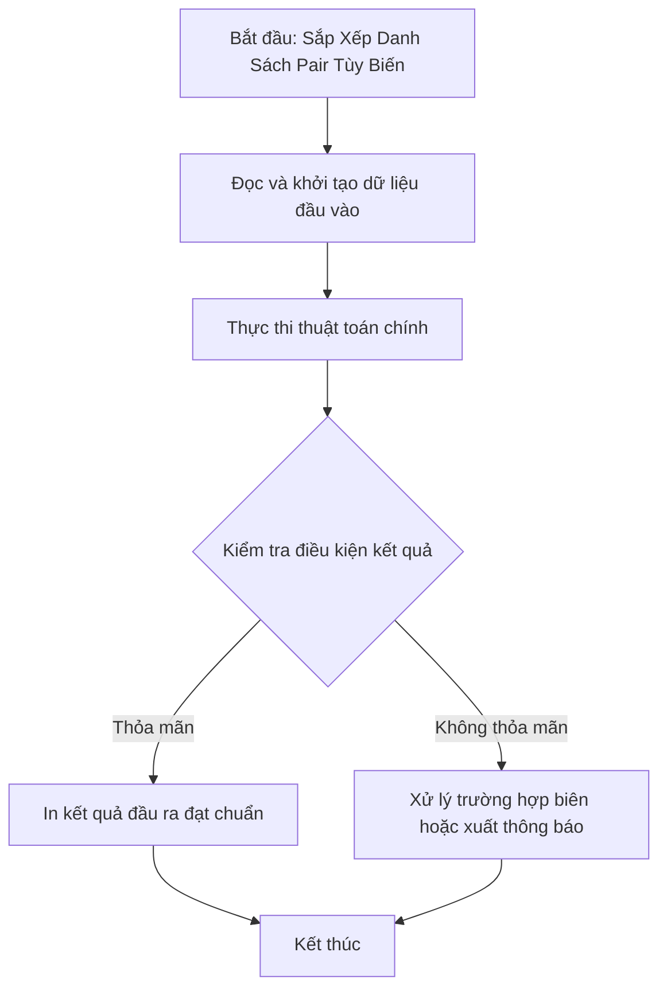

# Sắp Xếp Danh Sách Pair Tùy Biến

## 1. Thông tin tệp mã nguồn
- [`sort_pair.cpp`](./sort_pair.cpp)
- **Thư mục chuyên đề**: `DSA/04_Sap_Xep_va_Tim_Kiem/sort_pair/`
- **Ngôn ngữ**: C/C++ (Chuẩn C++11 trở lên)

## 2. Mục tiêu & Tóm tắt bài toán
Sắp xếp danh sách tọa độ điểm (pair) theo khoảng cách Euclid bình phương tới gốc tọa độ (0, 0).

---

## 3. Ý tưởng & Phương pháp giải thuật
### Phương án tiếp cận:
Sử dụng hàm so sánh tùy biến cmp tính x^2 + y^2 của từng điểm; điểm nào gần gốc tọa độ hơn sẽ đứng trước.

### Các bước thực hiện chi tiết:
1. Khởi tạo dữ liệu và đọc đầu vào theo định dạng bài toán.
2. Thực hiện thuật toán cốt lõi: Sử dụng hàm so sánh bool cmp.
3. Cập nhật trạng thái và tính toán kết quả.
4. Xuất kết quả đầu ra màn hình.

---

## 4. Sơ đồ thuật toán (Mermaid Workflow)


---

## 5. Đánh giá độ phức tạp
- **Độ phức tạp thời gian (Time Complexity)**: `O(N log N)`
- **Độ phức tạp không gian (Space Complexity)**: `O(N)`

---

## 6. Input / Output mẫu & Giải thích

### Input mẫu:
```text
3
1 5
2 3
1 2
```

### Output mẫu:
```text
Nhap so cap toa do:
1 2
2 3
1 5
```

### Giải thích:
Điểm (1,2) có d^2 = 1^2 + 2^2 = 5; (2,3) có d^2 = 4 + 9 = 13; (1,5) có d^2 = 1 + 25 = 26. Do đó thứ tự sau khi sắp xếp là (1,2), (2,3), (1,5).

## 7. Hướng dẫn biên dịch & chạy thử
```bash
# Di chuyển vào thư mục bài toán
cd "DSA/04_Sap_Xep_va_Tim_Kiem/sort_pair"

# Biên dịch chương trình C++
g++ -std=c++11 -O2 "sort_pair.cpp" -o "sort_pair"

# Chạy chương trình
./"sort_pair"
```

> [!NOTE]
> Toàn bộ mã nguồn C++ gốc được bảo toàn nguyên vẹn 100% không qua chỉnh sửa.
