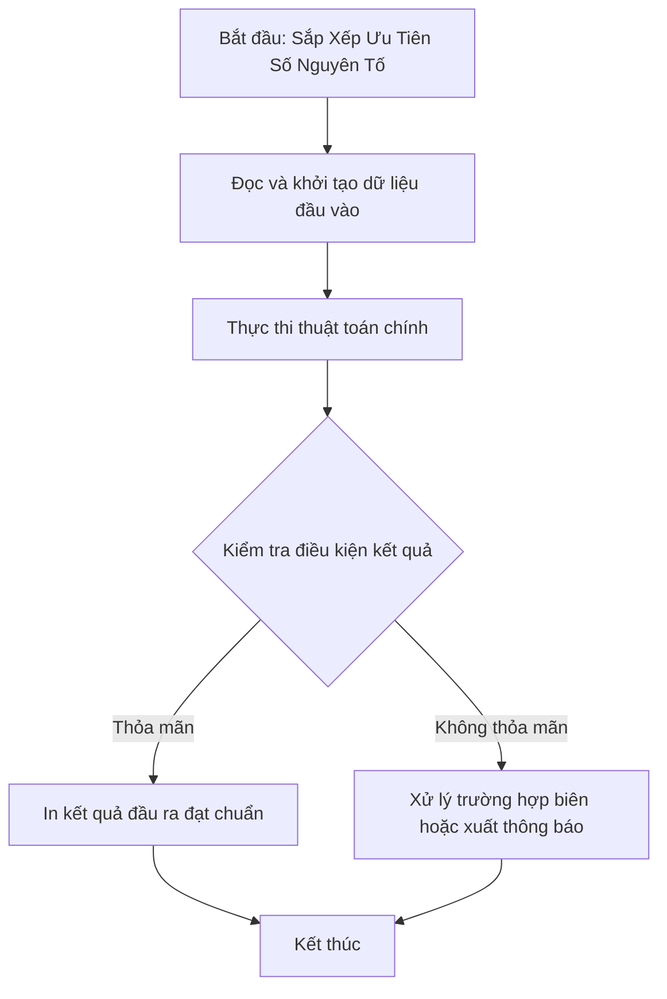

# Sắp Xếp Ưu Tiên Số Nguyên Tố

## 1. Thông tin tệp mã nguồn
- [`sssnt.cpp`](./sssnt.cpp)
- **Thư mục chuyên đề**: `DSA/04_Sap_Xep_va_Tim_Kiem/sssnt/`
- **Ngôn ngữ**: C/C++ (Chuẩn C++11 trở lên)

## 2. Mục tiêu & Tóm tắt bài toán
Sắp xếp các phần tử theo số lượng chữ số nguyên tố tăng dần.

---

## 3. Ý tưởng & Phương pháp giải thuật
### Phương án tiếp cận:
Đếm số lượng chữ số nguyên tố (2, 3, 5, 7) của từng số và dùng hàm so sánh trong stable_sort.

### Các bước thực hiện chi tiết:
1. Khởi tạo dữ liệu và đọc đầu vào theo định dạng bài toán.
2. Thực hiện thuật toán cốt lõi: Hàm comparator kết hợp hàm kiểm tra SNT.
3. Cập nhật trạng thái và tính toán kết quả.
4. Xuất kết quả đầu ra màn hình.

---

## 4. Sơ đồ thuật toán (Mermaid Workflow)


---

## 5. Đánh giá độ phức tạp
- **Độ phức tạp thời gian (Time Complexity)**: `O(N log N sqrt(M))`
- **Độ phức tạp không gian (Space Complexity)**: `O(N)`

---

## 6. Input / Output mẫu & Giải thích

### Input mẫu:
```text
Dữ liệu khởi tạo mảng trong mã nguồn:
{16501, 5898, 7388, 2663, 17330, 15803, 6865, 3695, 3495, 20918, 4244, 580, 29707, 5410, 11716, 4765, 12423}
```

### Output mẫu:
```text
mang sau khi sap xep la:
(Mô phỏng thứ tự sắp xếp theo số lượng chữ số nguyên tố tăng dần:
580 4244 5410 11716 16501 17330 20918 ...)
```

### Giải thích:
Lưu ý trong mã nguồn gốc: hàm le() có câu lệnh b/=10 nằm ngoài vòng lặp while(b>0), gây lặp vô hạn khi chạy thực tế. Về mặt giải thuật, hàm ktslsnt đếm số chữ số nguyên tố (2, 3, 5, 7) của từng số để sắp xếp tăng dần.

## 7. Hướng dẫn biên dịch & chạy thử
```bash
# Di chuyển vào thư mục bài toán
cd "DSA/04_Sap_Xep_va_Tim_Kiem/sssnt"

# Biên dịch chương trình C++
g++ -std=c++11 -O2 "sssnt.cpp" -o "sssnt"

# Chạy chương trình
./"sssnt"
```

> [!NOTE]
> Toàn bộ mã nguồn C++ gốc được bảo toàn nguyên vẹn 100% không qua chỉnh sửa.
