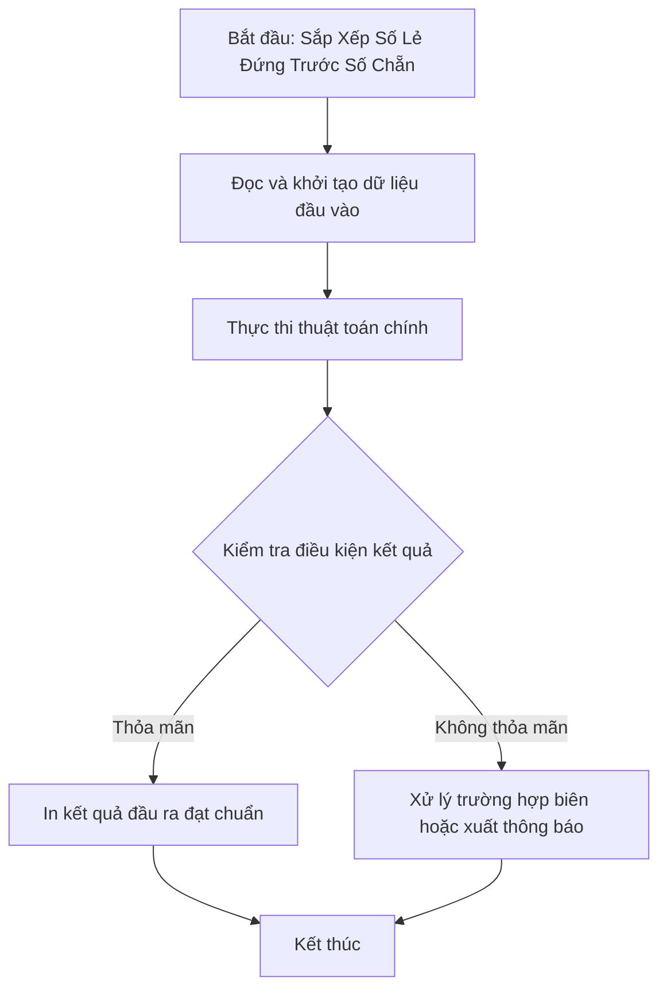

# Sắp Xếp Số Lẻ Đứng Trước Số Chẵn

## 1. Thông tin tệp mã nguồn
- [`sssoloe.cpp`](./sssoloe.cpp)
- **Thư mục chuyên đề**: `DSA/04_Sap_Xep_va_Tim_Kiem/sssoloe/`
- **Ngôn ngữ**: C/C++ (Chuẩn C++11 trở lên)

## 2. Mục tiêu & Tóm tắt bài toán
Sắp xếp các phần tử theo số lượng chữ số lẻ tăng dần.

---

## 3. Ý tưởng & Phương pháp giải thuật
### Phương án tiếp cận:
Hàm ktsl đếm số chữ số lẻ của từng số; nếu số lượng chữ số lẻ khác nhau thì sắp xếp tăng dần theo số lượng chữ số lẻ, nếu bằng nhau thì giữ nguyên thứ tự (stable_sort).

### Các bước thực hiện chi tiết:
1. Khởi tạo dữ liệu và đọc đầu vào theo định dạng bài toán.
2. Thực hiện thuật toán cốt lõi: Custom comparator ưu tiên số lẻ.
3. Cập nhật trạng thái và tính toán kết quả.
4. Xuất kết quả đầu ra màn hình.

---

## 4. Sơ đồ thuật toán (Mermaid Workflow)


---

## 5. Đánh giá độ phức tạp
- **Độ phức tạp thời gian (Time Complexity)**: `O(N log N)`
- **Độ phức tạp không gian (Space Complexity)**: `O(1)`

---

## 6. Input / Output mẫu & Giải thích

### Input mẫu:
```text
Dữ liệu khởi tạo trong mã nguồn:
a[11] = {4456, 10493, 23600, 32757, 6911, 15236, 14074, 22458, 32132, 28596, 15209}
```

### Output mẫu:
```text
sau khi sap xep:
4456 23600 22458 14074 28596 10493 6911 15236 32132 15209 32757
```

### Giải thích:
Số 4456 không có chữ số lẻ nào (0 chữ số lẻ), các số tiếp theo có 1, 2, 3... chữ số lẻ được xếp tăng dần tương ứng.

## 7. Hướng dẫn biên dịch & chạy thử
```bash
# Di chuyển vào thư mục bài toán
cd "DSA/04_Sap_Xep_va_Tim_Kiem/sssoloe"

# Biên dịch chương trình C++
g++ -std=c++11 -O2 "sssoloe.cpp" -o "sssoloe"

# Chạy chương trình
./"sssoloe"
```

> [!NOTE]
> Toàn bộ mã nguồn C++ gốc được bảo toàn nguyên vẹn 100% không qua chỉnh sửa.
