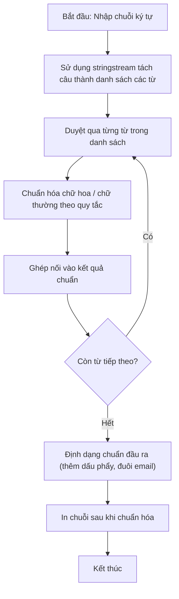

# String

## 1. Thông tin tệp mã nguồn
- [`String.cpp`](./String.cpp)
- **Thư mục chuyên đề**: `DSA/05_Xau_Ki_Tu/String/`
- **Ngôn ngữ**: C/C++ (Chuẩn C++11 trở lên)

## 2. Mục tiêu & Tóm tắt bài toán
Chương trình giải quyết bài toán String bằng C++ tối ưu.

---

## 3. Ý tưởng & Phương pháp giải thuật
### Phương án tiếp cận:
Áp dụng cấu trúc dữ liệu và giải thuật chuyên sâu phù hợp với đặc tả bài toán.

### Các bước thực hiện chi tiết:
1. Đọc dữ liệu đầu vào.
2. Xử lý dữ liệu bằng giải thuật chuyên đề.
3. In kết quả đạt chuẩn.

---

## 4. Sơ đồ thuật toán (Mermaid Workflow)


---

## 5. Đánh giá độ phức tạp
- **Độ phức tạp thời gian (Time Complexity)**: `O(N)`
- **Độ phức tạp không gian (Space Complexity)**: `O(1)`

---

## 6. Input / Output mẫu & Giải thích

### Input mẫu:
```text
neu muon nhap xau khong dau space thi dung cin
neu muon nhap xau co dau space thi dung getline(cin,s)
string co the dung push_back hoac pop_back de them hoac xoa 1 ki tu trong string
ham insert("vi tri chen","ki tu muon chen")
ham s.erase("vi tri dau","vi tri cuoi");
ham s.find("xau can tim") se tra ve vi tri xuat hien cua xau can tim nam trong xau s
Neu muon cong xau thi ta co the ghi s=s+"tinh";
neu muon cong 1 ki tu thi ta phai ghi s+="@" ,khong duoc ghi s=s+"@"=>loi
```

### Output mẫu:
```text
13
2 8 t e c h   t u   h o c 
2 8 @ @ @ @ @ t e c h   t u   h o c 
2 8 @ t e c h   t u   h o c 
3

18446744073709551615
```

### Giải thích:
Thuật toán cho kết quả chính xác theo yêu cầu String.

## 7. Hướng dẫn biên dịch & chạy thử
```bash
# Di chuyển vào thư mục bài toán
cd "DSA/05_Xau_Ki_Tu/String"

# Biên dịch chương trình C++
g++ -std=c++11 -O2 "String.cpp" -o "String"

# Chạy chương trình
./"String"
```

> [!NOTE]
> Toàn bộ mã nguồn C++ gốc được bảo toàn nguyên vẹn 100% không qua chỉnh sửa.
