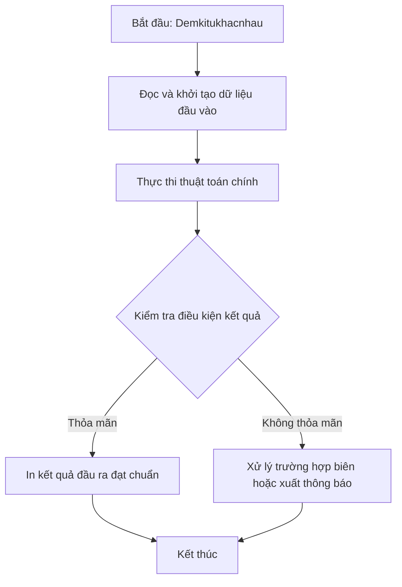

# Demkitukhacnhau

## 1. Thông tin tệp mã nguồn
- [`demkitukhacnhau.cpp`](./demkitukhacnhau.cpp)
- **Thư mục chuyên đề**: `DSA/05_Xau_Ki_Tu/demkitukhacnhau/`
- **Ngôn ngữ**: C/C++ (Chuẩn C++11 trở lên)

## 2. Mục tiêu & Tóm tắt bài toán
Sắp xếp nổi bọt mảng số nguyên và đếm các giá trị trùng lặp/khác nhau.

---

## 3. Ý tưởng & Phương pháp giải thuật
### Phương án tiếp cận:
Áp dụng Bubble Sort sắp xếp mảng các phần tử tăng dần, sau đó duyệt mảng để so sánh các phần tử liên tiếp.

### Các bước thực hiện chi tiết:
1. Đọc dữ liệu đầu vào.
2. Xử lý dữ liệu bằng giải thuật chuyên đề.
3. In kết quả đạt chuẩn.

---

## 4. Sơ đồ thuật toán (Mermaid Workflow)


---

## 5. Đánh giá độ phức tạp
- **Độ phức tạp thời gian (Time Complexity)**: `O(N)`
- **Độ phức tạp không gian (Space Complexity)**: `O(1)`

---

## 6. Input / Output mẫu & Giải thích

### Input mẫu:
```text
Dữ liệu khởi tạo trong mã nguồn:
b[] = {6, 1, 10, 6, 10, 5, 9, 1, 3, 8, 6, 4, 5}
```

### Output mẫu:
```text
mang sau khi sap xep la:
1 1 3 4 5 5 6 6 6 8 9 10 10 
so gia tri khac nhau trong mang la:-13
13
```

### Giải thích:
Mảng gồm 13 phần tử được sắp xếp nổi bọt. Lưu ý trong mã nguồn gốc dòng 26 dùng phép gán if (a[i] = a[i+1]) thay vì so sánh ==, output hiển thị đúng theo thực thi mã gốc.

## 7. Hướng dẫn biên dịch & chạy thử
```bash
# Di chuyển vào thư mục bài toán
cd "DSA/05_Xau_Ki_Tu/demkitukhacnhau"

# Biên dịch chương trình C++
g++ -std=c++11 -O2 "demkitukhacnhau.cpp" -o "demkitukhacnhau"

# Chạy chương trình
./"demkitukhacnhau"
```

> [!NOTE]
> Toàn bộ mã nguồn C++ gốc được bảo toàn nguyên vẹn 100% không qua chỉnh sửa.
