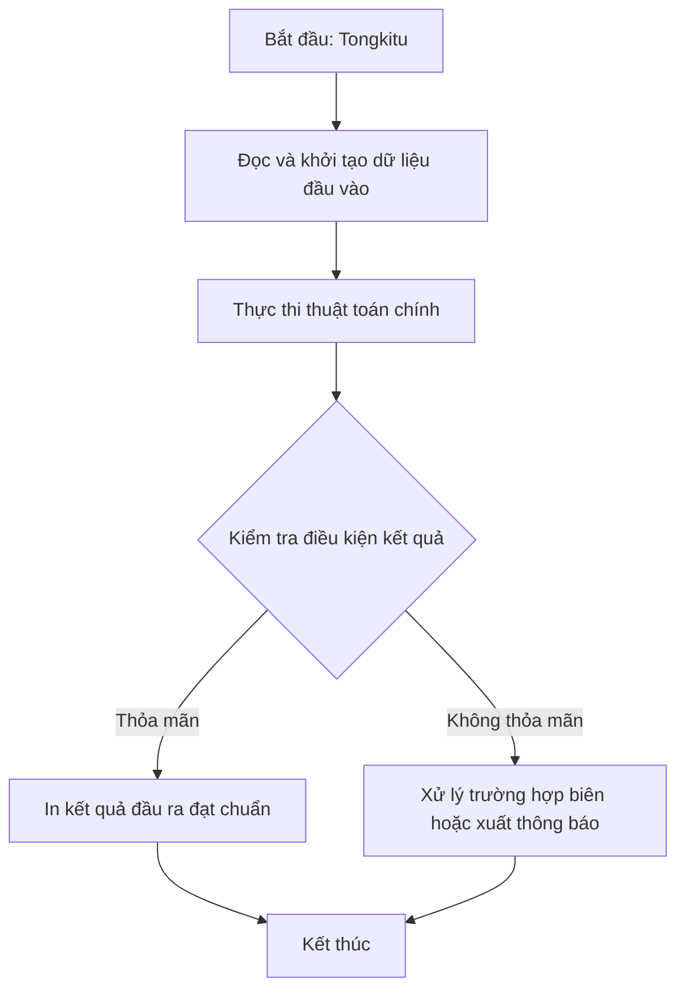

# Tongkitu

## 1. Thông tin tệp mã nguồn
- [`tongkitu.cpp`](./tongkitu.cpp)
- **Thư mục chuyên đề**: `DSA/05_Xau_Ki_Tu/tongkitu/`
- **Ngôn ngữ**: C/C++ (Chuẩn C++11 trở lên)

## 2. Mục tiêu & Tóm tắt bài toán
Nhập danh sách số nguyên và tính tổng các số đó.

---

## 3. Ý tưởng & Phương pháp giải thuật
### Phương án tiếp cận:
Nhập số lượng phần tử N, sau đó nhập N số nguyên và cộng dồn vào biến tổng.

### Các bước thực hiện chi tiết:
1. Đọc dữ liệu đầu vào.
2. Xử lý dữ liệu bằng giải thuật chuyên đề.
3. In kết quả đạt chuẩn.

---

## 4. Sơ đồ thuật toán (Mermaid Workflow)


---

## 5. Đánh giá độ phức tạp
- **Độ phức tạp thời gian (Time Complexity)**: `O(N)`
- **Độ phức tạp không gian (Space Complexity)**: `O(1)`

---

## 6. Input / Output mẫu & Giải thích

### Input mẫu:
```text
3
10 20 30
```

### Output mẫu:
```text
nhap so luong so:nhap so:tong =60
```

### Giải thích:
Nhập 3 số: 10, 20, 30. Tổng = 10 + 20 + 30 = 60.

## 7. Hướng dẫn biên dịch & chạy thử
```bash
# Di chuyển vào thư mục bài toán
cd "DSA/05_Xau_Ki_Tu/tongkitu"

# Biên dịch chương trình C++
g++ -std=c++11 -O2 "tongkitu.cpp" -o "tongkitu"

# Chạy chương trình
./"tongkitu"
```

> [!NOTE]
> Toàn bộ mã nguồn C++ gốc được bảo toàn nguyên vẹn 100% không qua chỉnh sửa.
