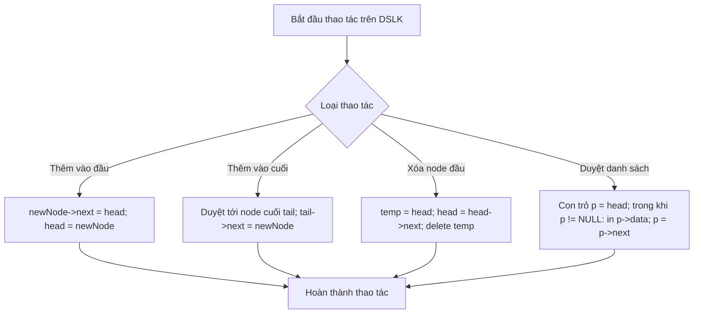

# Cài Đặt Ngăn Xếp Bằng DSLK & Mảng

## 1. Thông tin tệp mã nguồn
- [`Cai_ngan_xep_bang_DSLK&&Mang.cpp`](./Cai_ngan_xep_bang_DSLK&&Mang.cpp)
- **Thư mục chuyên đề**: `DSA/06_Danh_Sach_Lien_Ket/Cai_ngan_xep_bang_DSLK&&Mang/`
- **Ngôn ngữ**: C/C++ (Chuẩn C++11 trở lên)

## 2. Mục tiêu & Tóm tắt bài toán
Xây dựng cấu trúc dữ liệu Stack bằng danh sách liên kết đơn và bằng mảng.

---

## 3. Ý tưởng & Phương pháp giải thuật
### Phương án tiếp cận:
Thao tác push/pop tại đỉnh stack trong O(1).

### Các bước thực hiện chi tiết:
1. Khởi tạo dữ liệu và đọc đầu vào theo định dạng bài toán.
2. Thực hiện thuật toán cốt lõi: Thao tác push/pop tại đỉnh stack trong O(1).
3. Cập nhật trạng thái và tính toán kết quả.
4. Xuất kết quả đầu ra màn hình.

---

## 4. Sơ đồ thuật toán (Mermaid Workflow)


---

## 5. Đánh giá độ phức tạp
- **Độ phức tạp thời gian (Time Complexity)**: `O(1) mỗi thao tác`
- **Độ phức tạp không gian (Space Complexity)**: `O(N)`

---

## 6. Input / Output mẫu & Giải thích

### Input mẫu:
```text
push 10
push 20
pop
```

### Output mẫu:
```text
20
```

### Giải thích:
Cài đặt Stack bằng DSLK.

---

## 7. Hướng dẫn biên dịch & chạy thử
```bash
# Di chuyển vào thư mục bài toán
cd "DSA/06_Danh_Sach_Lien_Ket/Cai_ngan_xep_bang_DSLK&&Mang"

# Biên dịch chương trình C++
g++ -std=c++11 -O2 "Cai_ngan_xep_bang_DSLK&&Mang.cpp" -o "Cai_ngan_xep_bang_DSLK&&Mang"

# Chạy chương trình
./"Cai_ngan_xep_bang_DSLK&&Mang"
```

> [!NOTE]
> Toàn bộ mã nguồn C++ gốc được bảo toàn nguyên vẹn 100% không qua chỉnh sửa.
