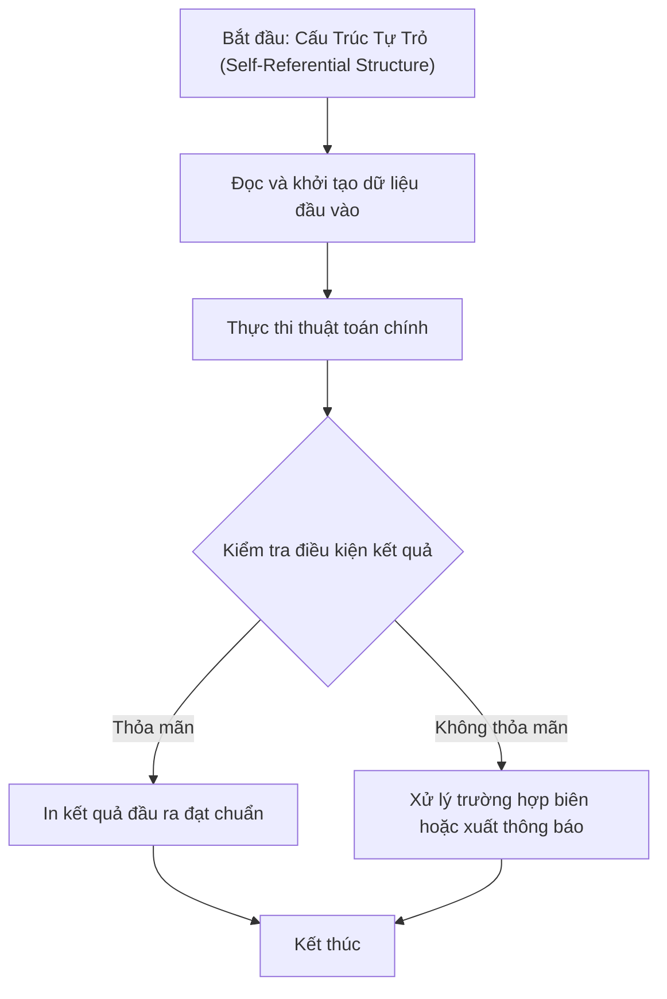

# Cấu Trúc Tự Trỏ (Self-Referential Structure)

## 1. Thông tin tệp mã nguồn
- [`Cau_truc_tu_tro.cpp`](./Cau_truc_tu_tro.cpp)
- **Thư mục chuyên đề**: `DSA/06_Danh_Sach_Lien_Ket/Cau_truc_tu_tro/`
- **Ngôn ngữ**: C/C++ (Chuẩn C++11 trở lên)

## 2. Mục tiêu & Tóm tắt bài toán
Minh họa cấu trúc struct node chứa con trỏ trỏ tới chính kiểu struct đó.

---

## 3. Ý tưởng & Phương pháp giải thuật
### Phương án tiếp cận:
Nền tảng xây dựng danh sách liên kết và cây.

### Các bước thực hiện chi tiết:
1. Khởi tạo dữ liệu và đọc đầu vào theo định dạng bài toán.
2. Thực hiện thuật toán cốt lõi: Nền tảng xây dựng danh sách liên kết và cây.
3. Cập nhật trạng thái và tính toán kết quả.
4. Xuất kết quả đầu ra màn hình.

---

## 4. Sơ đồ thuật toán (Mermaid Workflow)


---

## 5. Đánh giá độ phức tạp
- **Độ phức tạp thời gian (Time Complexity)**: `O(1)`
- **Độ phức tạp không gian (Space Complexity)**: `O(1)`

---

## 6. Input / Output mẫu & Giải thích

### Input mẫu:
```text
SinhVien sv = {"Nguyen Van A", "23T1", 3.8};
node *head = makeNode(sv);
```

### Output mẫu:
```text
Node khoi tao thanh cong voi sv.name = "Nguyen Van A", next = NULL
```

### Giải thích:
Cài đặt node tự trỏ cho danh sách liên kết đơn chứa dữ liệu sinh viên.

## 7. Hướng dẫn biên dịch & chạy thử
```bash
# Di chuyển vào thư mục bài toán
cd "DSA/06_Danh_Sach_Lien_Ket/Cau_truc_tu_tro"

# Biên dịch chương trình C++
g++ -std=c++11 -O2 "Cau_truc_tu_tro.cpp" -o "Cau_truc_tu_tro"

# Chạy chương trình
./"Cau_truc_tu_tro"
```

> [!NOTE]
> Toàn bộ mã nguồn C++ gốc được bảo toàn nguyên vẹn 100% không qua chỉnh sửa.
