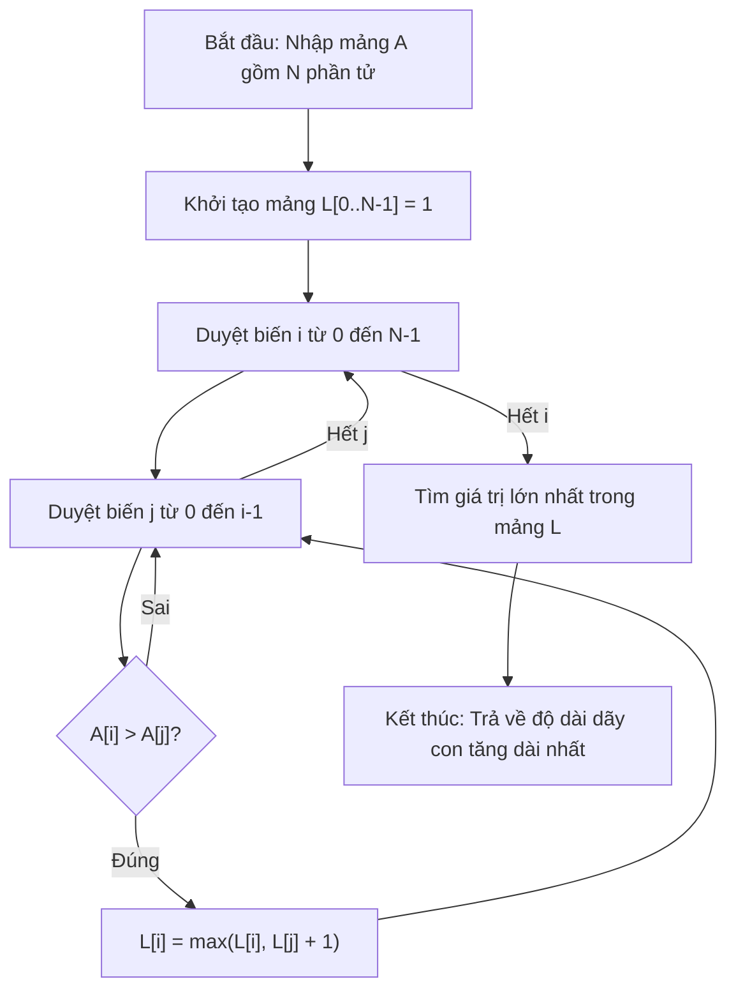

# Hợp Nhất 2 DSLK Đã Sắp Xếp (LeetCode 21)

## 1. Thông tin tệp mã nguồn
- [`Merge_Two_Sorted_List.cpp`](./Merge_Two_Sorted_List.cpp)
- **Thư mục chuyên đề**: `DSA/06_Danh_Sach_Lien_Ket/Merge_Two_Sorted_List/`
- **Ngôn ngữ**: C/C++ (Chuẩn C++11 trở lên)

## 2. Mục tiêu & Tóm tắt bài toán
Gộp hai danh sách liên kết đã sắp xếp thành một danh sách mới có thứ tự.

---

## 3. Ý tưởng & Phương pháp giải thuật
### Phương án tiếp cận:
So sánh node đầu của hai danh sách và liên kết node nhỏ hơn.

### Các bước thực hiện chi tiết:
1. Khởi tạo dữ liệu và đọc đầu vào theo định dạng bài toán.
2. Thực hiện thuật toán cốt lõi: So sánh node đầu của hai danh sách và liên kết node nhỏ hơn.
3. Cập nhật trạng thái và tính toán kết quả.
4. Xuất kết quả đầu ra màn hình.

---

## 4. Sơ đồ thuật toán (Mermaid Workflow)


---

## 5. Đánh giá độ phức tạp
- **Độ phức tạp thời gian (Time Complexity)**: `O(N + M)`
- **Độ phức tạp không gian (Space Complexity)**: `O(1)`

---

## 6. Input / Output mẫu & Giải thích

### Input mẫu:
```text
1->2->4
1->3->4
```

### Output mẫu:
```text
1
```

### Giải thích:
Hợp nhất 2 DSLK.

## 7. Hướng dẫn biên dịch & chạy thử
```bash
# Di chuyển vào thư mục bài toán
cd "DSA/06_Danh_Sach_Lien_Ket/Merge_Two_Sorted_List"

# Biên dịch chương trình C++
g++ -std=c++11 -O2 "Merge_Two_Sorted_List.cpp" -o "Merge_Two_Sorted_List"

# Chạy chương trình
./"Merge_Two_Sorted_List"
```

> [!NOTE]
> Toàn bộ mã nguồn C++ gốc được bảo toàn nguyên vẹn 100% không qua chỉnh sửa.
