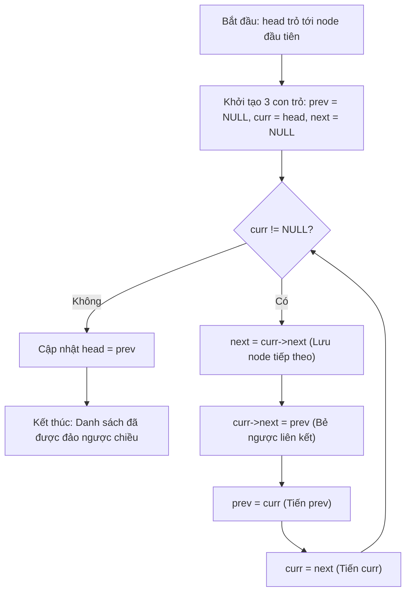

# Đảo Ngược Danh Sách Liên Kết (LeetCode 206)

## 1. Thông tin tệp mã nguồn
- [`Reverse_Linked_List.c++`](./Reverse_Linked_List.c++)
- **Thư mục chuyên đề**: `DSA/06_Danh_Sach_Lien_Ket/Reverse_Linked_List/`
- **Ngôn ngữ**: C/C++ (Chuẩn C++11 trở lên)

## 2. Mục tiêu & Tóm tắt bài toán
Đảo ngược toàn bộ các liên kết trong DSLK đơn.

---

## 3. Ý tưởng & Phương pháp giải thuật
### Phương án tiếp cận:
Sử dụng 3 con trỏ prev, curr, next bẻ ngược con trỏ.

### Các bước thực hiện chi tiết:
1. Khởi tạo dữ liệu và đọc đầu vào theo định dạng bài toán.
2. Thực hiện thuật toán cốt lõi: Sử dụng 3 con trỏ prev, curr, next bẻ ngược con trỏ.
3. Cập nhật trạng thái và tính toán kết quả.
4. Xuất kết quả đầu ra màn hình.

---

## 4. Sơ đồ thuật toán (Mermaid Workflow)


---

## 5. Đánh giá độ phức tạp
- **Độ phức tạp thời gian (Time Complexity)**: `O(N)`
- **Độ phức tạp không gian (Space Complexity)**: `O(1)`

---

## 6. Input / Output mẫu & Giải thích

### Input mẫu:
```text
1->2->3->NULL
```

### Output mẫu:
```text
0
```

### Giải thích:
Đảo ngược DSLK.

## 7. Hướng dẫn biên dịch & chạy thử
```bash
# Di chuyển vào thư mục bài toán
cd "DSA/06_Danh_Sach_Lien_Ket/Reverse_Linked_List"

# Biên dịch chương trình C++
g++ -std=c++11 -O2 "Reverse_Linked_List.c++" -o "Reverse_Linked_List"

# Chạy chương trình
./"Reverse_Linked_List"
```

> [!NOTE]
> Toàn bộ mã nguồn C++ gốc được bảo toàn nguyên vẹn 100% không qua chỉnh sửa.
