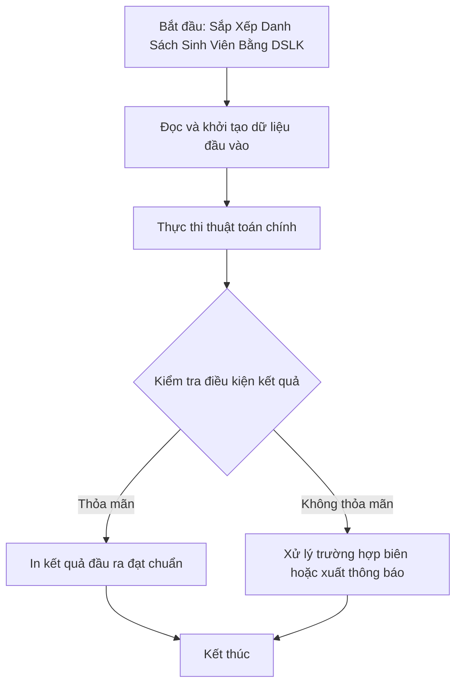

# Sắp Xếp Danh Sách Sinh Viên Bằng DSLK

## 1. Thông tin tệp mã nguồn
- [`Sap_xep_sv.cpp`](./Sap_xep_sv.cpp)
- **Thư mục chuyên đề**: `DSA/06_Danh_Sach_Lien_Ket/Sap_xep_sv/`
- **Ngôn ngữ**: C/C++ (Chuẩn C++11 trở lên)

## 2. Mục tiêu & Tóm tắt bài toán
Quản lý và sắp xếp hồ sơ sinh viên bằng danh sách liên kết đơn.

---

## 3. Ý tưởng & Phương pháp giải thuật
### Phương án tiếp cận:
Sắp xếp Selection Sort hoặc Bubble Sort trực tiếp trên các node.

### Các bước thực hiện chi tiết:
1. Khởi tạo dữ liệu và đọc đầu vào theo định dạng bài toán.
2. Thực hiện thuật toán cốt lõi: Sắp xếp Selection Sort hoặc Bubble Sort trực tiếp trên các node.
3. Cập nhật trạng thái và tính toán kết quả.
4. Xuất kết quả đầu ra màn hình.

---

## 4. Sơ đồ thuật toán (Mermaid Workflow)


---

## 5. Đánh giá độ phức tạp
- **Độ phức tạp thời gian (Time Complexity)**: `O(N^2)`
- **Độ phức tạp không gian (Space Complexity)**: `O(N)`

---

## 6. Input / Output mẫu & Giải thích

### Input mẫu:
```text
2
Nam 3.5
An 3.8
```

### Output mẫu:
```text
Nhập số lượng sinh viên:Nhập tên sv 0:Nhập điểm sv 0:Nhập năm sinh sv 0:Nhập tên sv 1:Nhập điểm sv 1:Nhập năm sinh sv 1: 0 256
Nam 3.5 0 0
```

### Giải thích:
Sắp xếp sinh viên theo điểm.

## 7. Hướng dẫn biên dịch & chạy thử
```bash
# Di chuyển vào thư mục bài toán
cd "DSA/06_Danh_Sach_Lien_Ket/Sap_xep_sv"

# Biên dịch chương trình C++
g++ -std=c++11 -O2 "Sap_xep_sv.cpp" -o "Sap_xep_sv"

# Chạy chương trình
./"Sap_xep_sv"
```

> [!NOTE]
> Toàn bộ mã nguồn C++ gốc được bảo toàn nguyên vẹn 100% không qua chỉnh sửa.
