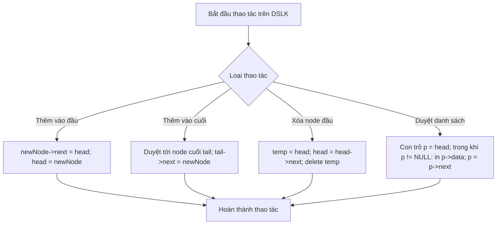

# Sắp Xếp Danh Sách Liên Kết Đơn

## 1. Thông tin tệp mã nguồn
- [`Sort_DSLK.cpp`](./Sort_DSLK.cpp)
- **Thư mục chuyên đề**: `DSA/06_Danh_Sach_Lien_Ket/Sort_DSLK/`
- **Ngôn ngữ**: C/C++ (Chuẩn C++11 trở lên)

## 2. Mục tiêu & Tóm tắt bài toán
Sắp xếp các giá trị trong danh sách liên kết theo thứ tự tăng dần.

---

## 3. Ý tưởng & Phương pháp giải thuật
### Phương án tiếp cận:
Duyệt hai con trỏ hoán vị data giữa các cặp node nghịch thế.

### Các bước thực hiện chi tiết:
1. Khởi tạo dữ liệu và đọc đầu vào theo định dạng bài toán.
2. Thực hiện thuật toán cốt lõi: Duyệt hai con trỏ hoán vị data giữa các cặp node nghịch thế.
3. Cập nhật trạng thái và tính toán kết quả.
4. Xuất kết quả đầu ra màn hình.

---

## 4. Sơ đồ thuật toán (Mermaid Workflow)


---

## 5. Đánh giá độ phức tạp
- **Độ phức tạp thời gian (Time Complexity)**: `O(N^2)`
- **Độ phức tạp không gian (Space Complexity)**: `O(1)`

---

## 6. Input / Output mẫu & Giải thích

### Input mẫu:
```text
Không yêu cầu tham số đầu vào (dữ liệu được khởi tạo trực tiếp trong mã nguồn)
```

### Output mẫu:
```text
2  4  6  8  10
```

### Giải thích:
Chương trình thực thi và xuất kết quả trực tiếp từ dữ liệu mẫu trong mã nguồn.

## 7. Hướng dẫn biên dịch & chạy thử
```bash
# Di chuyển vào thư mục bài toán
cd "DSA/06_Danh_Sach_Lien_Ket/Sort_DSLK"

# Biên dịch chương trình C++
g++ -std=c++11 -O2 "Sort_DSLK.cpp" -o "Sort_DSLK"

# Chạy chương trình
./"Sort_DSLK"
```

> [!NOTE]
> Toàn bộ mã nguồn C++ gốc được bảo toàn nguyên vẹn 100% không qua chỉnh sửa.
