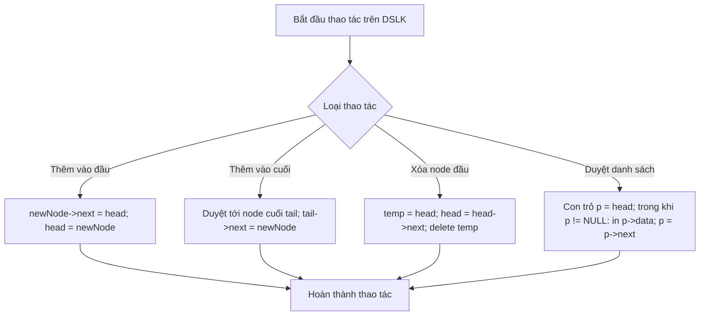

# Thêm Node & Duyệt Danh Sách Liên Kết

## 1. Thông tin tệp mã nguồn
- [`Them&&duyet_DSLK.cpp`](./Them&&duyet_DSLK.cpp)
- **Thư mục chuyên đề**: `DSA/06_Danh_Sach_Lien_Ket/Them&&duyet_DSLK/`
- **Ngôn ngữ**: C/C++ (Chuẩn C++11 trở lên)

## 2. Mục tiêu & Tóm tắt bài toán
Các thao tác cơ bản: thêm đầu, thêm cuối và duyệt in DSLK.

---

## 3. Ý tưởng & Phương pháp giải thuật
### Phương án tiếp cận:
Quản lý con trỏ head và con trỏ next.

### Các bước thực hiện chi tiết:
1. Khởi tạo dữ liệu và đọc đầu vào theo định dạng bài toán.
2. Thực hiện thuật toán cốt lõi: Quản lý con trỏ head và con trỏ next.
3. Cập nhật trạng thái và tính toán kết quả.
4. Xuất kết quả đầu ra màn hình.

---

## 4. Sơ đồ thuật toán (Mermaid Workflow)


---

## 5. Đánh giá độ phức tạp
- **Độ phức tạp thời gian (Time Complexity)**: `O(N)`
- **Độ phức tạp không gian (Space Complexity)**: `O(N)`

---

## 6. Input / Output mẫu & Giải thích

### Input mẫu:
```text
Không yêu cầu tham số đầu vào (dữ liệu được khởi tạo trực tiếp trong mã nguồn)
```

### Output mẫu:
```text
20 19 18 17 16 15 14 13 12 11 10 10 11 12 13 14 15
```

### Giải thích:
Chương trình thực thi và xuất kết quả trực tiếp từ dữ liệu mẫu trong mã nguồn.

## 7. Hướng dẫn biên dịch & chạy thử
```bash
# Di chuyển vào thư mục bài toán
cd "DSA/06_Danh_Sach_Lien_Ket/Them&&duyet_DSLK"

# Biên dịch chương trình C++
g++ -std=c++11 -O2 "Them&&duyet_DSLK.cpp" -o "Them&&duyet_DSLK"

# Chạy chương trình
./"Them&&duyet_DSLK"
```

> [!NOTE]
> Toàn bộ mã nguồn C++ gốc được bảo toàn nguyên vẹn 100% không qua chỉnh sửa.
