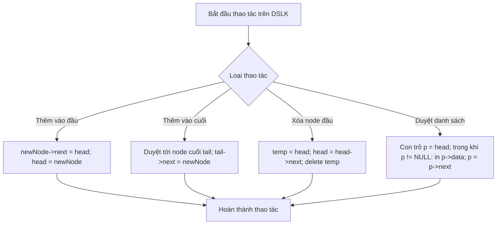

# Cài Đặt Danh Sách Liên Kết Đôi

## 1. Thông tin tệp mã nguồn
- [`Them_node_vao_DSLK_Doi.cpp`](./Them_node_vao_DSLK_Doi.cpp)
- **Thư mục chuyên đề**: `DSA/06_Danh_Sach_Lien_Ket/Them_node_vao_DSLK_Doi/`
- **Ngôn ngữ**: C/C++ (Chuẩn C++11 trở lên)

## 2. Mục tiêu & Tóm tắt bài toán
Thêm node vào đầu và cuối danh sách liên kết đôi.

---

## 3. Ý tưởng & Phương pháp giải thuật
### Phương án tiếp cận:
Cập nhật đồng thời con trỏ next và prev.

### Các bước thực hiện chi tiết:
1. Khởi tạo dữ liệu và đọc đầu vào theo định dạng bài toán.
2. Thực hiện thuật toán cốt lõi: Cập nhật đồng thời con trỏ next và prev.
3. Cập nhật trạng thái và tính toán kết quả.
4. Xuất kết quả đầu ra màn hình.

---

## 4. Sơ đồ thuật toán (Mermaid Workflow)


---

## 5. Đánh giá độ phức tạp
- **Độ phức tạp thời gian (Time Complexity)**: `O(1) thêm đầu`
- **Độ phức tạp không gian (Space Complexity)**: `O(N)`

---

## 6. Input / Output mẫu & Giải thích

### Input mẫu:
```text
3
10 20 30
```

### Output mẫu:
```text
---------------
1.Them node vao dau
2.Them node vao giua
3.Them node vao cuoi
4.Duyet
0.Thoat
Moi ban nhap lua chon:Moi ban nhap gia tri:---------------
1.Them node vao dau
2.Them node vao giua
3.Them node vao cuoi
4.Duyet
0.Thoat
Moi ban nhap lua chon:
```

### Giải thích:
DSLK đôi liên kết 2 chiều.

## 7. Hướng dẫn biên dịch & chạy thử
```bash
# Di chuyển vào thư mục bài toán
cd "DSA/06_Danh_Sach_Lien_Ket/Them_node_vao_DSLK_Doi"

# Biên dịch chương trình C++
g++ -std=c++11 -O2 "Them_node_vao_DSLK_Doi.cpp" -o "Them_node_vao_DSLK_Doi"

# Chạy chương trình
./"Them_node_vao_DSLK_Doi"
```

> [!NOTE]
> Toàn bộ mã nguồn C++ gốc được bảo toàn nguyên vẹn 100% không qua chỉnh sửa.
