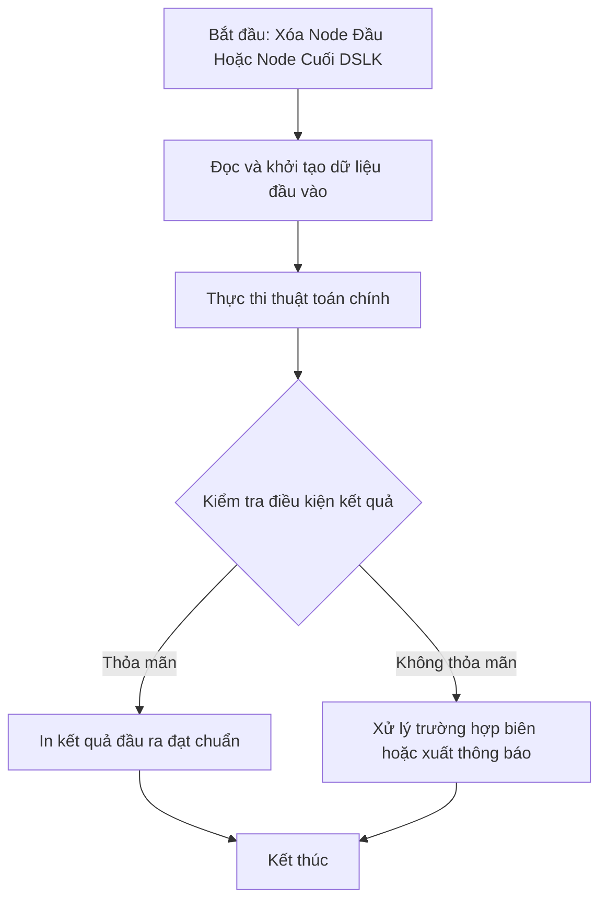

# Xóa Node Đầu Hoặc Node Cuối DSLK

## 1. Thông tin tệp mã nguồn
- [`Xoa_dau_or_Cuoi_node.cpp`](./Xoa_dau_or_Cuoi_node.cpp)
- **Thư mục chuyên đề**: `DSA/06_Danh_Sach_Lien_Ket/Xoa_dau_or_Cuoi_node/`
- **Ngôn ngữ**: C/C++ (Chuẩn C++11 trở lên)

## 2. Mục tiêu & Tóm tắt bài toán
Thao tác xóa phần tử ở đầu (popFront) hoặc ở cuối (popBack) của DSLK.

---

## 3. Ý tưởng & Phương pháp giải thuật
### Phương án tiếp cận:
Giải phóng bộ nhớ node bị xóa bằng delete.

### Các bước thực hiện chi tiết:
1. Khởi tạo dữ liệu và đọc đầu vào theo định dạng bài toán.
2. Thực hiện thuật toán cốt lõi: Giải phóng bộ nhớ node bị xóa bằng delete.
3. Cập nhật trạng thái và tính toán kết quả.
4. Xuất kết quả đầu ra màn hình.

---

## 4. Sơ đồ thuật toán (Mermaid Workflow)


---

## 5. Đánh giá độ phức tạp
- **Độ phức tạp thời gian (Time Complexity)**: `O(1) xóa đầu, O(N) xóa cuối`
- **Độ phức tạp không gian (Space Complexity)**: `O(1)`

---

## 6. Input / Output mẫu & Giải thích

### Input mẫu:
```text
3
1 2 3
xoa_dau
```

### Output mẫu:
```text
Nhap n:2
```

### Giải thích:
Xóa node đầu.

## 7. Hướng dẫn biên dịch & chạy thử
```bash
# Di chuyển vào thư mục bài toán
cd "DSA/06_Danh_Sach_Lien_Ket/Xoa_dau_or_Cuoi_node"

# Biên dịch chương trình C++
g++ -std=c++11 -O2 "Xoa_dau_or_Cuoi_node.cpp" -o "Xoa_dau_or_Cuoi_node"

# Chạy chương trình
./"Xoa_dau_or_Cuoi_node"
```

> [!NOTE]
> Toàn bộ mã nguồn C++ gốc được bảo toàn nguyên vẹn 100% không qua chỉnh sửa.
