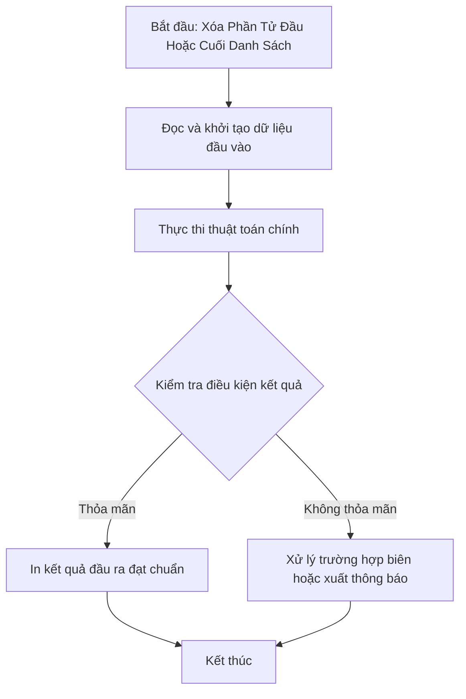

# Xóa Phần Tử Đầu Hoặc Cuối Danh Sách

## 1. Thông tin tệp mã nguồn
- [`Xoa_dau_or_cuoi.cpp`](./Xoa_dau_or_cuoi.cpp)
- **Thư mục chuyên đề**: `DSA/06_Danh_Sach_Lien_Ket/Xoa_dau_or_cuoi/`
- **Ngôn ngữ**: C/C++ (Chuẩn C++11 trở lên)

## 2. Mục tiêu & Tóm tắt bài toán
Xóa node đầu danh sách liên kết đơn.

---

## 3. Ý tưởng & Phương pháp giải thuật
### Phương án tiếp cận:
Chuyển con trỏ head sang node tiếp theo và giải phóng node cũ.

### Các bước thực hiện chi tiết:
1. Khởi tạo dữ liệu và đọc đầu vào theo định dạng bài toán.
2. Thực hiện thuật toán cốt lõi: Chuyển con trỏ head sang node tiếp theo và giải phóng node cũ.
3. Cập nhật trạng thái và tính toán kết quả.
4. Xuất kết quả đầu ra màn hình.

---

## 4. Sơ đồ thuật toán (Mermaid Workflow)


---

## 5. Đánh giá độ phức tạp
- **Độ phức tạp thời gian (Time Complexity)**: `O(1)`
- **Độ phức tạp không gian (Space Complexity)**: `O(1)`

---

## 6. Input / Output mẫu & Giải thích

### Input mẫu:
```text
3
10 20 30
```

### Output mẫu:
```text
20 30
```

### Giải thích:
Xóa phần tử đầu.

---

## 7. Hướng dẫn biên dịch & chạy thử
```bash
# Di chuyển vào thư mục bài toán
cd "DSA/06_Danh_Sach_Lien_Ket/Xoa_dau_or_cuoi"

# Biên dịch chương trình C++
g++ -std=c++11 -O2 "Xoa_dau_or_cuoi.cpp" -o "Xoa_dau_or_cuoi"

# Chạy chương trình
./"Xoa_dau_or_cuoi"
```

> [!NOTE]
> Toàn bộ mã nguồn C++ gốc được bảo toàn nguyên vẹn 100% không qua chỉnh sửa.
